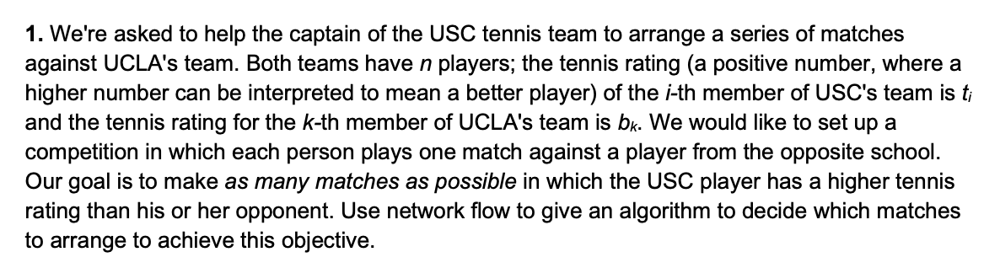
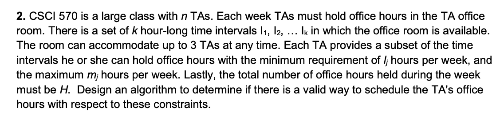
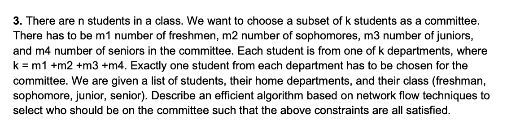
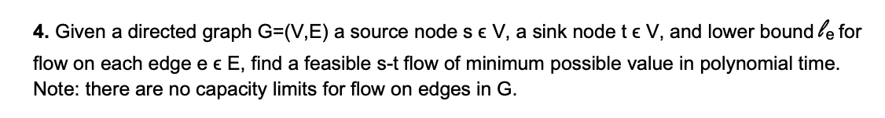

# Discussion 9

[TOC]

## Q1

**Solution:** we can present this problem as a Max Network Flow Problem.

We will construct a directed graph $G = (V, E)$ as the network flow graph.

- we add a node $s$ as the source node, and a node $e$ as the sink node.
- for the i-th member of USC, we introduce the node $T_i$ and its rating is $t_i$, for the k-th member of UCLA, we introduce the node $B_k$ and its rating is $b_k$
- add edges from $s$ to all $t_i$ nodes, with the capacity of 1.
- add edges from all $b_k$ nodes to $e$, with the capacity of 1.
- for any pair of $(T_i, B_k)$, if $t_i > b_k$, then add an edge from $T_i$ to $B_k$, with the capacity of 1.

Run s-t max flow algorithm (Ford Fulkerson) on $G$, and we can get the max flow value of $f$.

**Claim:** $f$ is the answer of the max number of possible match in which the USC player has a higher tennis rating than his or her opponent.

Then, to extract the path from s-t, we run a depth-first search on the return max flow graph starting from s, tracing the path to t. Remove the edges and the nodes and repeat $f$ times. Then, we can get all the pairs of $T_i, B_k$.

> [!note]
>
> To extract the actual match pairs, we don’t need to repeatedly run depth-first search on the residual graph. Instead, ==we can simply look at all edges from USC nodes $T_i$ to UCLA nodes $B_k$ that carry a flow of $1$== — each such edge directly represents a match in which the USC player has a higher rating than the UCLA player.

## Q2

**Solution:** we can solve this problem by presenting is as a circulation problem with lowerbound.

We will construct a directed network flow graph $G = (V, E)$:

- add a begin node $s$ and an ending node $t$
- for the i-th TA, we introduce the node $t_i$, for the j-th inteval, we introduce the node $i_j$.
- add edges from $s$ to all $t_j, \ \ j\in [1,n]$, with the lowerbound and upperbound of $[I_j, m_j]$
- add edges from all $i_j, j \in [1, k]$, with the capacity of 3
- for each pair of $(t_i, i_j), i \in [1, n], j \in [1,k]$, if the i-th TA can hold office hour of $i_j$, then add an edge from $t_i \to i_j$, with the capacity of 1.
- set the demand of the node $s$ $-H$, and the demand of the node $t$ is $H$

Then, we can run the solution of the circulation problem with lowerbound on the graph $G$. If there is a solution, then there is a valid way to schedule the TA's offices hours with respect to these constraints. Otherwise, there is no solution.

> [!note]
>
> 这题做的不错，够用

## Q3

**Solution:** we can solve this problem by presenting as a max flow problem. We will construct a directed graph $G = (V, E)$:

- add a source node $s$ and a sink node $t$.
- we add node $c_1,c_2,c_3,c_4$ for the freshmen, sophomores, juniors and seniors.
- for the i-th student, we introduce the node $s_i, i\in [1,n]$
- for the i-th department, we introduce the node $d_i, i\in[1,k]$
- add edges from $s$ to $c_i, i\in[1,4]$, with the capacity of $m_1, m_2, m_3$ and $m_4$
- add edges from $c_i$ to $s_j$ ($i \in[1,4], j\in[1,n]$), if student $s_j$ is in class $c_i$, with the capacity of 1
- add edges from $s_i$ to $d_j$ ($i \in[1,n], j\in[1,k]$), if student $s_i$ is in department $d_j$, with the capacity of 1.
- add edges from $d_i, i \in[1,k]$ to $t$, with the capacity of 1.

Run the max network flow algorithm (Ford-Fulkerson) on the graph $G$ and we can get the max value of flow $f$.

Claim: if $f=k$, then we can find a solution that all the constraints are all satisfied. otherwise, there is no valid solution.

To extract all the path in the return network flow graph. we can simply look at the edges from $c_i\to s_j\to d_k$ and find out the flow on the edges are 1. Then we can determine which student should be selected as a committee.

> [!note]
>
> 这题做的不错，够用。基本可以拿到满分

## Q4

> [!note]
>
> 这题是带下界的最小可行流问题，属于一个特殊的题了。

**关键点：**

这其实就是**带下界的最小 s–t 可行流问题**。

通常我们处理带下界问题的套路是：

1. 对每条边 $e(u,v)$，先分配下界流 $\ell_e$，

   然后令剩余容量 $c’_e = c_e - \ell_e$。

2. 调整每个节点的流量平衡 $b(v) = \sum_{in} \ell - \sum_{out} \ell$。

3. 再在调整后的图上做 circulation。

但现在**容量无限**，所以不能靠上界约束来卡死流量，我们要找**最小可行流量**。

于是这题的 trick 是——用 **binary search (二分)** 来“逼出最小流量”。

***

它设了一个“假想容量” $C = \sum \ell_e$，足够大来保证任何下界都能被满足。

然后它在 $[0, C]$ 区间上对 s 的净流出量（或 t 的净流入量）进行二分：

- 给定一个假设的 flow value F（即想让 s→t = F）

- 检查是否存在一条满足所有下界的 **可行 circulation**（通过把 s,t 的需求分别设置成 -F, +F）

- 如果存在，则说明可以更小；否则增大 F

  直到找到最小的可行 F。

这样就把“最小流量”问题变成了“可行流判断 + 二分搜索”，所以复杂度是

$O(\log C \cdot T_{circulation})$，

而 $T_{circulation}$ 是多项式的。

***

我的理解：

> 因为是要找最小：此时没有demand限制，demand可以无限大
>
> 所以先假想一个demand，这个demand肯定有feasible流，然后对f做二分，直到找到最小的F
>
> **这个是正确的**