# HW9

- 📒表示需要记录到cheat sheet中

- ⚠️表示做错了，或者很容易错，或者没想到思路，反正是需要复习的题目

- thus, the capacity constraints on the edges are satisfied. 这句话经常用，在证明的时候，先记住。

- 证明的时候，可以把流的path写出来：path $s \to S_i \to P_{j(input)} \to P_{j(output)}\to Y_k \to t$

- Q3考试前看一下就行，就是一个步骤题
- For the i-th guard, introduce a vertex gi & for the j-th time interval, introduce a vertex tj. 这个表达挺好用的，考试的时候可以用上。
- 第五题和第六题，第五题不需要t连接s，第六题需要t连接s，并设置 capacity = ∞。这个是值得讨论的
  - 第五题中，s和t都可以在题目要求下很自然的加上demand，所以不用连接t和s
  - 第六题，其实很像一个最大流问题，但是这个最大流问题又有lowerbound，导致不能用最大流框架，只能用 lowerbound 的那个框架。而且根据题目，也不能很方便的给s和t增加demand，所以直接连接t和s
- we can simply look at all edges from USC nodes $T_i$ to UCLA nodes $B_k$ that carry a flow of $1$

[TOC]

## Q1 (📒)

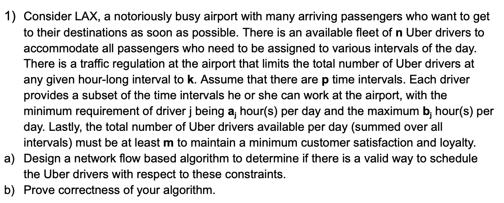

这题没有问题，我可以想到思路，这题先对着答案学习答案的写法。

**Solution:** 

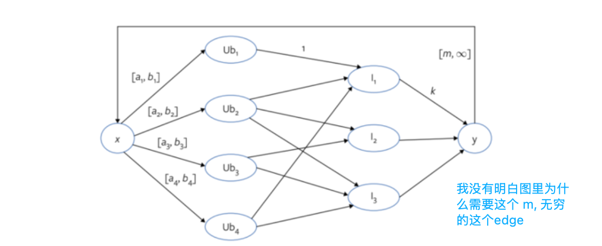

we will reduce the Uber driver's problem to a circulation problem.

We construct a Network H as follower.

- We have a node $Ub_j$ for each uber driver $j$, and node $I_t$ for each hour-long interval $t$.
- We insert the edge between driver $Ub_i$ and time interval $I_j$ if the driver prefers to work at that at that hour, with the capacity of 1. There could be many drivers willing to work at that hour, so having flow 0 on that edge is interpreted as a driver not covering that time interval.
- Next, we add two new vertices x and y (==Note that we don't call these source and sink - a circulation netwrok does not have a source/sink==). 
- Connect x to all $Ub_j$, and all $I_t$ to y. The edge (x, $Ub_j$) has a lower bound $a_j$ and upperbound $b_j$ for each driver $j$. The edge ($I_t$, y) has capacity of k for all t.
- ‼️Finally, we add the edge (y, x). The flow on this edge represents the total number of Uber drivers serving the airport, and so we set a lower bound of m.

Claim: There is a valid way to schedule the Uber drivers if and only if there is a feasible circulation in network H constructed above.

**Proof:**

Forward Claim:

Assume that there is a valid way to schedule the Uber drivers subject to all the constraints.

We show there is feasible circulation H as follows. For every driver j who works during a time interval t, we assign a flow of one unit on edge (x, Ubj), (Ubj, It), (It, y) and (y, x).

Thus, doing so set: (这里其实就是一条一条边来解释)

- a flow along the edge (s, Ubj) to the number of time intervals that drivers works, so the lower bound and capacity here are satisfied given driver j is correctly assigned to at least aj and at most bj hours per day.
- (Ubj, It)
- (It, y) -> no. of drivers who work during that time interval t, which at most k, satisfied the capacity constraint on these edges.
- (y, x) is the total number of Uber drivers serving the airport which at least m, satisfying the lower bound here.

Thus, the circulation as defined above is feasible

Backward Claim:

consider a feasible circulation in H. for each edge (Ubj, It) that carries on unit of flow, we assign driver j to interval i. Then:

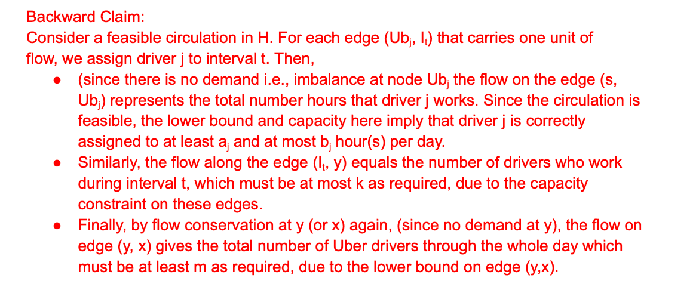

> [!note]
>
> 其实最重要，还是要把图弄出来，证明部分也要会，但是分数占比不多。
>
> 我也不可能证明部分一分拿不到。
>
> 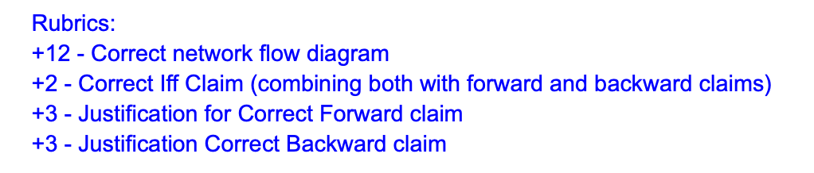

## Q2 (⚠️)

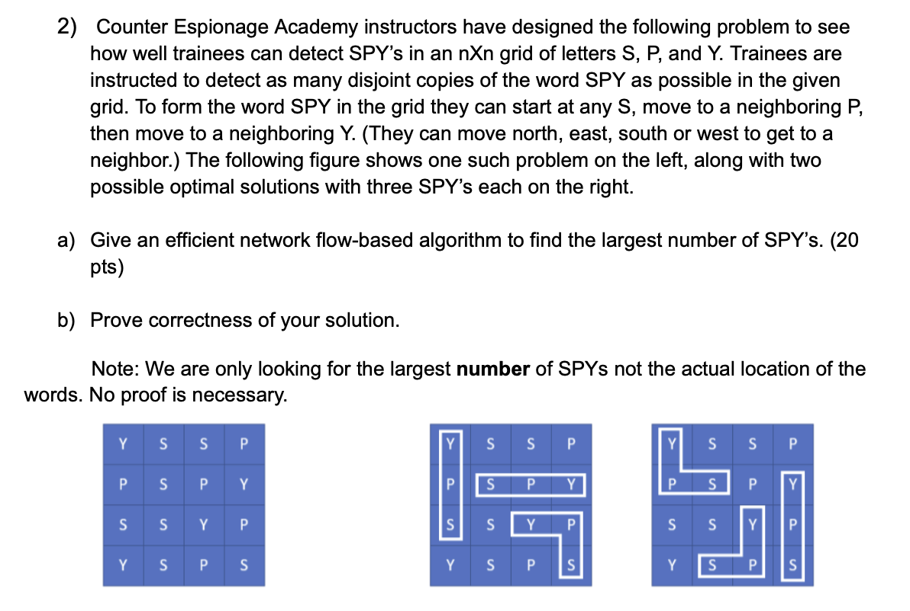

**(a). Solution:**

we will solve this problem by representing it as a maximum network flow problem. First, we need to build the network flow directed graph $G = (V, E)$:

- add a source node $s$, and a sink node $t$.
- every letters in the nXn grid can be represented as nodes in $G$, presents as $n_i$, (the ith node).
- then, add an edge from $s$ to every single letter "S" node in the grid, with the capacity of 1.
- then, add an edge from every single letter "Y" to $t$, with the capacity of 1.
- For each node $n_i$ in grid, let $L(n_i)$ be the letter of $n_i$,
  - if $L(n_i)$="S", and there is a node $n_j, L(n_j)$ = "P", and $n_j$ is one of the neighbors of $n_i$, then add and edge from $n_i$ to $n_j$, with the capacity of 1.
  - if $L(n_i)$="P", and there is a node $n_j, L(n_j)$ = "Y", and $n_j$ is one of the neighbors of $n_i$, then add and edge from $n_i$ to $n_j$, with the capacity of 1.

Run the s-t max. flow algorithm on G. then we can get the max s-t flow $f$.

Claim: the value of $f$ is the largest number of SPY's.

**Complexity:** 

- the rum time of Ford–Fulkerson: O(Cm), C is the sum of the all capacities of the edges, and the m is the edges in the graph.
- since each node in the grid can have at most 4 neighbors, therefore the number of the edges: O(n^2)
- at the same time, since each edge has capacity of 1, therefore, C: O(n^2)
- therefore the overall runtime will be O(n^4)

> [!caution]
>
> 我这个答案是不对的！漏了很关键的一步！这里每个点的容量只能是1，因为点不能被重复使用。所以要用点分裂！！！
>
> ==We **split each cell node into two nodes ($u_{in}$ and $u_{out}$) connected by an edge of capacity 1** to ensure that each cell can be used at most once in the flow.==
>
> 而且，只有P是需要分裂的，以为只有P会被复用。
>
> We only split each $P$ node into $P_{in}$ and $P_{out}$ (connected by an edge of capacity 1), since S and Y are already capacity-limited by the source and sink.

**(b). Proof**

**Forward Claim: 假设有M个SPY路径被找到了，我们要推出，此时网络流是M**

Suppose M copies of SPY are found. For any copy that uses the letter $S_i$, $P_j$, $Y_k$, we add a unit of flow along the path $s \to S_i \to P_{j(input)} \to P_{j(output)}\to Y_k \to t$. Obviously, if there a such path exists, it can gives a flow of 1 to the network flow. Since the copies of SPY do not share the letters, each letter is on at most one flow path, and **thus, the capacity constraints on the edges are satisfied.**

**Backward Claim: 这里要证明，如果此时网络流是M，我们要推出此时有M个SPY路径**

Suppose we have s-t flow of value M in the network. By construction, each unit of s-t flow is on a path $s \to S_i \to P_{j(input)} \to P_{j(output)}\to Y_k \to t$ for some i, j, k. By construction Si, Pj, Yk can form a valid copy of SPY. Doing so for each unit of s-t flow gives M copies. The capacity constraints on $s \to S_i \to P_{j(input)} \to P_{j(output)}\to Y_k \to t$ ensure each i, j, k triplet is different, i.e., the resultant copies of SPY are non-overlapping.

## Q3

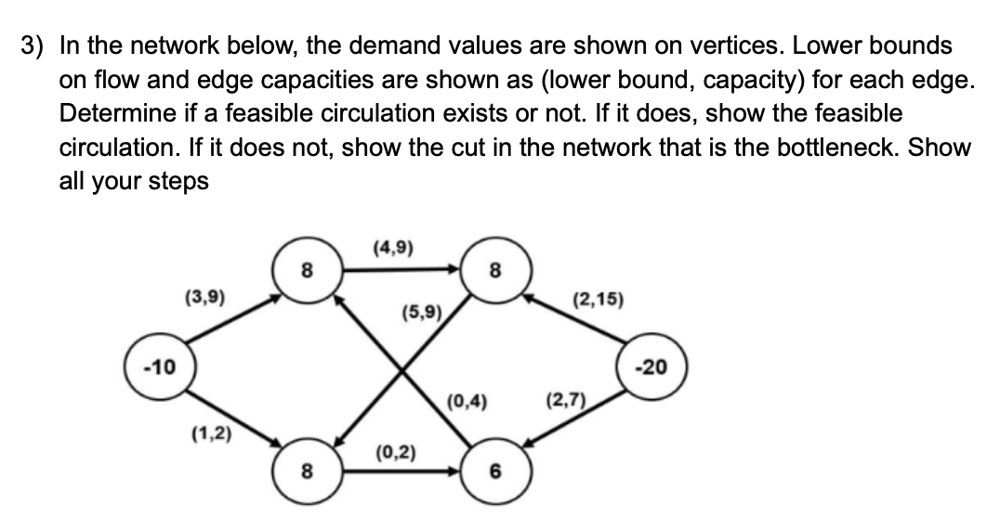

Solution: First, we eliminate the lower bound from the edges. Then, we attach a supper-source s* to each node with negative demand, and a supper-sink t* to each node with positive demand. The capacities of the edges attached accordingly correspond to the deman of the nodes.

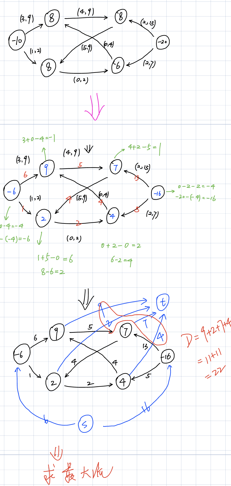

这题答案算错了。

不过我自己做了一次也当练习了。

## Q4 (⚠️ 看似简单，但需要复习)

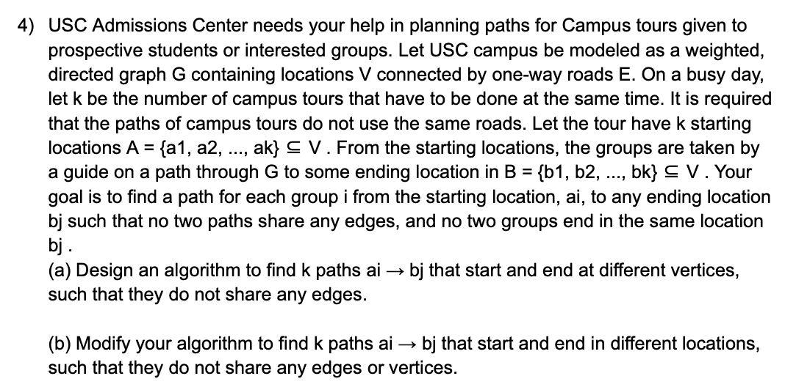

**Solution:** 

we can solve this problem by presenting as a maximum network flow problem. First, we need to construct a directed graph $G = (V, E)$.

- let all the locations V be the vertices of graph G
- let all the one-way roads E be the directed edge, with the capacity of 1.
- add a source vertice $s$, and add edges from $s$ to all starting locations ($A = \{a_1, ...a_k\}$), with the capacity of 1.
- add a sink vertice $t$, and add edges from all ending locations ($B = \{b_1, ...b_k\}$), with the capacity of 1.

with all the road edges have the capacity of 1, therefore we can make sure that there can be only one team using this road.

Then, we run the maximum s-t flow on the graph $G$, and get the maximum flow $f$. 

Claim: if $f < k$, therefore we have no solution, else there is a solution.

> [!warning]
>
> 走到这里是很简单的，但是这题题目是让你找到路径。不只是判断有没有解。

因此还需要增加第三部分：

to extract the paths from a_i to b_j (as well as which starting location ultimately connectes to which ending location), run a depth-first search on the returned max flow f starting from s, tracing a path to t. ==**Remove these edges**== and repeat k times until we have the k edge disjoint paths. 

(b) 即使要把点分开，然后跑max flow算法，第三部分的描述有些许不同。

to extract the paths from a_i to b_j (as well as which starting location ultimately connectes to which ending location), run a depth-first search on the returned max flow f starting from s, tracing a path to t. **==Remove these edges and vertices==** and repeat k times until we have the k edge disjoint paths. 

> [!note]
>
> ==**其实很好理解，(a) 中，找到一条路径之后，就删掉涉及到的 边，这样就能保证找到的都是边不相关的。**==
>
> ==**(b) 中，除了删除对应的边，还要删除点！！！**==

## Q5 (⚠️)

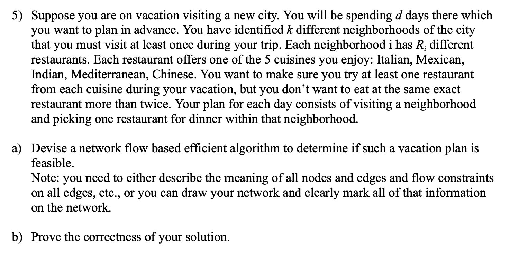

其实本质是一个 Circulation with Lower Bounds 问题

**Solution:**

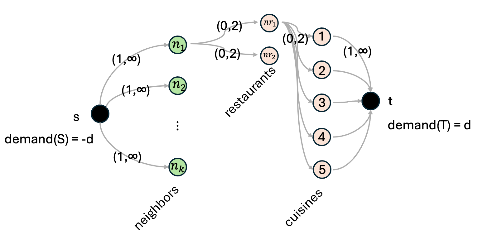

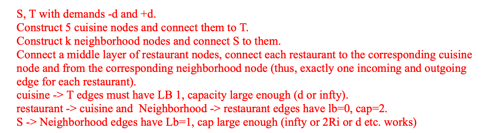

**Claim:** vacation plan satisfying the constraints exists if and only if feasible circulation in the constructed network.

证明同样是两个方向即可

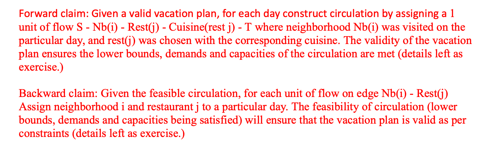

## Q6

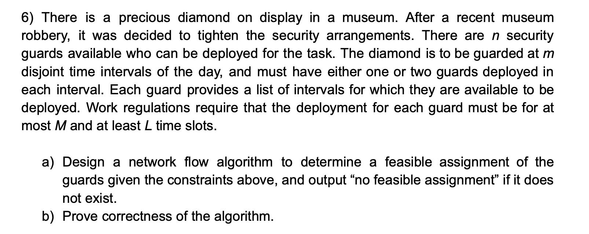

> [!caution]
>
> 区分什么时候要加上 t -> s 连接！

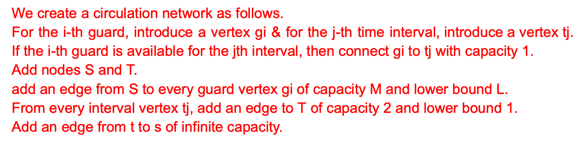

> [!important]
>
> 