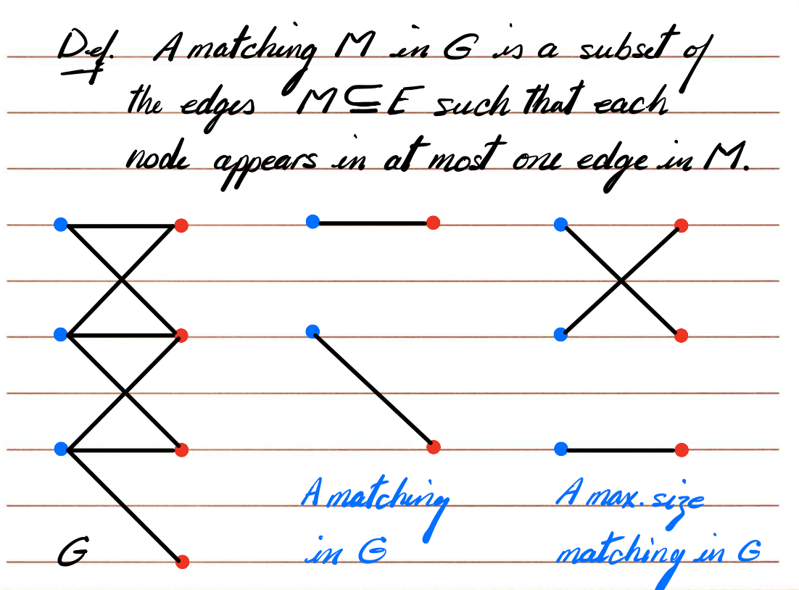
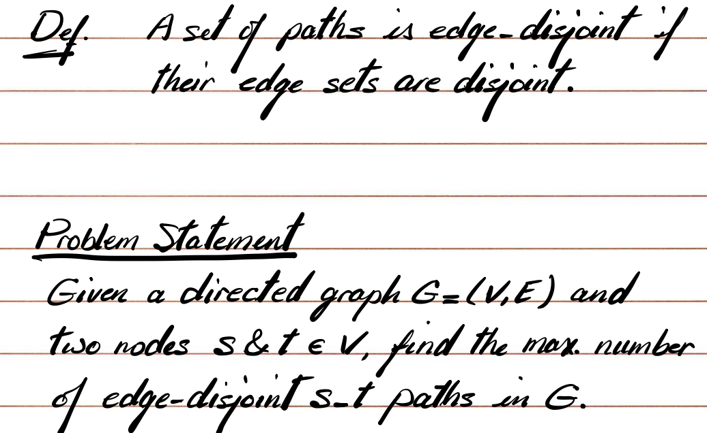
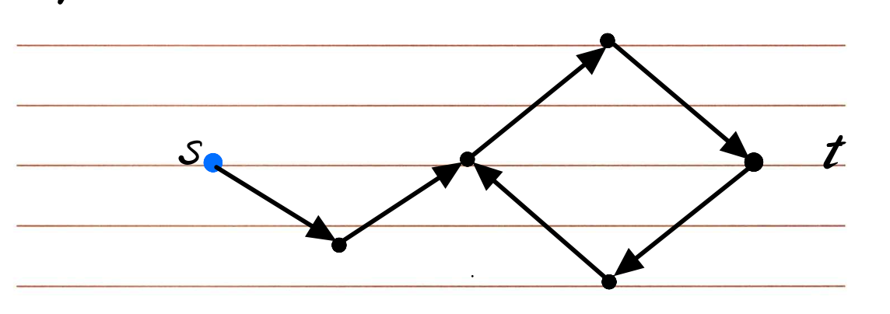
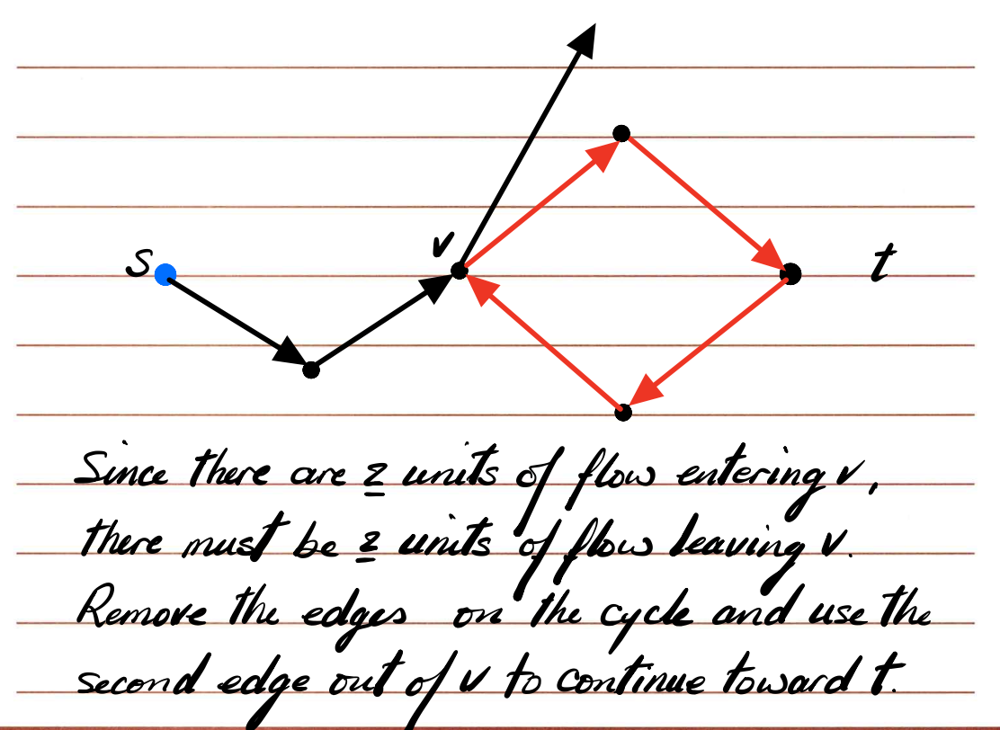
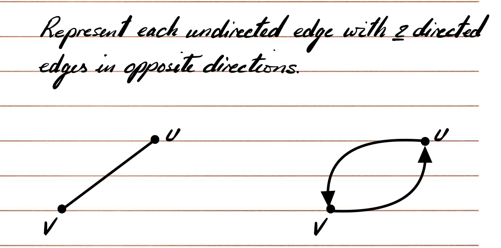
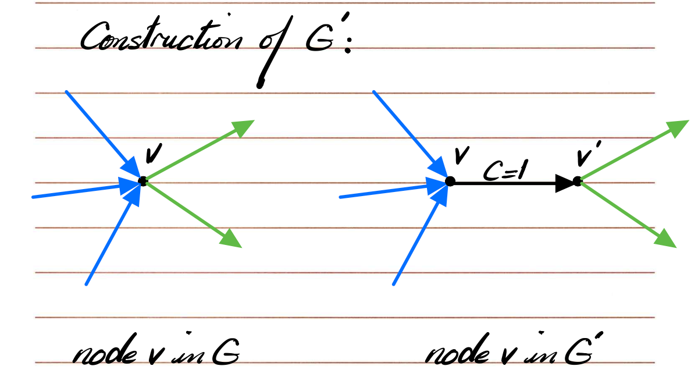
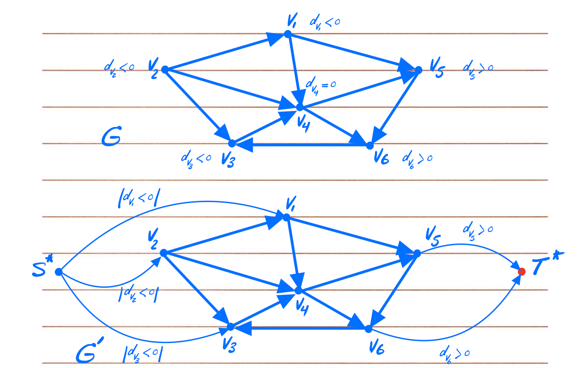
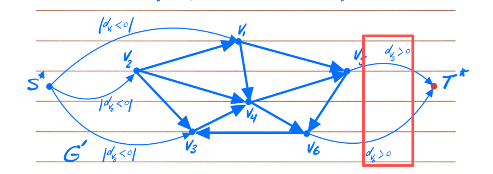
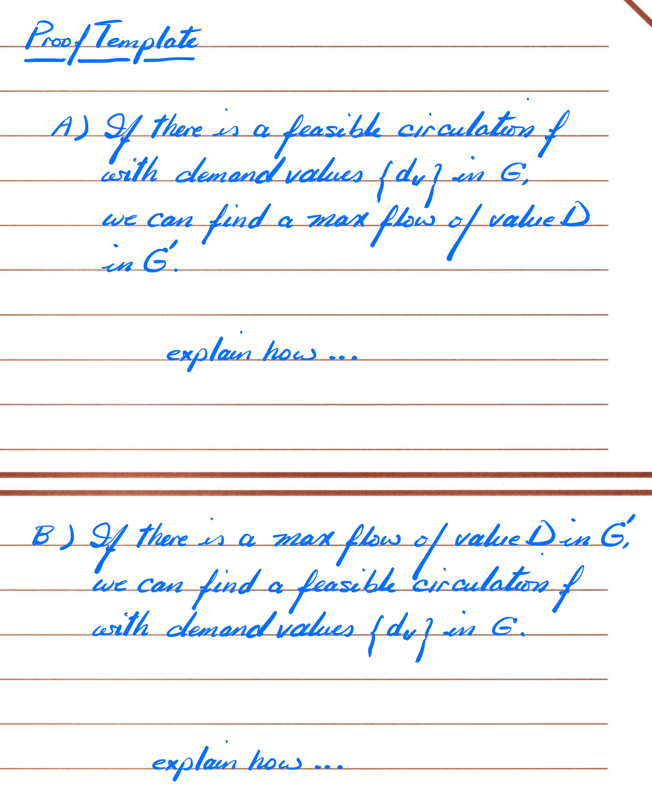

# Lecture 10 Network Flow Applications

[TOC]

## Bipartite matching Problem

首先是一些定义。

|  |  |
| ------------------------------------------------------------ | ------------------------------------------------------------ |

Problem Statement:

> given a bipartite graph $G$, find a matching of largest possible size in G

general plan:

> design a flow network $G'$ that will have a flow value $v(f) = k$ if there exists a matching of size $k$ in $G$, moreover, flow $f$ in $G'$ should identify the matching $M$ in $G$.

Solution:

> find max. flow in $G'$, say max. flow in f. 
> Edges carrying flow between sets X and Y will correspnd to our max. size matching in G.

==Proof strategy:== 这里很重要，要学会

> to prove this, we will show that G' will have a flow of value k if G has matching of size k.

> [!note]
> 这里的证明就是分成两个方向去证明就行了。“匹配 -> 流” 和 “流 -> 匹配”

- “匹配 ⇒ 流”：若有大小 k 的匹配 M，给每条匹配边 (x, y) 让 S→x、x→y、y→T 各送 1 单位流，总流量 k，容量与守恒都满足。
- “流 ⇒ 匹配”：若最大流值为 k，则恰有 k 条 X→Y 边流量为 1。由于 S→x、y→T 容量都是 1，任何 x 或 y 最多参与一条带流边，故这些边互不共享端点，构成大小为 k 的匹配。

> [!tip]
> 其实这里具体怎么写，就按照题目定义去写。比如 "流->匹配" 的证明里面：...故这些边不共享端点，这个表述，就是从题目中来的。

English Version:

> A. if we have a matching of size k in G, we can find s->t flow f of value k in G'
>
> set  C=1 for all edges, using the matching of size k, we will find k independent s->t paths each with capacity 1.
>
> B. if we have an s->t flow f of value k in G', we can find a matching of size k in G
>
> Given flow f of value k, there must be k edges on cut(A, B) that carry flow. These k edges cannot share any node, i.e. a matching of size k.

**Complexity:**

Complexity of Ford-Fulkerson: O(Cm)

Since all edge capacity are set to 1, therefore, C = O(n)

therefore, the complexity will be O(mn)

## Edge-Disjoint Paths Problem

定义：

这个题其实挺简单的，edge-disjoint就是不共享边的意思。

**General Plan:**

> Design a flow network G' that will have a flow value $v(f) = k$ if there exist k edge-disjoint s-t paths in G. Moreover, flow f in G' should identify the set of k edge-disjoint s-t paths in G.

Construction of G':

> set C=1 for all edges

Solution:

> - find max flow f in G'
> - v(f) will equal the max number of edge-disjoint s-t paths in G
> - f will identify the edges on these paths

**Proof:** 同样，也是两个方向来弄

> A. if we have k edge disjoint s-t paths in G, we can find a flow of value k in G'.
>
> Obviously, since each path can carry 1 unit of flow (independently) from s to t in G'. 
>
> B. If we have a flow of value k in G', we can find k edge-disjoint s-t paths in G.
>
> Using conservation of flow, we can follow each unit of flow leaving s and find the s-t path that carries that flow into t.  We remove all edges on that path from G' and repeat the process. Since there are k units of flow leaving s, we can find k edge-disjoint s-t paths.

- “有 k 条边不相交路径 ⇒ 有值为 k 的流”：每条路径送 1 单位流，因边容量为 1 且路径不共享边，容量与流守恒均满足。
- “有值为 k 的流 ⇒ 有 k 条边不相交路径”：从 s 出发跟随每 1 单位流必能走到 t（守恒保证不会“丢失”），重复 k 次得到 k 条互不共享边的路径。

**Complexity:**

O(mn), 和上一题一样的。

**what if we run into a flow cycle on our path to t ?**

意思是：

1. 由于 v 节点有 2 单位流入 ⇒ 也必有 2 单位流出（守恒）。

2. 这说明其中 1 单位可能是在环上循环、没往 t 方向去。

3. 处理办法：**把环上的流删掉（减 1）**，

   然后从 v 的另一条出边（不是在环上的那条）继续往 t 走。

4. 这样就能恢复真正通向 t 的流路径，不会被卡在环里。

→ 直观理解：**流环不影响最终的 s-t 流量值**，只是在提取路径时造成干扰。

只要删掉这些环，我们提取出的每一单位流一定能组成一条真正的 s→t 路径。

**How can we apply this solution to undirected graphs?**

弄成双向有向

但是这样会引入新的问题：

But now we can end up with paths that use the edge v–u twice!

因为我们复制成两条反向边，如果不注意，提取路径时可能会出现这种“假路径”：

一条路径先走 u→v，另一条又用 v→u，于是实际上是同一条无向边被用了两次。

**这样路径虽然边不相交（在方向上不同），但在原无向图中却共享了边。**

**==所以此时的 Solution 是：“To solve this problem, first remove all flow cycles on single edges before finding s-t paths.==**

**当你要从最大流结果中还原“边不相交的 s-t 路径”时：**

- 如果遇到环（flow cycle），删掉环的流再继续。

- 如果是无向图，要先把双向流（单边形成的 2-环）清理掉。这样提取出的路径才是真正合法、不共享边的 s-t 路径集合。

## Node-Disjoint Paths Problem

上面那题是不能共享边，这题是节点也不能共享。

Def. A set of paths is node-disjoint if their node sets (except for starting and ending nodes) are disjoint.

我们的挑战就是 “节点也具有限制 1 的容量”。

方法：**节点分裂（node-splitting trick）**

方法就是求最大流，不赘述了。

**正确性证明（直觉版）**

- **(⇒)** 若原图有 k 条点不相交 s-t 路径：

  在每条路径经过的节点 v 上， v_in → v_out 只用一次，容量 1 刚好满足；

  因此可构造出 k 单位流。

- **(⇐)** 若最大流为 k：

  每个 v_in → v_out 边最多流 1，意味着每个节点至多被一条路径使用。

  所以这些 k 单位流可以分解成 k 条互不共享节点（除 s,t 外）的 s-t 路径。

## Circulation & Feasible Flow

可行循环流

Def. A circulation network is a directed graph $G = (V, E)$ with following features

- each edge e has a non-negative capacity $c_e$

- associated with each node $v \in V$ is a demand $d_v$

  - if $d_v > 0$, node v has demand $d_v$ for flow (sink)

  - if $d_v < 0$, node v has a supply of $|d_v|$ fro flow (souce)
  - if $d_v = 0$, v is neither a sink nor a source

这里其实就开始是 flow 的拓展问题了，在基础的 flow 中，除了 s 和 t，其他点流入一定等于流出。但是在这个问题里面，就不一定了。

**Notation:**

We will call $f(e)$ circulation through edge e. $f(e)$ has the following propreties:

- capacity constraint: for each edge $e \in E$, $0 \le f(e) \le c_e$
  - demand condition: for each node $v \in V$, `inflow(v) - outflow(v) = d(v)`.

**Fact:**

if there is a feasible circulation with demands $\{d_v\}$, then $\sum_{v}d_v = 0$

这个证明也是很简单的：每条边的流量同时算作某个节点的 outflow 以及另一个节点的 inflow，

全图求和后互相抵消，只剩下 $Σ d(v)$。

**Problem Statement:**

> Given a circulation network G with demands $\{d_v\}$, is there a feasible circulation in G ?

**Solution:** we will reduce the feasible circulation problem to max flow problem.

其实本质也可以用最大流去解决。

**Solution:**

>  构造一个新的流网络 G′：
>
> 1. 新增一个超级源点 S 和超级汇点 T。
>
> 2. 对每个节点 u：
>
>    - 如果 d(u) < 0（即 supply），则连一条边 S → u，容量 = -d(u)。
>    - 如果 d(u) > 0（即 demand），则连一条边 u → T，容量 = d(u)。
>
> 3. 其他原边保持原样（容量 c(e)）。
>
> 4. 令 $D = Σ_{d(u) > 0} d(u)$。也就是所有需求总量。如下图红框所示：
>
>    
>
> 对这个 G' 求最大流：
>
> - 若 **|f| = D**，说明供给节点能完全满足所有需求，
>
>   → 存在一个可行 circulation。
>
> - 若 **|f| < D**，说明需求无法全部满足，
>
>   → 不存在 feasible circulation。

**Proof:** 

最大流的题目，证明模版就只有一个：两个方向同时讨论一下即可！

**Complexity:**

只是一次标准的最大流运行。

所以复杂度等价于所用的流算法（例如 Ford–Fulkerson O(mn) 或更优算法）。

## Circulation with Lower Bounds

这一部分好是前面部分的一个拓展。

Def. A circulation network with lower bounds is a directed graph $G = (V, E)$ with following features:

- each edge e has a non-negative capacity $c_e$ ==and a lower bound constraint on flow $l_e$.==

- associated with each node $v \in V$ is a demand $d_v$

  - if $d_v > 0$, node v has demand $d_v$ for flow (sink)

  - if $d_v < 0$, node v has a supply of $|d_v|$ fro flow (souce)
  - if $d_v = 0$, v is neither a sink nor a source

然后每条边的限制就变成了 $l_e\le f_e \le c_e$

> [!note]
> 和上一个问题的区别就在于，这里多了一个下界。所以我们的目标就是：消除下界的影响。

方法是：

> 原本节点需要净流入 du (我认为不需要区分净流入还是净流出，因为 du 可以为负数）
>
> 因为现在已经流入了 ku 了，所以后面只需要流入 du - ku 了
>
> **然后ku 怎么计算呢？**
>
> 对于节点u来说，有n条边指向u，从u出发有m条边
>
> 因为每条边的流量 +le, 所以对于节点u来说，他的流量变化为 nle - mle (当然我这假设 le 都相等，一般情况不相等的话，就是求和就可以了)，ku就是这个东西
>
> k(u) = （所有指向u的边的 l(e) 之和） - （所有从u出发的边的 l(e) 之和）

然后此时按照上一题的方法进行操作即可，求最大流问题。

那么原问题的最终流量为：`f_total(e) = l(e) + f′(e)`

如果修正后找不到 feasible circulation, 则原图没有可行解。

## Survey Design Problem

这个其实是一个例子：是 "Circulation with lower bounds" 的一个实例。

假设我们在做一份问卷调查，有：

- 一组 **顾客 (customers)**

  记作：C₁, C₂, …, Cₙ

- 一组 **产品 (products)**

  记作：P₁, P₂, …, Pₘ

我们要决定：

> 哪些顾客会被问到哪些产品的问题。

课件列出了四种限制：

1. 对于每个顾客 i：
   - 最少要问 aᵢ 个问题
   - 最多能问 bᵢ 个问题
2. 对于每个产品 j：
   - 最少要被问 a'_j 次
   - 最多能被问 b'_j 次
3. 对于每个顾客–产品配对 (i, j)：
   - 这个连接（即“问顾客 i 关于产品 j”）的存在与否，可以视为一条边；
   - 我们希望判断是否能安排出一份问卷，使所有上下界条件都满足。

***

我们可以建一个有下界的 circulation 网络：

1. 建立节点：

   - 源点 S
   - 汇点 T
   - 顾客节点集 {Cᵢ}
   - 产品节点集 {Pⱼ}

2. 连接方式：

   - 从 S → 每个顾客 Cᵢ：

     - 表示“问顾客的问题数量”
     - 下界 = aᵢ, 上界 = bᵢ

   - 从每个顾客 Cᵢ → 每个产品 Pⱼ：

     - 如果顾客 i 可以被问到产品 j，连一条边
     - 下界 = 0, 上界 = 1（表示最多问一次）

   - 从每个产品 Pⱼ → T：

     - 表示“每个产品被问的次数”
     - 下界 = a’_j, 上界 = b’_j

     

   