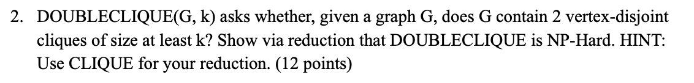
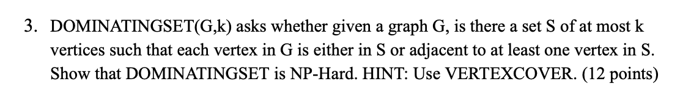
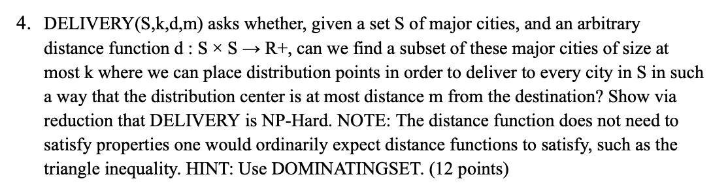
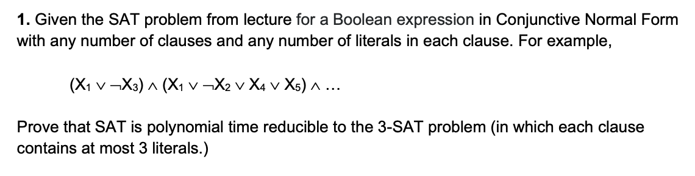
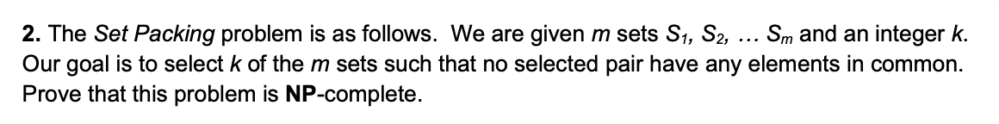
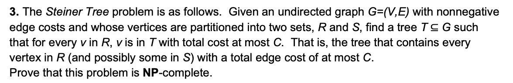

# Homework10

- [Homework10](#homework10)
  - [Question1](#question1)
    - [Define the Decision Version](#define-the-decision-version)
    - [Showing the Problem is in NP](#showing-the-problem-is-in-np)
    - [Reduction from Set Cover Problem](#reduction-from-set-cover-problem)
    - [Correctness of the Reduction](#correctness-of-the-reduction)
    - [Conclusion](#conclusion)
  - [Question2](#question2)
    - [Define the Decision Version](#define-the-decision-version-1)
    - [Showing the Problem is in NP](#showing-the-problem-is-in-np-1)
    - [Reduction from Independent Set Problem](#reduction-from-independent-set-problem)
    - [Correctness of the Reduction](#correctness-of-the-reduction-1)
    - [Conclusion](#conclusion-1)
  - [Question3](#question3)
    - [The hint](#the-hint)
    - [Showing the Problem is in NP](#showing-the-problem-is-in-np-2)
    - [Reduction from 3-SAT](#reduction-from-3-sat)
    - [Correctness of the Reduction](#correctness-of-the-reduction-2)
  - [Ungraded Q1](#ungraded-q1)
  - [Ungraded Q2](#ungraded-q2)
  - [Ungraded Q3](#ungraded-q3)
  - [Ungraded Q4](#ungraded-q4)
  - [DIS10 Q1](#dis10-q1)
  - [DIS10 Q2](#dis10-q2)
  - [DIS10 Q3](#dis10-q3)


## Question1

The Sushi Express wants to implement a new feature, "order batching." The menu consists of a set of disired food items $F$ and set of combos $c_1, ..., c_n$ where each combo is a set of food items along with a price - we represent combo $c_i = (\{f_i^1, f_i^2, ..., f_i^k\}, p_i)$, where each $f_i^j$ is a food item in the combo. If a student orders $c_i$, they receive each of the food items, and they pay the cost $p_i$. In the new order batching system, the students would input a list of food items that they want, and the order batching system should find the cheapest set of combos, which would include at least one of each desired food item. Write the decision version of this problem, and show via reduction that this decision problem is NP Hard.

> Example:
>
> Foods F = {Fries, Burger, Pizza, drink, sandwich, cookie, chips}
>
> C1 = ({Fries, Pizza, cookie}, 10$)
>
> C2 = ({Fries, drink, sandwich}, 15$)
>
> C3 = ({drink, Pizza, chips, burger}, 17$)

### Define the Decision Version

We define the decision version of the Sushi Batching problem as follows:

**Input:**

- A set of food items $F$
- A collection of combos $C_1, ..., C_n$, where $C_i = (S_i, p_i), S_i \subseteq F$.
- A set of required items $R \subseteq F$
- A budget $B\in\mathbb{Z}^+$.

**Question:** 

Does there exists a subset of combos $I \subseteq \{1, ...,n\}$ such that:

1. $\displaystyle \bigcup_{i\in I} S_i \supseteq R$ (Unite to cover all the food you want), and
2. $\displaystyle \sum_{i\in I} p_i \le B$

### Showing the Problem is in NP

A certificate can be a subset of combo indices $I \sube \{1,...,n\}$. The certifier checks the following in polynomial time: 

1. Compute $\sum_{i\in I}p_i$ and verify it is $\le B$
2. Compute the union $\bigcup_{i\in I} S_i$ and verify that it contains every element of R.
3. Verify that I has no duplicate indices.

These checks require only scanning sets and summing numbers, all of which take polynomial time. **Thus the problem has an efficient certification and is in NP.**

### Reduction from Set Cover Problem

We reduce from the classic NP-complete **SET COVER** problem.

A Set Cover problem can be presents as:

- a universe $U = \{e_1,...,e_m\}$
- a family of subsets $S_1,...,S_n \sube U$
- an integer $k$

We construct a Sushi-Batching instance as follows:

1. Let the set of food itmes be $F:= U$
2. For each subset $S_i$, create a combo $C_i = (S_i, p_i)$, and set all prices to $p_i:=1$.
3. Set the required items to be $R:=U$
4. Set the budget to $B:=k$

This construction is clearly polynomial time.

### Correctness of the Reduction

**If the SET COVER instance is YES:**

Suppose there exists a cover $I$ with $|I| \le k$ and $\bigcup_{i\in I} S_i = U$.

Then in our Sushi-Batching instance, selecting the same index set $I$:

- the total price is $\sum_{i\in I} p_i = |I| \le k = B$
- The covered foods are $\bigcup_{i\in I} S_i = U = R$.

Thus the Sushi-Batching instance is also YES.

**If the Sushi-Batching instance is YES:**

Suppose there exists a set of combos I such that:

- $\bigcup_{i\in I} S_i \supseteq R (=U)$
- $\sum_{i\in I} p_i \le B (=k)$

Since each $p_i = 1$, we have $|I| \le k$.

Thus the same I forms a valid set cover of size $\le k$.

Therefore the SET COVER instance is YES.

### Conclusion

We have prove that:

1. Sushi-Batching is NP (efficient certificate)
2. SET COVER $\le p$ Sushi-Batching
3. Therefore, Sushi-Batching is NP-hard
4. Combined with (1), the decision version is NP-complete

## Question2

Problem $\operatorname{CLIQUE}(G,k)$ asks whether, given a graph G, does G contain a k-clique? A k-clique is defined to be a set of k vertices such that each pair of these vertices shares an edge. Show via reduction that CLIQUE is NP-complete.

### Define the Decision Version

The decision version CLIQUE is defined as follows

Input:

- A graph $G = (V, E)$
- An integer $k$

Question:

Does $G$ contain a k-clique?

i.e., is there a subset $S \sube V$ with $|S|=k$ such that every pair of vertices in $S$ in connected by an edge in $E$ ?

### Showing the Problem is in NP

**Certificate:**

A certificate can be a subset of vertices $S \sube V$ with $|S|=k$.

**Certifier:**

Given $(G,k)$ and the certificate $S$, the certifier:

1. Checks that $|S|=k$
2. For every pair $(u,v)$ in $S$, checks whether $(u,v)\in E$

There are at most $k / 2$ pairs, so this verification takes polynomial time in the size of the input graph. Thus CLIQUE has an efficient certifiction and is in NP. 

### Reduction from Independent Set Problem

Independent Set decision problem:

Input: 

- Graph $G = (V, E)$
- Integer $k$

Question:

Is there a set $S \sube V$ with $|S| \ge k$ such that no two vertices in $S$ share an edge. 

This problem is known to be NP-Complete.

Now, we need to prove that $\operatorname{Independent Set} \le _p \operatorname{CLIQUE}$.

Given an instance $(G = (V, E), k)$ of independent set, we construct an instance $(G = (V, E), k)$ of CLIQUE as follows:

- The vertex set of $G$ is the same: $V(G) := V(G)$.
- The edge set $E$ is the complement of $E$: for every pair of distinct vertices $u,v \in E$, we construct that $(u,v)\in E \to (u,v)\notin E$

That is, we create an edge in G exactly when that edge is not present in G. This construction takes polynomial time (we just check all pair of vertices once). We keep the same parameter $k$.

### Correctness of the Reduction

**direction ->**

Assume $(G,k)$ is a YES-instance of Independent Set. Then there exists $S \sube V$ with $|S| \ge k$ such that no edge in $E$ has both endpoints in S. That means for every pair $u,v \in S$, we have $(u,v) \notin E$. By construction of the complement graph, this implies $(u,v)\in E$ for all $u,v \in S$. Thus every pair of vertices in $S$ is connected by an edge in $G$, so $S$ forms a clique of size at least $k$ in $G$.

Therefore, $(G, E)$ is a YES-instance of CLIQUE.

**direction <-**

Conversely, assume $(G,k)$ is a YES-instance of CLIQUE.

Then there exists set $S \sube V$ with $|S| \ge k$ such that every pair of vertices in $S$ in connected by an edge in E.

By the definition of E, this means that no pair $u,v \in S$ in connected by an edge in $E$.

Hence, $S$ contains no adjacent vertices in the original graph $G$, so $S$ is an independent set of size at least $k$ in $G$. Thus $(G, k)$ is a YES-instance of Independent Set.

### Conclusion

We have shown that:

- The transformation from $(G, k)$ to $(G, k)$ is polynomial-time.
- $(G, k)$ is YES for Independent Set iff $(G, k)$ is YES for CLIQUE.

Therefore, $\operatorname{Independent Set} \le _p \operatorname{CLIQUE}$, and since Independent Set is NP-complete, CLIQUE is NP-hard.

Therefore, CLIQUE is NP-complete.

## Question3

Recall the 3-SAT problem: Given a 3-CNF input formula, it tries to find an assignment of variables that satisfies **ALL** given clauses. Now, we consider a variation — the partial satisfiability problem, denoted as $3\text{-Sat}(\alpha)$, for a specified constant $\alpha$. Here, we are given a collection of $k$ clauses, each of which contains exactly three literals, and we are asked to determine whether there is an assignment of true/false values to the literals such that **at least $\alpha k$ clauses will be true**. Note that for $\alpha = 1$, we have the problem $3\text{-Sat}(1)$ which is exactly the 3-SAT problem as per definition. We want to analyze the problem corresponding to a smaller $\alpha$, in particular, $\alpha = \frac{15}{16},$ which gives us the problem $3\text{-Sat}\left(\frac{15}{16}\right)$.

**Show that the problem $3\text{-Sat}\left(\frac{15}{16}\right)$ is NP-complete.** (20 points)

**Hint:** If $x, y, z$ are variables, there are eight possible clauses containing them:

$(x \lor y \lor z),\ (\lnot x \lor y \lor z),\ (x \lor \lnot y \lor z),\ $

$(x \lor y \lor \lnot z),\ (\lnot x \lor \lnot y \lor z),\ (\lnot x \lor y \lor \lnot z),\ (x \lor \lnot y \lor \lnot z),\ (\lnot x \lor \lnot y \lor \lnot z).$

### The hint

If $x, y, z$ are variables, there are eight possible clauses containing them:

$(x \lor y \lor z),\ (\lnot x \lor y \lor z),\ (x \lor \lnot y \lor z),\ $

$(x \lor y \lor \lnot z),\ (\lnot x \lor \lnot y \lor z),\ (\lnot x \lor y \lor \lnot z),\ (x \lor \lnot y \lor \lnot z),\ (\lnot x \lor \lnot y \lor \lnot z).$

**For any assignment x, y, z, exactly one of these eight clauses will be false, and the other seven will be true.**

### Showing the Problem is in NP

We need to use the efficient certification to prove that $3\text{-Sat}\left(\frac{15}{16}\right)$ is in NP.

In the problem $3\text{-Sat}(\alpha)$:

- **certificate:** a truth assignment to all variables
- certifier:
  1. evaluate each of the $k$ clauses under this assignment
  2. count how many clauses are satisfied
  3. accept iff the number of satisfied clauses is at least $15k/16$

This takes poly-time in the size of the input, so $3\text{-Sat}\left(\frac{15}{16}\right)$ problem has an efficient certification so is in NP.

### Reduction from 3-SAT

now we need to prove that $\text{3-SAT} \le _p \text{3-SAT}(\frac{15}{16})$.

**1. Preprocess: Make the number of clauses a multiple of 8 (for easier use of hints)**

First, let the original problem instance have $k$ clauses $C_1, ..., C_k$. If $k$ is not a multiple of 8, we add some tautological clauses such as $x \or \lnot x\or y$, which are always true, until the total number of clauses becomes $k$, and $k$ is a multiple of 8.

These added clauses do not change satisfiability: the new formula is satisfiable iff the original one is.

**So w.l.o.g. (without loss of generality) assume we start with a 3-SAT formula with $k$ clauses and k is a multiple of 8.**

**2. Construct the new set of clauses**

Now we have $k = 8n$ clauses, we can divide the clauses into $n$ groups, and each group have 8 clauses.  

For each group of 8 clauses, we introduce **three new variables** $x,y,z$ ==(fresh for this block)== and add **8 new clauses** which are exactly the 8 possible clauses over $x,y,z$ listed in the hint.

So each block becomes:

- 8 original clauses, plus
- 8 new clauses over $x,y,z$,

for a total of 16 clauses per block.

Therefore, we have $n$ groups of clauses, each group have 16 (8+8) clauses.

**3. How many clauses can be satisfied at the same time in one block ?**

Obviously, in the 16 clauses, we can at most satisfied 15 clauses at the same time, because for the 8 clauses in the hint: **For any assignment x, y, z, exactly one of these eight clauses will be false, and the other seven will be true.**

Therefore, must be 7 true, 1 false.

If we can satisfied all the clauses in the original 8 clauses, the total number of the satisfaction is 15.

Therefore, we get the 15/16.

### Correctness of the Reduction

The original $\text{3-SAT}$ satisfies ⇔ The new $\text{3-Sat}(\frac{15}{16})$ satisfies at least the clauses of 15/16.

**direction ->**

Assume that the original 3-SAT formula (with k clauses) is satisfied.

Let $\sigma$ be a satisfying assignment of all original variables.

For each block:

- Under $\sigma$, all 8 original clauses are true.
- We can assign values to the new variables $x,y,z$ arbitrarily; for any assignment, exactly 7 of the 8 new clauses are satisfied.

So in each block we can satisfy: 8+7=15 clauses. Therefore, we can satisfied 15/16 clauses overall.

Therefore, the constructed instance of $3\text{-Sat}\!\left(\frac{15}{16}\right)$ is a YES-instance.

**direction <-**

Now suppose the constructed $3\text{-Sat}\!\left(\frac{15}{16}\right)$ instance has an assignment that satisfies at least its 15/16 clauses.

For that to happen, every group (block) must have exactly 15 satisfied clauses.

In any group:

- the 8 new clauses from hint contributes5 at most 7 satisfied clauses
- therefore, to reach 15, all 8 original clauses in that group must be satisfied

So in every group, the original 8 clauses are true under the assignment.

Hence, all k original clauses are satisfied, i.e., the original 3-SAT formula is satisfiable.

Since adding tautologies in the preprocessing step did not change satisfiability, the original input 3-SAT instance is a YES-instance.

## Ungraded Q1

Given a graph G = (V, E) and two integers k, m, the Dense Subgraph Problem is to find a subgraph G′ = (V′, E′) of G, such that V′ has at most k vertices and E′ has at least m edges. Prove that the Dense Subgraph Problem is NP-Complete. 

HINT: Use Independent Set for your reduction.

从 Independent Set(G, k) 归约到 Dense Subgraph(G′, k, m)。

给定原图 $G=(V,E)$，我们先取它的补图 $G'$。Independent Set 问的是：是否存在 k 个点之间没有任何边；在补图中，==这等价于：是否存在 k 个点之间全部都有边==，也就是一个 k-clique。一个 k-clique 恰好有 $k(k−1)/2$ 条边。**==所以在 Dense Subgraph 中设定 k′=k，m = k(k−1)/2==**，并在 $G'$ 上询问：是否存在一个包含至多 k 个点并且至少有 m 条边的子图。

这样我们把“独立集 = 0 条边”转化为“补图中的 clique = 至少 m 条边”。独立集与稠密子图刚好相反，因此使用补图（complement graph）是最自然的构造：

• 在 $G$ 中没有边 ⇔ 在 $G'$ 中有边

• 在 $G$ 中 k 个点互不相连 ⇔ 在 $G'$ 中这 k 个点构成一个 k-clique（边数 = k choose 2）

而 clique 正好是 dense subgraph 的一个特例，因此构造自然成立。

双向证明：

(⇒) 若 G 中存在一个 size=k 的 Independent Set，则这 k 个点在 G 中互不相连，因此在 Gᶜ 中两两都有边，它们就是一个 k-clique，拥有恰好 k(k−1)/2 条边，因此满足 Dense Subgraph 的要求（≤k 个点、≥m 条边）。

(⇐) 若在 Gᶜ 中存在一个子图，包含至多 k 个点，并且至少有 m = k(k−1)/2 条边，则由于 k 个点最多只能有 k(k−1)/2 条边，因此边数达到 m 意味着这 k 个点两两相连，形成一个 k-clique。于是它们在原图 G 中两两无边，构成一个 size=k 的 Independent Set。

***

**Construction:**

To reduce Independent Set(G, k) to Dense Subgraph(G′, k, m), take the complement graph G^c of G.

Independent Set asks whether there exist k vertices with **no edges** among them.

In the complement graph, this is equivalent to asking whether these k vertices have **all possible edges**, i.e., they form a k-clique.

A k-clique contains exactly k(k-1)/2 edges.

Therefore we set k' = k and m = k(k-1)/2, and ask whether G^c contains a subgraph with at most k vertices and at least m edges.

This construction is natural because Independent Set and Dense Subgraph are opposites:

• no edges in G ⇔ all edges in G^c

• a k-independent set ⇔ a k-clique in G^c (with k \choose 2 edges)

And a clique is exactly a special case of a dense subgraph.

**Correctness (two directions):**

(⇒) If G contains an independent set of size k, then those k vertices have no edges in G, so they form a k-clique in G^c. That clique contains exactly k(k-1)/2 edges, so it satisfies the Dense Subgraph requirement (≤k vertices, ≥m edges).

(⇐) If G^c contains a subgraph with at most k vertices and at least m = k(k-1)/2 edges, then these vertices must have **exactly** k(k-1)/2 edges—the maximum possible among k vertices—so they form a k-clique in G^c. Therefore in G the same set of vertices has no edges, forming an independent set of size k.

This completes the construction and correctness proof.

## Ungraded Q2



先回忆clique的证明，在HW的Q2

这题是比较简单的，原来G中如果已经有一个CLIQUE了，那就再多加一个即可。

构造 G′：

1. 从 G 开始

2. 添加 k 个新顶点：v₁,…,v_k

3. 对所有 i≠j 加边 (vᵢ, vⱼ)

   → 它们构成一个 clique

4. 不与 G 的其他点连边

**

现在 G′ 中永远有一个 clique（新加的）。

DOUBLECLIQUE(G′, k) 是否为 YES

==取决于：== 最重要是这里，这个步骤

> G 中是否存在另一个 k-clique，与我们添加的 clique 不共享顶点。

这正是 CLIQUE(G, k)。

所以：

- G 有 clique → G′ 有两个 disjoint clique
- G 没 clique → G′ 只有我们加的那个 clique

reduction 完成。

## Ungraded Q3



这题我理解了一下答案说的。

- Vertex Cover 要“覆盖边”。

- Dominating Set 要“支配点”。

首先在Vertex Cover中，G中一条边 $(u, v)$, 必须选其中之一，也就是要不就是 $u$ 被选，要不就是 $v$ 被选。所以构造成一个v字结构，$u-v$ 变成 $u - x - v$ ，此时，对于DS问题来说，每个点都需要被支配，想要支配x，就必须选 $u, v$ 其中之一，这就对应来VC问题中的 $u,v$ 必须选其中之一了。

## Ungraded Q4



Take some dominating set instance G, k. Create a DELIVERY instance with the following parameters. Let the cities be vertices, k be the same in the DOMINATINGSET instance, d be 1 for any pair of vertices which share an edge, and 3 otherwise, and m be 2. Note that 2 cities are close enough for delivery iff they correpond to adjacent edges in the original graph. Therefore, a dominating set G correspond to adjacent edges in the original graph. Therefore, a dominating set in G corresponds precisely to a set of cites for DELIVERY. 

***

- d(u,v) = 1 if (u,v) ∈ E
- d(u,v) = 3 otherwise
- m = 2

这样：

> d(u,v) ≤ 2 ⇔ (u,v) 是 DS 中的邻居关系

所以这样其实就已经对应起来了。

## DIS10 Q1



好，这题其实就是课上讲过的经典规约：

> 把 **一般的 SAT（子句可以有任意多 literal）** 规约成 **3-SAT（每个子句最多 3 个 literal）**。

**1. 我们只需要把“一个子句”变成几个 3-literal 子句**

整条公式是很多子句相与：

$(C_1)\land(C_2)\land\dots$

只要我们能把**每一个子句** C 单独变成一些 3-SAT 子句，并且保证：

> 原来的子句 C 可满足

> \iff

> 转换后的那一小串 3-literal 子句“整体可满足”

那整个公式就被正确地规约成 3-SAT 了。

**2. 长度 ≤ 3 的子句怎么处理**

- 长度 1：$(X_1)$

  变成 $(X_1 \lor X_1 \lor X_1)$

- 长度 2：$(X_1 \lor X_2)$

  变成 $(X_1 \lor X_2 \lor X_1)$（随便复制一个）

- 长度 3：$(X_1 \lor X_2 \lor X_3)$

  直接保留

这些都不会改变可满足性，很好理解。

**3. 长度 > 3 的子句：用“链式 + dummy 变量”拆成多个 3 子句**

设有一个子句：

$(X_1 \lor X_2 \lor X_3 \lor \dots \lor X_k),\quad k>3$

我们引入 k-3 个新的 dummy 变量：

$S_1, S_2, \dots, S_{k-3}$

然后按下面的**链式结构**拆成 3-SAT 子句（和你截图一模一样）：

- 当 k = 4：

  $(X_1 \lor X_2 \lor S_1)\ \land\ (\lnot S_1 \lor X_3 \lor X_4)$

- 当 k = 5：

  $(X_1 \lor X_2 \lor S_1)\ \land\ (\lnot S_1 \lor X_3 \lor S_2)\ \land\ (\lnot S_2 \lor X_4 \lor X_5)$

- 一般的 pattern（记住这个就行）：

  第一条：

  $(X_1 \lor X_2 \lor S_1)$

  中间的链：

  $(\lnot S_1 \lor X_3 \lor S_2)\ \land\ (\lnot S_2 \lor X_4 \lor S_3)\ \land\ \dots$

  最后一条：

  $(\lnot S_{k-3} \lor X_{k-1} \lor X_k)$

总共会有 k-2 个 3-literal 子句。

**4. 正确性证明：两个方向（照着你的截图那段 proof）**

**A. 原来的长子句可满足 ⇒ 这串 3 子句可满足**

如果原来的

$(X_1 \lor \dots \lor X_k)$

是可满足的，说明至少有一个 $X_i$ 为真。

选出**最靠左的那个为真的** $X_i$，然后我们给 $S_1,\dots,S_{k-3}$ 适当赋值，使得每个 3-literal 子句都变成真。

直觉理解：

- 在链的前面几条里，用 $S_j$ 的真假把子句“硬撑”为真；
- 当走到那条包含第一个“真正真”的 $X_i$ 的子句时，这条子句直接因为 $X_i$ 真而为真；
- 后面的子句继续通过合适设置剩下的 S 让它们也都为真。

关键点：

**因为原子句里有一个真实的** $X_i=1$，链里至少有一条 3-literal 子句会靠这个 $X_i$ **而变真，其余子句都可以用 dummy 变量补齐成真。**

所以我们可以扩展一个满足原子句的赋值，得到一个满足整条链的赋值。

**B. 这串 3 子句可满足 ⇒ 原来的长子句可满足**

反过来，假设整条链

$(X_1 \lor X_2 \lor S_1)\land(\lnot S_1 \lor X_3 \lor S_2)\land\dots$

是可满足的。

看每条 3-literal 子句：

dummy 变量 $S_j$ 和 $\lnot S_j$ 最多只是“帮忙”，不可能单独让所有子句都真。

整个链可满足，必然在某一条子句里有某个 $X_i$ 为真（否则所有子句全靠 S 的真假撑起来是不可能的，因为有正 $S$ 又有 $¬S$ 链式约束，会冲突）。

一旦有某个 $X_i = 1$，那么原来的长子句

$(X_1 \lor \dots \lor X_k)$

里也至少有一个 literal 为真 → 它也被满足。

所以：

**链可满足 ⇒ 至少一个** X_i **为真 ⇒ 原子句可满足。**

**5. 总结你在考试需要记住的点**

1. 对整个公式：每个子句独立转换，最后把所有新子句 AND 起来。

2. 子句长度 ≤3 时，直接补重复变量凑到 3。

3. 子句长度 k>3 时，用

   $(X_1 \lor X_2 \lor S_1)\land(\lnot S_1 \lor X_3 \lor S_2)\land\dots\land(\lnot S_{k-3} \lor X_{k-1} \lor X_k)$

   这个链式结构。

4. 记住“**dummy 变量负责传递信息，但最终一定要由某个真实的** X_i **来让链成立**”，两个方向的证明都是围绕这个来写的。

## DIS10 Q2



这题我暂时想到的思路是：

也是作为一个图： S1, ..., Sm 分别看作m个节点。

如果两个集合有common的元素，则连接起来

然后就可以用独立集来规约了，这对吗

**对的！这是我想自己想到的，为数不多的题目的其中一个。**

## DIS10 Q3

> [!important]
>
> 通过这题我发现了，和上面有一题也是异曲同工之妙的。
>
> 因为vc问题是，用点来支配所有边。然后很多题目是要求支配点的。
>
> - 所以经常会遇到，支配点的问题规约到支配边的问题上
>
> 因为在vc中，uv至少选一个，所以添加一个 u-r-v, 如果要支配r，那你就要支配u或者支配v。在这题中，同理，从u或者从v进入树中。
>
> 所以支配点的问题，都可以通过 u-r-v 这个结构，往vc问题上想。
>
> ***
>
> 很多 NP-hard 题目都能用同一个 VC-gadget 来规约：
>
> 对原图中每条边 (u,v)，构造一个强制节点 r，并连接成：
>
> ```
> u — r — v
> ```
>
> 然后让问题的约束要求「必须满足/覆盖/连接所有 r」。
>
> 因为要满足 r 只能通过 u 或 v，于是解被强制“至少选 u 或 v”，
>
> 这**正好模拟 Vertex Cover 的定义**。
>
> 因此：
>
> > **只要一个问题包含“覆盖节点 / 支配节点 / 服务节点 / 连接必须节点”等机制，就可以用 u–r–v 结构逼出 VC。**
>
> **出现这些词 → 优先怀疑可以用 VC gadget**
>
> - cover
> - dominate
> - monitor
> - guard
> - service
> - connect
> - reach
> - supply
> - ensure
> - satisfy
> - must be included
> - required nodes
> - terminals
> - must be reachable
> - must be served/covered
>
> 看到这些词就想：
>
> > **能不能把“覆盖边”变成“覆盖节点” → 用 u-r-v 强制至少选端点？**



**题目在问什么？（一看就懂的版本）**

你有一个图 G，有边的 cost（非负）。

图的所有点被分成两个集合：

- R = 必须包含的点（required terminals）
- S = 可选的点（Steiner points）

你的任务是：

>  找一棵树 T（T 是 G 的子图），这棵树必须包含所有 **R 中的点**（你可以选择是否包含 S 中的点），并且树的总边权重 ≤ C。

这棵 T 就叫「Steiner Tree」。

换句话说：

**你要用最便宜的方式，把 R 中所有必须连接的点连成一棵树。**

你可以用 S 中的点（辅助节点）来帮助减少成本。

***

**一、先牢记 Vertex Cover 的本质**

对于每条边 e=(u,v)，至少要选：

- u，或
- v

否则这条边 **没人覆盖**。

换句话说：

> **每条边都必须被它的端点至少一个“代表”。**

**🚀 二、我们想让 Steiner Tree 模拟这个行为**

Steiner Tree 的强制点集是：

> **所有 R 里的点必须被连进树里**

所以构造的关键思想是：

> **把“每条边必须被覆盖”这件事，变成“每个 r_e 必须接入树，并且 r_e 只能通过 u 或 v 接进树”。**

你看到这里：

**是不是已经闻到 Vertex Cover 的味道了？**

**🚀 三、构造的灵魂：每条旧边 e=(u,v) → 一个新节点 rₑ\****

画图：

```
     u ---- v   （原图的一条边）

     在 G′ 中变成：

        rₑ
        / \
       u   v
```

非常关键：

- rₑ 是 R 中的必选点（必须进入 Steiner Tree）

- 它要被接入树，只能走两条路：

  - rₑ → u
  - rₑ → v
  
- 若你不选择 u，也不选择 v，当 rₑ 必须被接入树时，

  **根本没路连它**。

于是：

> 选 u 或 v 进入 Steiner Tree = 选 u 或 v 作为 Vertex Cover 中的一个点

看到了吧？

**这就是模拟 VC 最核心的结构。**

**🚀 四、处理多个点：需要一个 root（超级节点 r₀）**

Steiner Tree 必须是连通树，你不能让很多 u、v、x、y 散着。

所以加一个：

```
      r₀
     / | \
    u  v  x  ... 所有原节点
```

为什么要这样？因为：

- 你最终至少要选一些“原节点”（这些就是 VC 中的节点）
- 它们必须连成一棵树
- 唯一方式是：**通过 r₀**

r₀ 强制连接所有“被选来帮助连树的原节点”。

**🚀 五、预算设为 m + k 的真正原因**

总共有：

- m 个 rₑ 点，每个至少要用 **1 条边** 接入树

  → 必须用掉 m 条树边

- 剩下的预算只有 k 条用于连接 r₀

  → 说明：

> **你最多只能从原节点里选 k 个节点作为“入口”加入树。**

这 k 个节点就是 Vertex Cover。

**六、此时整个行为被强制变成对应关系**

⭐ rₑ 必须接入树 → 必须选 u 或 v

⭐ r₀ 只能连到最多 k 个原节点 → 只能选 k 个点做 VC

⭐ 若这些点不能覆盖所有边 → 某个 rₑ 无路可接入 → Steiner Tree 不可能存在

⭐ 若存在 Steiner Tree → 说明这些 k 个点覆盖了所有边 → 是一个 VC

**完美一一对应**

**七、现在把构造写成你能理解的版本**

**1. 对每条边 (u,v)：加新点 rₑ**

```
rₑ
/ \
u  v
```

rₑ 属于 R（必须进入树）

**2. 为了让树连通，加超级节点 r₀**

```
r₀ 连接所有原图节点 V
```

**3. 所有边权 = 1**

预算 C = m + k

**八、现在你闭上眼睛就能理解为什么这个构造对应 VC**

**若你选的原节点集合是 VC（≤k）：**

- r₀ 连到这 k 个节点（花 k）
- 每个 rₑ 连到覆盖它的端点之一（花 m）
- 总共 m + k

树 OK ✔

**若 Steiner Tree 存在（花费 ≤ m+k）：**

- m 条边用于连 rₑ

- 只能剩下 k 条边连 r₀

- ⇒ r₀ 只能连 k 个原节点

  ⇒ 这些节点必须为每个 rₑ 提供路径

  ⇒ 这些节点覆盖所有边

  ⇒ 是 Vertex Cover

**总结一句话（你考试记住这个）**

> **“每条边 e 变成一个必须接入树的节点 rₑ，它只能通过它的端点 u 或 v 接入，因此 Steiner Tree 必须选择 VC；预算 m+k 强制最多选 k 个端点。”**