# Tractability & Computational Compleity Classes

- [Tractability \& Computational Compleity Classes](#tractability--computational-compleity-classes)
  - [Overview](#overview)
  - [Independent Set Problem \& Vertex Cover Problem](#independent-set-problem--vertex-cover-problem)
    - [Independent Set Problem](#independent-set-problem)
    - [Vertex Cover Problem](#vertex-cover-problem)
    - [FACT](#fact)
    - [Vertex Cover 和 Independent Set 是相互规约的](#vertex-cover-和-independent-set-是相互规约的)
    - [Set Cover Problem](#set-cover-problem)
  - [Reduction Using Gadgets](#reduction-using-gadgets)
    - [Some Definitions](#some-definitions)
    - [When does an assignment satisfy a clause?](#when-does-an-assignment-satisfy-a-clause)
    - [SAT / 3-SAT Problems](#sat--3-sat-problems)
  - [Efficient Certification](#efficient-certification)
    - [Intro](#intro)
    - [3-SAT's efficient certification](#3-sats-efficient-certification)
    - [Independent Set's efficient certification](#independent-sets-efficient-certification)
    - [The Def. of the NP](#the-def-of-the-np)
    - [P v.s. NP](#p-vs-np)
    - [NP-hard and NP-complete](#np-hard-and-np-complete)
    - [Transitivity](#transitivity)
    - [Basic strategy to prove a proble X is NP-Complete](#basic-strategy-to-prove-a-proble-x-is-np-complete)
    - [Def. of NP-hard](#def-of-np-hard)

## Overview

Loose Definition:

> If a  problem X is at least as hard as problem Y, it means that if we could solve X, we could also solve Y.

Formal Definition:

> $Y \le _pX$ (Y is polynomial time reducible to X)

if Y can be solved using a polynomial number of standard computational steps plus a polynomial number of calls to a blackbox that solves X.

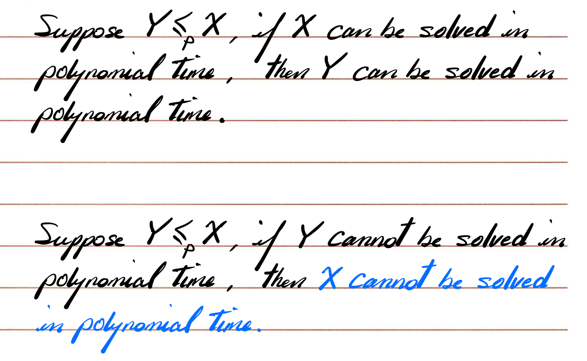

这里正反两个方向，其实也是很好理解的。

## Independent Set Problem & Vertex Cover Problem

### Independent Set Problem

定义。

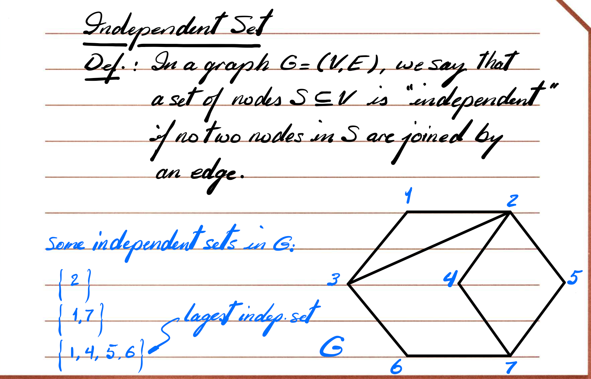

其实定义也是很好理解，就是在一个 Graph 里面，没有被直接相连的点的集合。

**Independent Set Problem:**

> - Find the largest independent set in graph G (optimization version)
>
> - Given a graph G and a number k, does G contain an independent set of size at least k? (decision version)

### Vertex Cover Problem

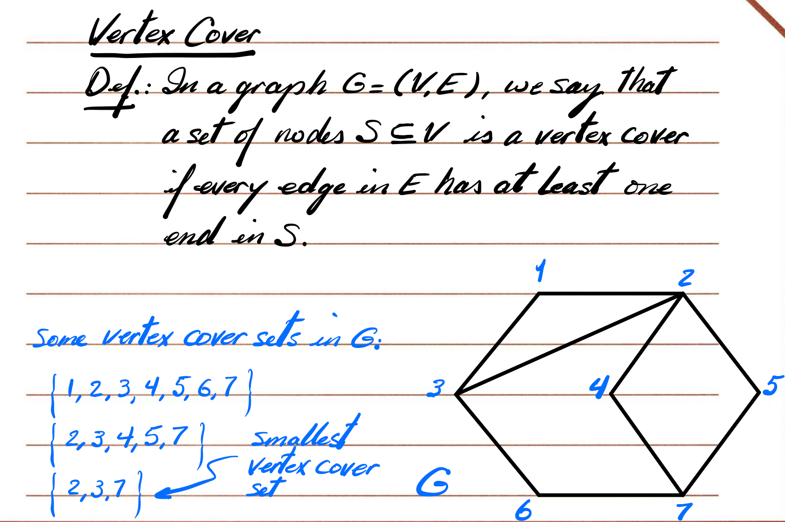

点覆盖所有边。

**Vertex Cover Problem:**

> Find the smallest vertex cover set in G. (optimization version)
>
> Given a graph G and a number of k, does G contain a vertex cover set of size at most k? (decision version)

### FACT

Let $G = (V, E)$ be a graph, then S in an independent set if and only if its complement V-S is a vertex cover set.

**Proof:**

> A) First suppose that S is an independent set
>
> consider edge $u-v$
>
> There are 3 possibilities:
>
> - u is in S and v is not; then v-s will have v and not u
> - v isi in S and u is not; then v-s wil have u and not v
> - neither v and u is in S; then v-s will have both u and v

...

这里的证明slides里没有完整的。

| 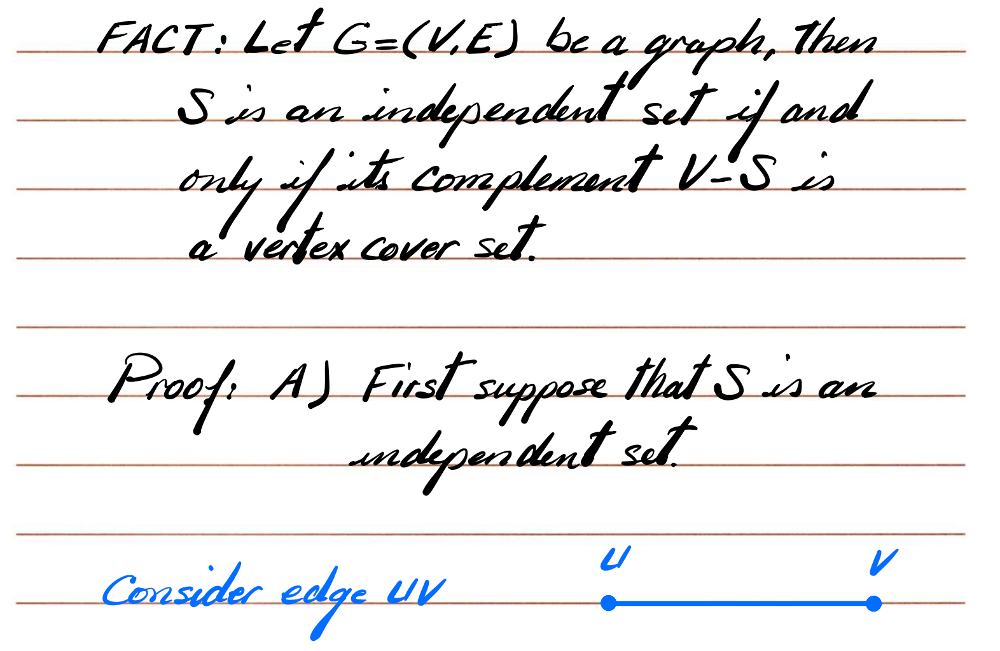 | 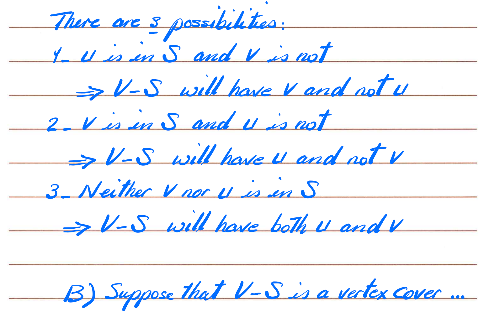 |
| ------------------------------------------------------------ | ------------------------------------------------------------ |

### Vertex Cover 和 Independent Set 是相互规约的

| 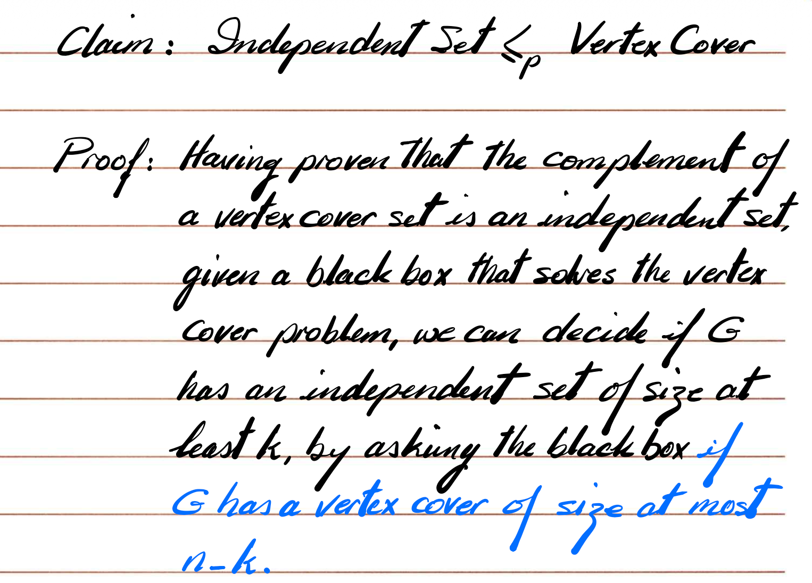 | 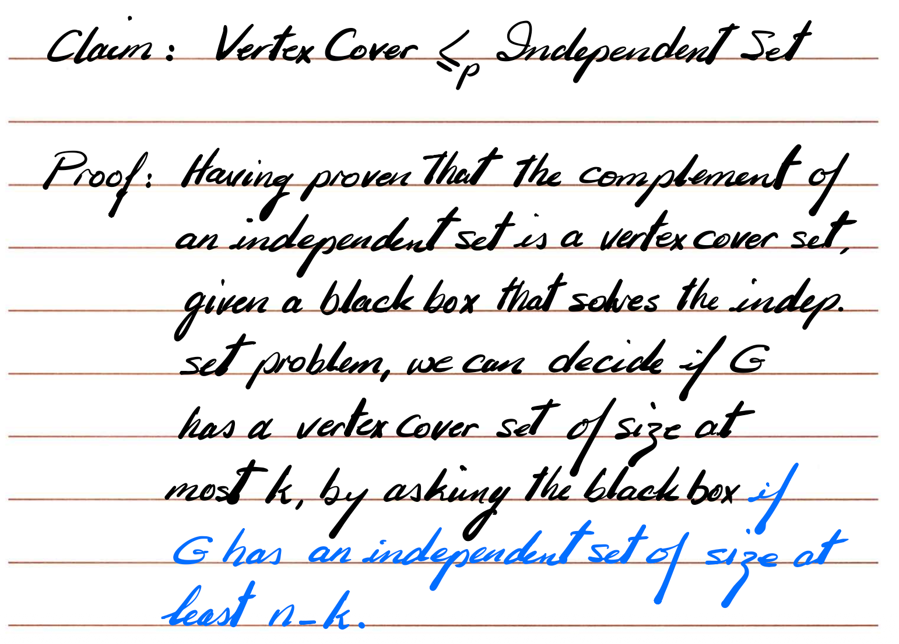 |
| ------------------------------------------------------------ | ------------------------------------------------------------ |

其实这里很好理解，就不赘述了。

Independent Set 和 Vertex Cover 是互补问题：一个大小为 k 的 independent set ⇔ 一个大小为 ≤ n−k 的 vertex cover。

所以要判断 “有没有 independent set ≥ k”，只需要问黑盒 “有没有 vertex cover ≤ n−k”；反过来判断 “有没有 vertex cover ≤ k”，只需要问黑盒 “有没有 independent set ≥ n−k”。

这两段话分别就是在说明这两个方向的规约。

### Set Cover Problem

Given a set U of n elements, a collection $S_1, S_2, ..., S_m$ of subsets of U, and a number k, does there exist a colletion of at most k of these sets whose union in equal to all of U?

**用最短的方式讲清楚 Set Cover Problem：**

**Set Cover Problem 是什么？**

给：

- 一个元素集合 **U**（比如 {1,2,3,4,5}）
- 一组集合 **S1, S2, …, Sm**（每个集合包含 U 里的一些元素）
- 一个数字 **k**

**问题：能否选最多 k 个集合，使得它们的并集覆盖 U？**

也就是：

> **选 k 个集合，把所有元素都“盖住”。**

 Vertex Cover 可以规约到 Set Cover，说明：

**Set Cover 至少和 Vertex Cover 一样难 → NP-hard。**

**==Vertex Cover $\le _p$ Set Cover==**

**规约的核心思想**

Vertex Cover 问题：

> 选 k 个点，使得所有边都被覆盖。

把边看作 Set Cover 里的“元素”，

把每个顶点看作“集合”（包含所有与该点相连的边）。

这样：

- 选一个顶点，就是选一个集合
- 覆盖所有边，就是覆盖所有元素

因此：

**G 是否有大小 ≤ k 的 vertex cover ⇔**

**集合家族是否有 ≤ k 个集合覆盖所有边。**

## Reduction Using Gadgets

### Some Definitions

**clause**

Given n Boolean variables $x₁ … xₙ$, a clause is a disjunction of terms $t₁ ∨ t₂ ∨ … ∨ t_j$ where $tᵢ ∈ {x₁…xₙ, ¬x₁…¬xₙ}$

给定 n 个布尔变量 x₁ … xₙ，一个 **clause（子句）** 是很多项的“或”（∨）连接。

每一项 tᵢ 要么是某个变量 xᵢ，要么是它的否定 ¬xᵢ。

**简单理解：** 子句就是：至少有一个为真 ⇒ 整个子句为真。

> [!note]
>
> 子句的意思就是：**子句 = 很多个“变量或变量取反”用 “OR (∨)” 连接起来的表达式。**
>
> $t₁ ∨ t₂ ∨ … ∨ tⱼ$, where $t_i \in \{x_1, ..., x_n, !x_1, ..., !x_n\}$

**truth assignment**

A truth assignment for X is an assignment of values 0 or 1 to each xᵢ.

一个 **truth assignment（真假赋值）** 就是对每个变量 xᵢ 赋值 0（false）或 1（true）。就是把刚才 t1...tn 赋值进去。

### When does an assignment satisfy a clause?

==An assignment satisfies a clause== C if it causes C to evaluate to 1.

当一个赋值使得子句 C 的值为 1（true）时，称这个赋值 **满足** 这个子句。

For clause (x₁ ∨ ¬x₂):

- x₁=0, x₂=0 → satisfying
- x₁=1, x₂=0 → satisfying
- x₁=0, x₂=1 → **not** satisfying

这两个例子很好理解了。

**An assignment satisfies a collection of clauses** if C₁ ∧ C₂ ∧ … ∧ C_k evaluates to 1.

其实这个也很好理解啊，就是满足所有的Clauses，那就表示可以满足这个Collection

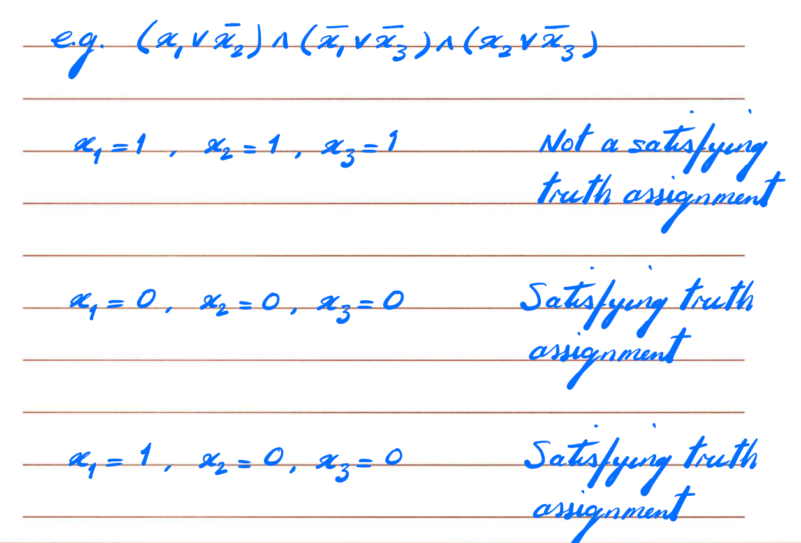

其实这里就有例子，其实很简单很好理解的。

### SAT / 3-SAT Problems

**SAT Problem Statement**

Given clauses C₁…Cₖ，变量集合 X，问是否存在满足赋值？

**3-SAT Problem Statement**

每个子句长度 = 3（正好有 3 项），问是否可满足。3-SAT 是 SAT 的特例：每个子句都刚好有 3 个项，比如 (x₁ ∨ ¬x₃ ∨ x₅)。

**Claim: 3-SAT ≤ₚ Independent Set**

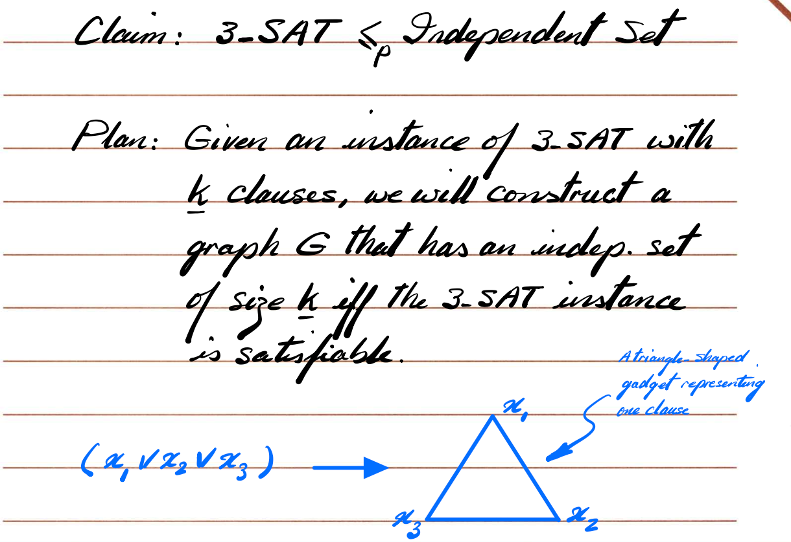

我们要证明 3-SAT 能多项式归约到独立集 Independent Set。

首先这个三角形还是很好理解的：

$x_1 \or x_2 \or x_3$， 三个不能同时选1，所以就是放到一个三角形中。 

> 三角形的含义是：
>
> **一个子句里只能选 1 个点进入独立集（因为三角形里任意两个都相邻）。**
>
> 这等价于：
>
> **一个子句里只能选择一个 literal 为真。**

**为什么 xᵢ 和 ¬xᵢ 不能同时选？**

因为它们的含义是：

- 选 xᵢ = 把 xᵢ 设为 TRUE
- 选 ¬xᵢ = 把 xᵢ 设为 FALSE

这两个东西**不能同时为真**，否则就矛盾。

所以：

==**我们必须禁止 independent set 同时包含 xᵢ 和 ¬xᵢ。**所以就连到一起。==

***

==现在的重点是，如何证明这个关系：**Claim: 3-SAT ≤ₚ Independent Set**==

同样也是需要两个方向：

>  **A) If the 3-SAT instance is satisfiable…**
>
> **中文解释：**

> 如果 3-SAT 有满足赋值：
>
> - 每个子句至少有一个 literal 为真
> - 所以每个 triangle gadget 里至少有一个节点“代表真”
> - 从每个 triangle 选一个真节点 → 得到 k 个节点组成集合 S
>
> PPT 图画的蓝色 aᵢ 与红色边是说明：
>
> - xᵢ 与 ¬xᵢ 不会同时为真
>
> - 因此不会同时被选
>
> - 所以不会形成边
>
>   → S 是 independent set
>
> **第七页：第二方向证明（⇐）**
>
> **B) Suppose G has an independent set S of size ≥ k**
>
> **中文解释：**
>
> 如果 G 有一个大小至少为 k 的独立集：
>
> - 每个三角形只能贡献 1 个节点
> - 所以 independent set 必须选择每个子句的一个 literal
>
> 因此我们从 S 反向构造赋值：
>
> - 如果 xᵢ 出现在 S → xᵢ = 1
> - 如果 ¬xᵢ 出现在 S → xᵢ = 0
> - 如果两个都没出现 → 随便 0 或 1
>
> 得到的赋值一定满足所有子句。

==有点像网络流的证明，从两个方向证明即可，感觉不是特别难，是可以理解的。==

## Efficient Certification

### Intro

高效认证

A problem has efficient certification if, given a solution, the correctness of the solution can be confirmed in polynomial time.

如果给你一个“候选解”，你能在 **多项式时间** 内检查“这个解是否正确”，那么这个问题叫做 **有高效认证能力**。

> [!tip]
>
> 这里不是要你“求出”解，只是“验证别人提供的解是否对”。

To show efficient certification, we need:

1. polynomial length certificate
2. polynomial time certifier

1️⃣ 多项式长度的 certificate（证明/解 保证是短的）

certificate = 别人给你的“候选解”

要求：这个解的大小 ≤ 输入大小的多项式，不然你不能在多项式时间读完它。

例如：

- SAT 的 certificate = 每个变量的 TRUE/FALSE

  → 长度就是 n，完全是多项式

2️⃣ 多项式时间 certifier（检查算法必须快）

certifier = 验证算法

它检查 certificate 是否真的满足要求。

例如：

- SAT：把赋值带入每个子句检查 → 多项式
- Independent Set：检查是否有两个点相邻 → 多项式

### 3-SAT's efficient certification

Certificate t is assignment of truth values to variables xᵢ.

SAT 的 certificate 就是：每个变量的真假（0/1），满足多项式长度（n）。

Evaluate the clauses. If all evaluate to 1 → yes

certifier：把每个子句检查一遍：

- 把变量值代入子句
- 看是否有至少一个 literal 为真
- 所有子句都真 → 公式满足 → 回答 YES

O(#clauses × length_of_clause) → 多项式

所以 **3-SAT ∈ NP**。

### Independent Set's efficient certification

Certificate t is a set of nodes of size ≥ k

Independent Set 的 certificate：

- 别人给你一个点集 S
- 声称 S 是一个独立集 AND |S|≥k

这个集合大小不会超过 n → 多项式长度。

**Certifier**

- Check each edge has NOT both ends in S
- Check size ≥ k
- Check no repeating nodes

certifier 做三件事：

1️⃣ 检查 S 是否真的没有相邻节点

→ 对图中每条边(u,v)，看看是否 u,v 都在 S

→ 如果有一条边两端都在 S → 不是独立集

2️⃣ 确认 S 的大小 ≥ k

3️⃣ 检查 S 里没有重复节点

所有检查都是 ==O(#edges)== → 多项式。

所以 Independent Set ∈ NP。

### The Def. of the NP

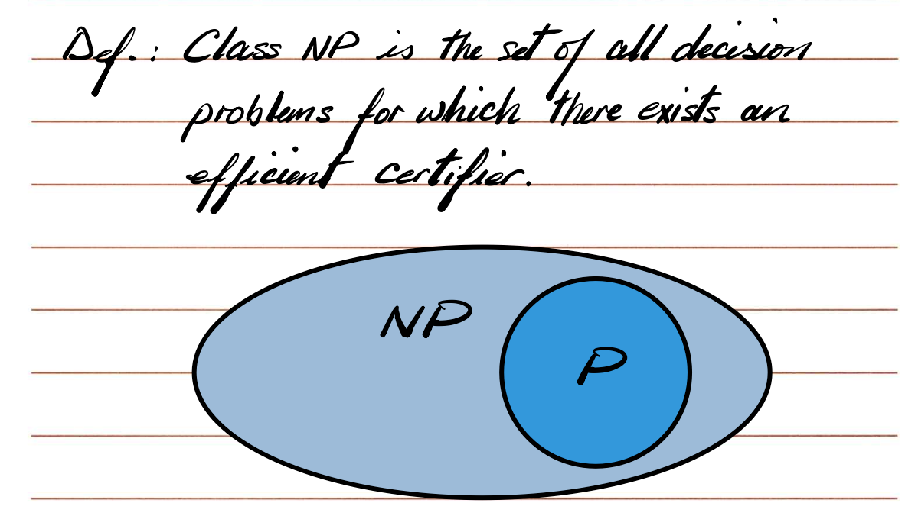

Class NP is the set of all decision problems for which there exists an efficient certifier.

NP = 所有“能高效验证”的问题集合。

注意：NP 不是“不确定性”的意思，是 **Nondeterministic Polynomial**。

### P v.s. NP

All problems in P are in NP. 如果你能很快“求解”（P），那肯定能很快“验证”。

**Are all problems in NP in P? i.e., is P = NP? We don’t know. This is an open problem.**

→ 世界未解决大难题

→ 没人知道答案

### NP-hard and NP-complete

If X ∈ NP and ∀ Y ∈ NP, Y ≤ₚ X, then X is the hardest problem in NP.

- X 在 NP
- NP 里所有问题都能多项式归约到 X

那么 X 就是 NP 里最难的问题 → NP-complete。

**3-SAT is the hardest problem in NP**

已证明 3-SAT 是 NP-complete。

### Transitivity

transitivity in polyn. time reduction

If Z ≤ₚ Y and Y ≤ₚ X then Z ≤ₚ X 这个也是很好理解

规约是可以传递的。这是证明 NP 完全性的核心技巧。

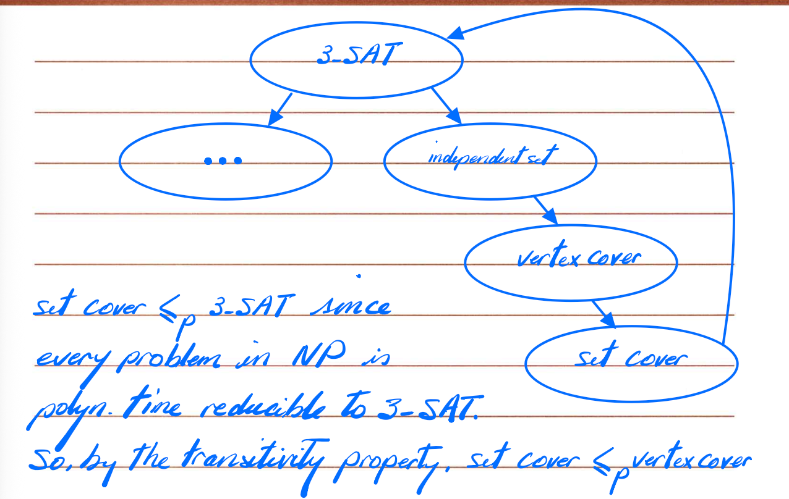

这个是NP的经典传递链条

### Basic strategy to prove a proble X is NP-Complete

1. Prove X ∈ NP
2. Choose known NP-complete Y
3. Prove Y ≤ₚ X

### Def. of NP-hard

NP-hard = at least as hard as NP-complete problems.

一个问题 NP-hard：

- NP 里所有问题都能归约到它

- 可能比 NP 还难

- 不要求它在 NP 中（可能不是判定问题）

例如 TSP 优化版就是 NP-hard，但不在 NP。

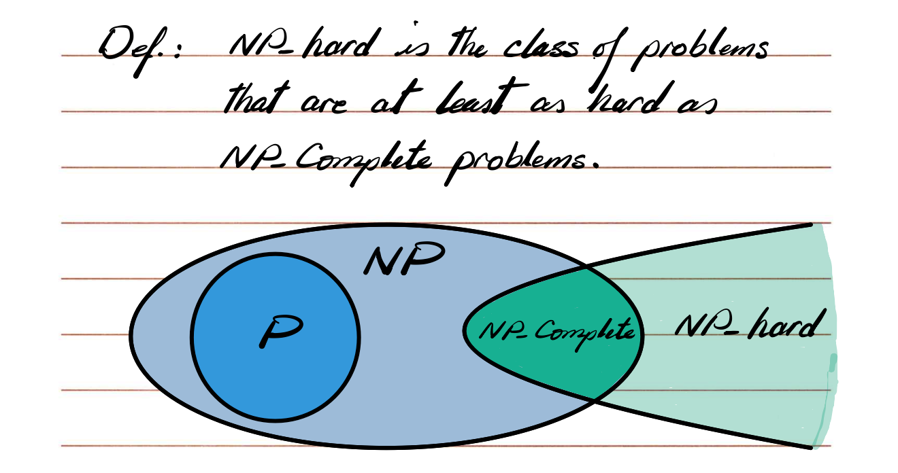
