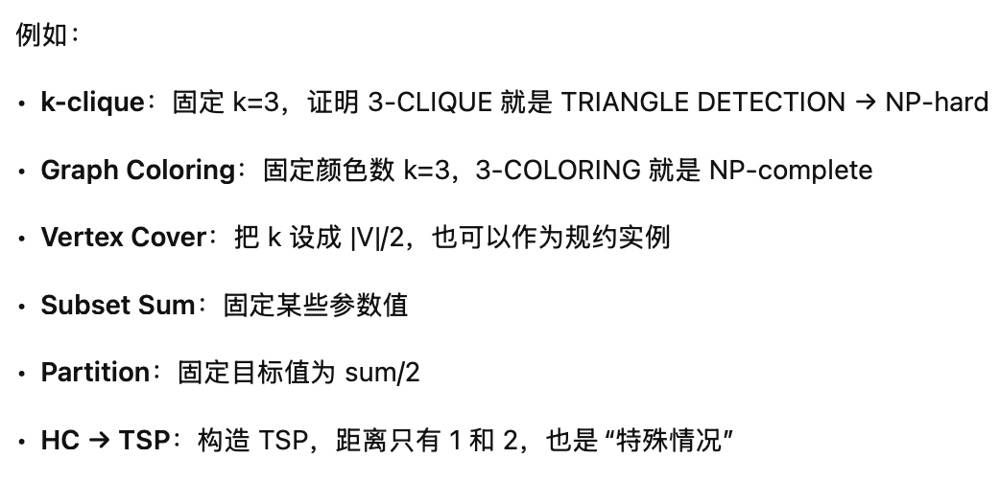

# Homework11-CN

- [Homework11-CN](#homework11-cn)
  - [Question1](#question1)
  - [Question2](#question2)
  - [Question3](#question3)

## Question1

Given an undirected graph $G=(V,E)$, and positive integer $k$, the max-degree-spanning-tree (MDST) problem asks whether $G$ has a spanning tree whose degree is at most $k$. The degree of a spanning tree T is defined as the maximum number of neighbors a node has within the tree (i.e., a node may have many edges incident on it in G, but only some of them get included in T). Show that the max-degree-spanning-tree (MDST) problem a) is in NP. (4 pts) b) is NP-hard. (16 pts)

第一步证明属于np很简单。

**第二步如何构造是重点：**

给定哈密顿路径问题的一个实例 G = (V,E)，我们构造 MDST 的一个实例 (G', k) 如下：

- 令 G' = G（图保持不变）。
- 设定 k = 2。

这个变换显然是多项式时间的（实际上是线性时间），因为只是复制了图并把 k 设为常数 2。

> [!note]
>
> 在 NP-hardness 证明里，我们可以选择 **任何我们喜欢的 k 值**，只要规约是合法的、多项式时间的即可。
>
> 

当k=2的时候就很简单了，度<=2的树其实就是一个路径，刚好对应一个HC。

## Question2

**规约构造的核心步骤（从 HC 到 2-cycle-decomposition）**

输入：HC 的实例 G=(V,E)，假设 |V| \ge 3，G 连通。

构造新的图 G' 和参数 k,a_1,a_2：

1. **保留原图 G 的所有点、边。**

2. **加三个新点**：x,y,z。

3. 在这三个点之间加边

   (x,y), (y,z), (z,x)，

   形成一个**三角形**（3-cycle）。

4. 为了让整个图连通，只在原图里任选一个点 v_0，

   再加一条边 (x, v_0)。

   **注意：新点只通过 x 连到原图，y 和 z 只和 x、彼此相连。**

5. 设置参数：

   - k = 2
   - a_1 = |V|（要求一个环大小等于原图的点数）
   - a_2 = 3（另一个环大小为 3）

6. 新图的顶点数是 |V'| = |V| + 3，

   所以 a_1 = |V| < |V'|，a_2 = 3 < |V'|，满足题目 ai < |V|（这里的 |V| 指的是新图 G' 的顶点数）。

**直观正确性（只讲感觉）**

- **如果原图 G 有哈密顿环 C：**

  - 第一个环：就用 C，把所有老顶点 V 串成一个 size = |V| 的环；
  - 第二个环：用新加的三角形 (x,y,z,x)，size = 3；
  - 两个环不相交，共同覆盖了 V' = V \cup \{x,y,z\}，大小刚好是 a_1,a_2 要求。

- **反过来，如果 G′ 能被拆成两个环，大小分别是** |V| **和 3：**

  - 因为 y、z 只连着 x 和彼此，所以**任何包含 y 或 z 的简单环**只能是三角形 (x,y,z,x)，否则会重复点；

  - 所以 size=3 的那个环必须是这个三角形；

  - 那么剩下的 size=|V| 的那个环就只能全部用原图里的点 V，

    这条环访问每个原顶点恰好一次 → 正是原图的 Hamiltonian Cycle。

这样就实现了：

> G 有 HC ⇔ G′ 上存在一个 size=|V| 和一个 size=3 的环分解，覆盖所有点。

所以 HC 可以多项式时间规约到 k-cycle-decomposition（k=2），

从而说明 k-cycle-decomposition（对任意 k>1）是 NP-hard。

## Question3

Given a graph G = (V , E) with an even number of vertices as the input, the HALF-IS problem is to decide if G has an independent set of size $|V|/2$. Prove that HALF-IS is a) is in NP. (4 pts) b) is NP-hard. (16 pts)

**构造的真正含义**

你可以把整个规约理解为：

> **把图补到一个“刚好一半等于 k”的大小，并且强迫 HALF-IS 必须从原图里选点。**

具体做法：

1. 原图有 n 个点
2. 我们需要最终图有 2k 个点（因为 HALF-IS 要选一半，也就是 k）
3. 所以加入 (2k – n) 个新点
4. 把这些新点连成一个 clique
5. 再把 clique 里的每个点连接到原图所有点

结果是什么？超级重要：

- clique 本身不能选
- clique 和原图的点之间也连着 → 只能选原图点
- HALF-IS 要选半数 = k → 必须在原图里选 k 个
- 而原图里只有 Independent Set 问题能保证是否能选到 k 个互不相邻的点
- 所以 HALF-IS 解出 YES/NO，就是原图 Independent Set 的 YES/NO

***

