## TSP & Hamiltonian Cycle

- [TSP \& Hamiltonian Cycle](#tsp--hamiltonian-cycle)
  - [Important](#important)
  - [Problem Overview](#problem-overview)
  - [Show that the Hamiltonian Cycle Problem is NP-Complete](#show-that-the-hamiltonian-cycle-problem-is-np-complete)
  - [Proof](#proof)
  - [Prove that TSP is NP-Complete](#prove-that-tsp-is-np-complete)
  - [Prove that $\\text{HC} \\le \_p \\text{TSP}$](#prove-that-texthc-le-_p-texttsp)
- [Set of known NP-Complete problems](#set-of-known-np-complete-problems)
- [Intermediate problems in NP](#intermediate-problems-in-np)
- [Triangle Inequality TSP 的 2-Approx Algorithm](#triangle-inequality-tsp-的-2-approx-algorithm)
- [The General TSP](#the-general-tsp)

### Important

这个课件P17列举了，考试的时候可能会用作 reduction 的一些 NP-Complete 问题

### Problem Overview

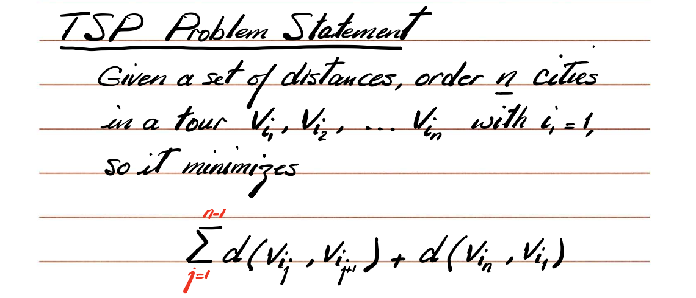

给定：

- n 个城市 $v_1, v_2, ..., v_n$
- 两两之间的距离 $d(v_i, v_j)$

目标：

找一个从 $v_1$ 到 $v_n$ 再回到 $v_1$ 的环，使得 **总距离最小**。

公式：
$$
\sum_{i=1}^{n} d(v_i, v_{i+1}) + d(v_n, v_1)
$$
**Decision version of TSP**

Given a sset of distances on n cities and a bound D, in there a tour of lenght/cost at most D?

**Def. of Hamiltonian Cycle**

A cycle C in G in a Hamiltonian Cycle if it visits each vertex exactly once.

一个 cycle，如果它 恰好访问所有节点一次，就是 HC。

**HC Problem Statement**

Given an undirected graph G, is there a Hamiltonian Cycle in G?

### Show that the Hamiltonian Cycle Problem is NP-Complete

**1. show that the problem is in NP**

(a) certificate: an ordered list of nodes on the HC

(b) certifier: we will check the following 

- all nodes appear on the list 
- nodes only appear once
- every pair of adjacent nodes in the given order must have an edge between them
- the first and last nodes have an edge between them

**2. choose vertex cover as the problem known to be NP-Complete**

we need to show that $\text{Vertex Cover} \le _p \text{HC}$

Plan: Given an undirected graph $G = (V, E)$ and an integer $k$, ==we construct $G' = (V', E')$ that has a Hamiltonian Cycle iff G has a vertex cover size at most $k$.==

方案：给定一个无向图 $G = (V, E)$ 和一个整数 $k$，我们构造一个图 $G' = (V', E')$，使得 $G' 具有哈密顿回路当且仅当 G 的顶点覆盖大小至多为 $k$。

‼️

Construction of G'

For each edge $vu$ in G, G' will have on gadget $w_{uv}$ with following node labeling: 

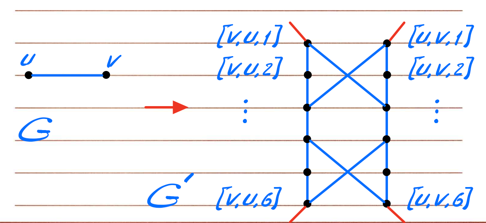

**为什么需要 gadget？**

因为它“强制” Hamiltonian Cycle 在通过某条边对应的 gadget 时，只能有三种通过方式，分别对应 vertex cover 中三种“谁覆盖这条边”的情况。

**如何区分：**

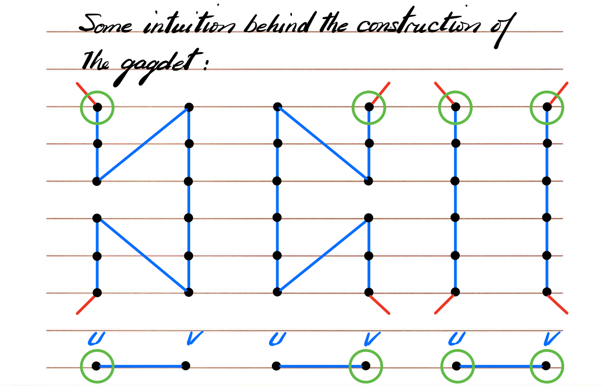

> [!important]
>
> There are only 3 ways that a HC can go through all the node of one gadget. These three ways correspond to the 3 ways that an edge can be covered in the vertex cover problem.

**==这个构造很重要，因为这个构造对应了 vertex cover 问题中的三种形态==**

要记住，我觉得有可能会考一个类似的构造！

==The gadget is constructed such that if a HC enters the gadget on one side, it has to leave the gadget on the same side.==

Other vertices in G'

- selector vertices: there are k selector vertices in G', S1, ..., Sk

Other edges in G'

- for each vetex $u \in V$, we add edges to join airs of gadgets in order to form a  path going through all the   gadgets in order to form a path going through all the gadgets corresponding to edges incident on node u in G.
- then, final set of edges in G' join the first vertex [X, Y, 1] and the last vertex [X, Y_deg(x), 6] of each of these paths to each of the selector vertices

**Selector Vertices：**

- 有 k 个，分别是 S_1, ..., S_k

- 用来表示你选择了哪些节点进入 vertex cover。

对每个原图节点 u，会把所有与 u 相关的 gadget 串成一条路径（page 7 下半部分）。

| 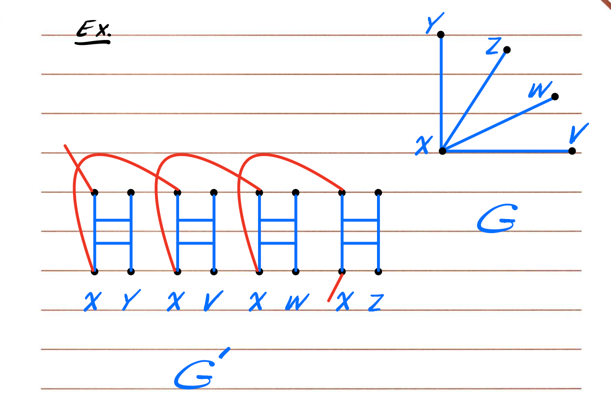 | 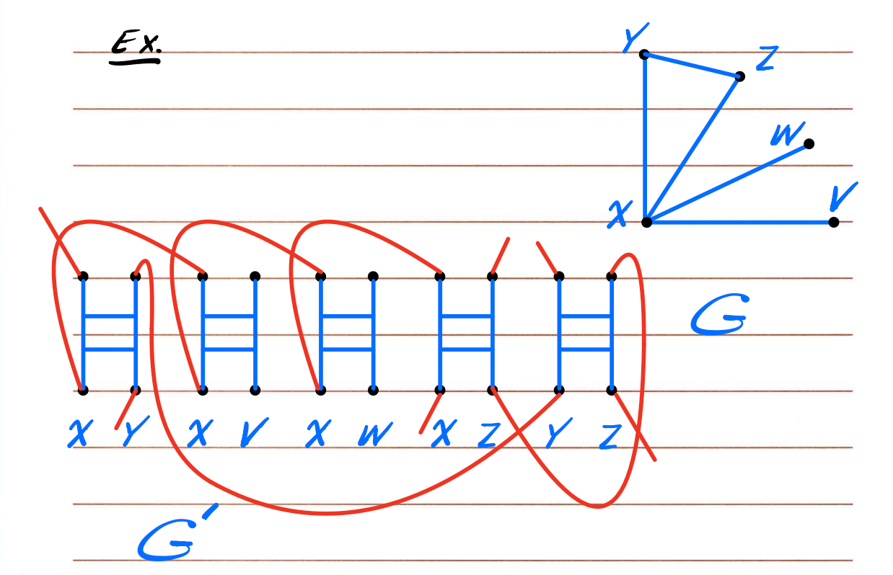 |
| ------------------------------------------------------------ | ------------------------------------------------------------ |

对于这个图2，为什么是这样呢，要抓住这些点：

- 首先，一个gadget左右分别是一个节点，这个很好理解。图2中的X-V，因为V本来就是一个终端点，没有别的边连接，所有这里右边是空的，这个没毛病，比如X-Y，因为Y是有连接的，所有Y要和Y-Z中的Y连起来，这个没毛病。
- 目前先理解这样

这样 HC 会从某些 selector 节点进入某个 u 的 gadget path，表示“选择了 u”。

***

**p10, k=1和k=2的例子，非常关键**

| 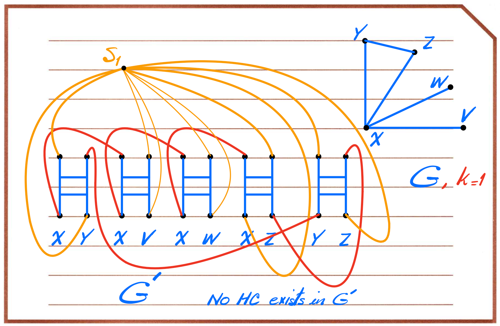 | 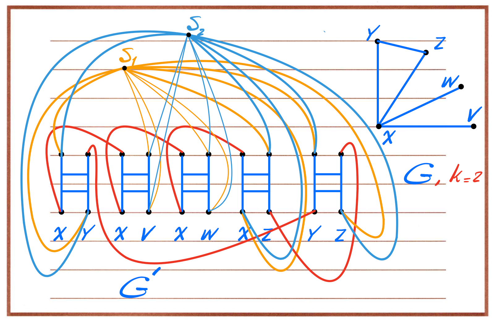 |
| ------------------------------------------------------------ | ------------------------------------------------------------ |

***

构造的中文解释。

**1. Selector 节点 S₁…Sₖ 是什么？为什么要引入？**

Vertex Cover 问题：

给定 G、k，问是否存在大小 ≤ k 的 VC。

当我们想把 VC ≤p HC 时，我们必须让：

- HC “选择”某些节点（最多 k 个）
- 这些被选的节点就是 VC

==**Selector 节点 S₁…Sₖ 就是模拟“我们选了 k 个节点”**。==

具体做法：

**一个 selector Sᵢ 对应“选第 i 个节点用于 cover edges”**

例如：

- S₁ 连接到节点 X 的 gadget path → 表示“我选择 X 作为 VC 中的第一个节点”
- S₂ 连接到节点 Y 的 gadget path → 表示“我选择 Y 作为 VC 中的第二个节点”

因此：

**Selector 节点就是：Hamiltonian Cycle 用来“游标选择 VC 中节点”的工具。**

**2. 为什么 selector 要连接到每个节点 u 的 gadget path 的两端？**

因为：

每个节点 u 的所有 edge-gadgets 被串成一条路径（叫“u-path”）：

```
gadget(u, v1) → gadget(u, v2) → … → gadget(u, v_deg(u))
```

**如果 HC 想走节点 u（表示选择 u），它必须：**

- 从 selector Sᵢ 进入 u-path 的“起点”
- 穿过所有 gadget（表示 u covers all incident edges）
- 从 u-path 的“终点”出去到 selector Sᵢ₊₁

因此：

> **selector Sᵢ 必须同时连接到 u-path 的头部和尾部。**

这在图上就是：

Sᵢ → (u, v₁) 的入口

Sᵢ → (u, v_last) 的出口

否则 HC 走不到完整的 u-path。

**3. Page 10 到底在画什么？**

Page 10 上的两张图是这个意思：

**Case 1：k = 1（只允许选一个 VC 节点）**

你必须用 **唯一的 selector S₁** 覆盖图中所有 edge-gadget path。

画面上你会看到：

- S₁ 连到所有 u-path 的头尾

  → 因为它没有其他 selector 了，只能自己负责所有 cover

结果：

**G’ 无法形成 Hamiltonian Cycle**

为什么？

**因为 1 个 selector 不能同时“串”这么多 u-path**

想象你是 HC：

- 你从 S₁ 出发
- 你必须进入某个 u-path（比如 X 的）
- 走完后必须从终点回到 selector
- 只有 S₁ 好，你只能回到 S₁
- 再想进入另一个节点 Y 的 path
- 但是你已经访问过 S₁ → 不能重复访问
- HC 失败，无解

所以图中写：“No HC exists in G′”

**Case 2：k = 2（允许选两个 VC 节点）**

现在你有 S₁、S₂ 两个 selector。

可以：

- S₁ → 选择节点 X（走完 X 的 path）
- 然后从 X 的结尾回到 S₂
- S₂ → 选择节点 Y（走完 Y 的 path）
- 再回到 S₁ 完成 cycle

这样就能串起来：

```
S₁ → X-path → S₂ → Y-path → S₁
```

所以第二张图比例清晰地标了两个 selector：

- 一条红线从 S₁ 连到 X 的两个端点
- 一条蓝线从 S₂ 连到 Y 的两个端点

这样整个 G′ 就形成一个合法的 Hamiltonian Cycle。

**4. 为什么 k=1 不行而 k=2 可以？**

因为：

- 你要从 HC 中访问所有 gadget
- gadget 覆盖结构要求：如果你选择节点 u，就要走完 u-path
- 走完后必须返回另一个 selector
- 但 HC 不允许重复访问节点

当 k = 1：

- 你从 S₁ 出发进入 X-path
- 出来后必须回到 S₁（因为没有 S₂）
- 但这样 S₁ 二次访问 → 违反 HC
- 崩溃

当 k = 2：

- 你从 S₁ → X-path → S₂
- 再从 S₂ → Y-path → 回到 S₁
- 一切合法

所以：

> **selector 个数 k 决定你能够选多少个节点作为 VC。**

> **HC 通过跳 selector 来“切换”不同的 cover 选择。**

**5. Page 10 的图虽然乱，本质只有一句话：**

> **k 个 selector = 允许 HC 选择 k 个节点去覆盖所有 gadget。**

> **如果只有 1 个 selector，就不够“跳转”，HC 无法覆盖所有 path，所以无解。**

**6. 最终总结让你完全记住：**

- **Selector Sᵢ 对应 VC 的第 i 个位置**
- **Sᵢ 连到所有 u-path 的头尾**
- **HC 通过 Sᵢ → u-path → Sᵢ₊₁ 来表示选择了节点 u**
- **k=1 → 只能选一个节点 → 不可能 cover 所有 edges → 无 HC**
- **k=2 → 可以选两个节点 → 覆盖所有 edge gadget → 有 HC**

***

| 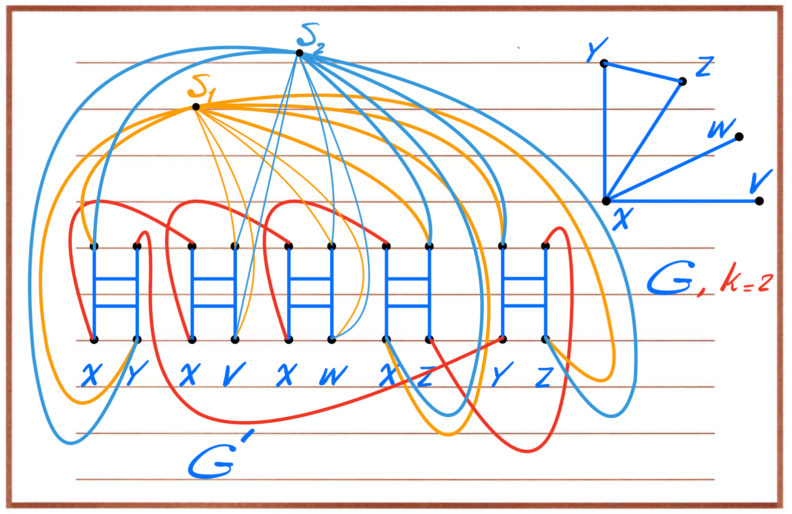 | 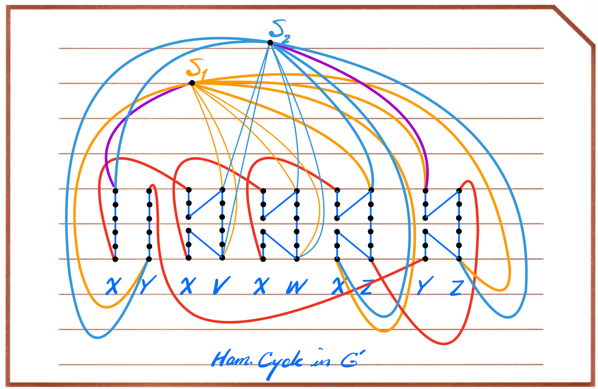 |
| ------------------------------------------------------------ | ------------------------------------------------------------ |

Edge between S1 and [X, Y, 1] indicates that S1 has selected node X

Edge between S2 and [Y, Z, 1] indicates that S2 has selected node Y

Therefore the vertex cover set identified by this HC is the set {X, Y}

### Proof

**A. 如果 G 有大小 k 的 vertex cover → G’ 有 HC**

- 从 S₁ 走到你选择的第一个节点 u₁ 的 gadget path
- 按顺序走 gadget 的内部所有节点
- 回到下一个 selector S₂
- 重复
- 最后走完 k 条 path

可以组成完整 HC。

**B. 如果 G’ 有 HC → 选出的 k 个 selector → 对应节点形成 vertex cover**

理由：

- 每段 selector S_i → gadget path → selector S_{i+1}

  这段对应原图某个节点 u 的所有 edges 被覆盖

- 因为 HC 会走过所有 gadgets

  所以所有 edges 都被覆盖

得到的 S 就是一个 vertex cover。

### Prove that TSP is NP-Complete

First, show that $\text{TSP} \in NP$

a. certificate: a tour of cost at most D

b. certifier:

- all checks we did for HC, plus
- check that cost of tour <= D

certifier这里就是首先肯定要判断是否存在汉密尔顿环（全部城市都去了一遍），然后再去判断价格是不是小于等于D就行了。

很明显，遍历一次路径即可，所以是polytime的

### Prove that $\text{HC} \le _p \text{TSP}$

构造 G’：

- 节点和 G 相同
- **G’ 是 complete graph**
- 如果 (u,v) 是 G 中的边 → cost = 1
- 如果 (u,v) 不在 G 中 → cost = 2

关键数字：

若 G 有 Hamiltonian Cycle，则 TSP-tour = n

否则，每使用 1 条“假边”（cost 2 的边）就会让 tour cost > n。

下方图展示：

- 黑色边 = cost 1
- 红色虚线 = cost 2

一旦没有 HC，就必然要使用至少一条 cost-2 边 → tour 总是 > n。

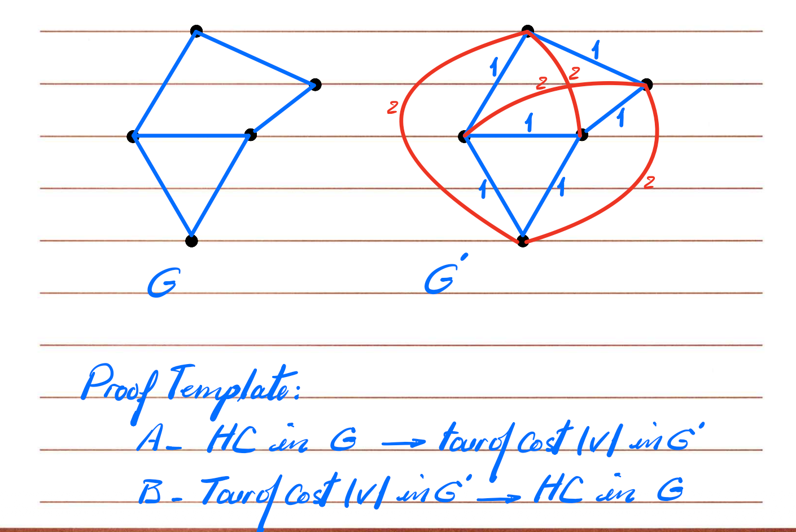

## Set of known NP-Complete problems

here are the problems that we can choose from our proof of NP-Completeness when exam

- 3-SAT
- Independent Set
- Vertex Cover
- Set Cover
- Set Packing
- Hamultonian Cycle
- TSP

we can also use the decision version of 

- 01 knapsack
- subset sum

## Intermediate problems in NP

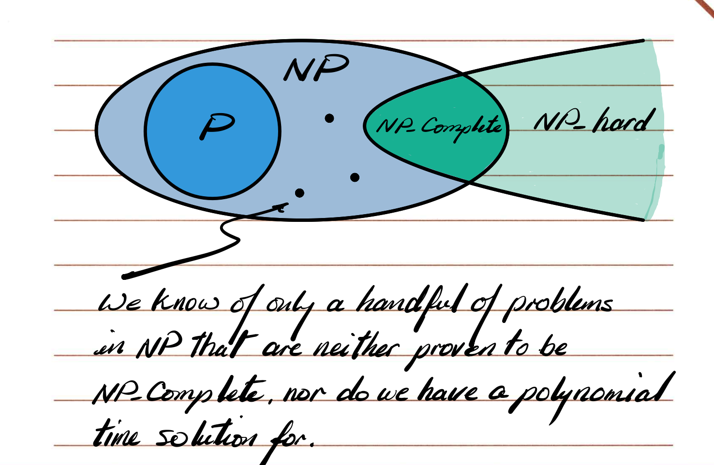

不是 NP-complete，也不知道是否能 polynomial-time：

- Graph Isomorphism
- Integer Factoring

## Triangle Inequality TSP 的 2-Approx Algorithm

**适用条件：**

距离满足三角不等式：

$d(a,c) \le d(a,b) + d(b,c)$

**算法流程：**

1. 求 MST

2. 把 MST 的边每条走两遍

   → 得到一条 Euler Tour

3. 移除重复访问的节点（shortcut）

   → 得到一个 TSP tour

4. 证明 $cost ≤ 2 × OPT$

这是经典的 **2-approx**。

图中解释：

- 蓝色：MST
- 红色：Euler Tour
- 紫色：shortcut 之后的实际 TSP tour

***

一般 TSP 是 NP-hard

→ 无法在多项式时间求最优的。

但如果 **满足三角不等式**，则我们可以找到一个 **近似解**（不是最优，但保证不太差）。

这个算法能保证：找到一个成本 ≤ 2 × OPT 的路线

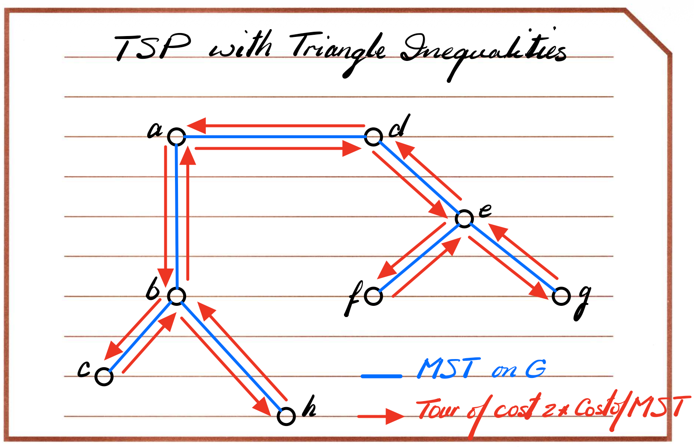

先求 MST，然后从 MST 构造一个近似 TSP-tour。

这个方法叫：**Double-Tree Algorithm**

非常经典。

1. 求MST，蓝色的就是 MST。

   - 此时很明显：**MST 的成本 ≤ TSP 最优解（OPT）的成本**
   - 因为最优 TSP-tour 也是连接所有节点的一个 cycle，去掉一条边就变成一个 spanning tree → 比 MST 还大或等于。

2. **把 MST 的每条边“走两遍” → 得到 Euler Tour**

   因为 MST 是树，每条边出现一次，但如果每条边走两遍：

   - 每条边出现两次
   - 每个节点的度变成偶数
   - 得到 **Eulerian graph**（必定存在 Euler Tour）

   这个 tour 会经过节点多次，因为它是：一个每条边都走两次的路径

   成本 = 2 × MST 成本 ≤ 2 × OPT

3. **Shortcut（删除重复访问的节点）**
   - Euler Tour 可能反复经过某节点，比如：`A → B → A → C → A → D…`
   - 因为满足三角不等式：直接从前一个访问节点跳到下一个新节点，会变得更短，不会更长。
   - 所以 `A->B->A->C` 可以变成 `A->B->C`
   - 因为 $d(B,C) \le d(B,A) + d(A,C)$
   - 这样删掉重复节点后，就得到一个 **合法的 TSP tour**
4. **得到 TSP Tour（保证 ≤ 2 × OPT）**
   - 不超过 2 × MST
   - 不超过 2 × OPT
   - 是一个合法的 TSP 巡回路（每个城市访问一次）

总结：

> - 求 MST
> 2. 把 MST 边全部走两遍 → Euler Tour
> 3. 去掉重复访问节点（shortcut）
> 4. 得到 TSP 的近似解

**为什么和之前的 TSP NP 完全性没有冲突？**

因为：

- **一般 TSP（不满足三角不等式）没有任何常数近似 → APX-hard**
- **但特殊版本（metric TSP）可以做到 2-approx**

## The General TSP

Theorem: If $P \ne NP$, then for any constant $p \ge 1$, there is no polynomial time approximation alg. with approximation ratio p for the gernal tsp.

如果 P ≠ NP, 则 **任意常数 c** 都不存在一个 c-approximation for general TSP。

证明思路（高层）：

- 若存在常数近似算法
- 就可以把 HC 归约成 TSP
- 用这个算法区分“是否存在 HC”
- 会导致 P=NP

因此 general TSP 是 **APX-hard**。
