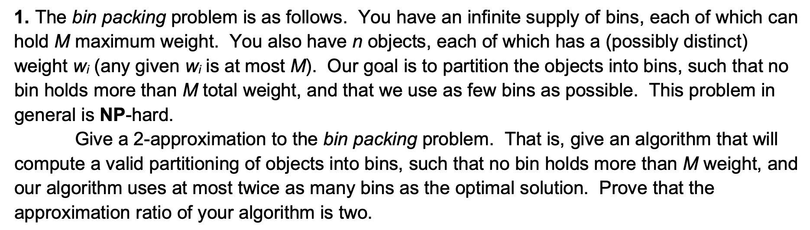
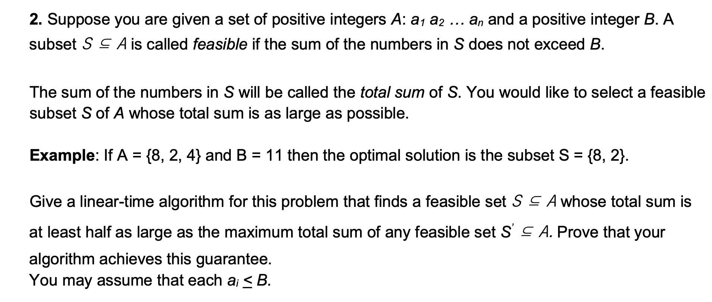
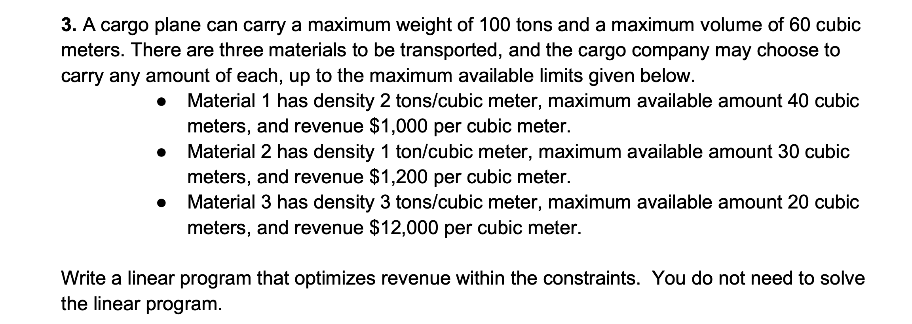
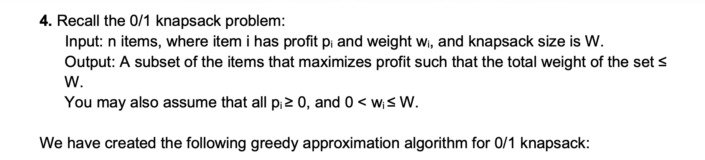
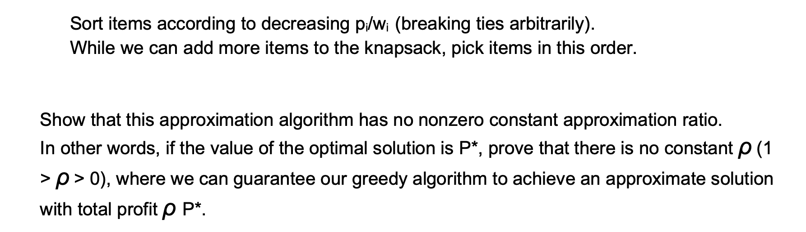
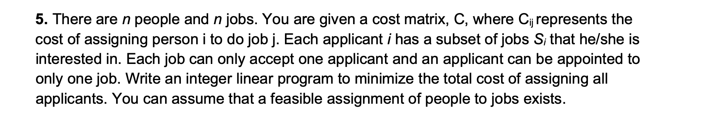
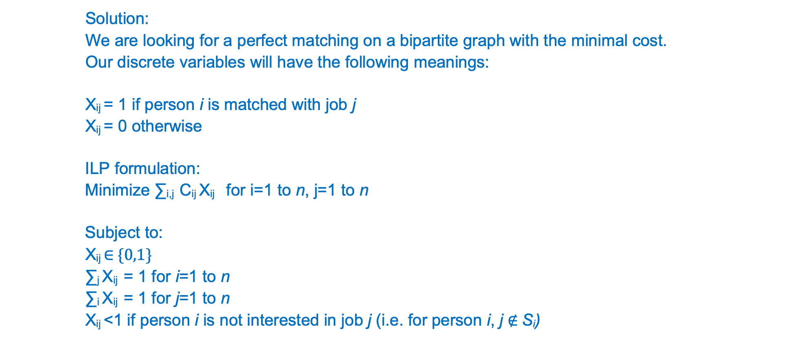

# DIS12

[TOC]

## ‼️Q1

**Algorithm (Next-Fit):**

Process items in the given order.

Put each item into the current bin; if it does not fit, start a new bin.

**Proof of 2-approximation:**

1. Whenever we open a new bin (bin i+1), the current item of weight w did not fit into bin i, so

   $\text{load}(bin_i) + w > M$.

2. Since bin (i+1) contains that item (weight ≥ w),

   $\text{load}(bin_i)+\text{load}(bin_{i+1}) > M$.

3. Therefore, for every pair of consecutive bins (1,2), (3,4), (5,6), … in our solution,

   the total weight exceeds M.

   Any feasible packing (OPT) must use **at least one bin** to hold the items in each such pair.

4. If our algorithm uses 2k bins, there are k such pairs, so

   $OPT \ge k.$

5. Hence:

   $\frac{ALG}{OPT} \le \frac{2k}{k} = 2$.

Thus Next-Fit is a **2-approximation algorithm** for bin packing.

> [!important]
>
> **每次开新 bin 就意味着前一个 bin 已经非常满，所以每一对相邻的两个 bin 的总重量都大于 M，而 OPT 至少需要一个 bin 来装这些重量> M 的物品，于是整个算法最多比 OPT 多用 2 倍的 bin。**

> [!note]
>
> 这题其实是很简单的，就是直接拿，所以这个要记住！

## ‼️Q2

**题目要求的大白话**

给你一堆正整数 a₁, a₂, …, aₙ

还有一个限制 B。

你要选一些数，让它们的总和 ≤ B

并且尽可能大。

但是我们不求最优，只要保证：

> **我们找到的和 ≥ 最优解 OPT 的一半（≥ OPT/2）**

并且算法要 **O(n)**。

**最重要的观察（你靠这个能秒做此题）**

因为每个 aᵢ ≤ B

所以最优解的总和 OPT ≤ B。

所以如果你找到一个和 ≥ B/2

那一定 ≥ OPT/2

因为 OPT ≤ B。

所以问题变成：

> **怎么保证我们找到一个 ≥ B/2 的和（或者一个 ≥ B/2 的单个元素）？**

**线性时间算法（大白话）**

从左到右依次把元素加入集合 S：

1. **不断加，直到总和 ≥ B/2：**

   **→ 找到了 1/2-approx**

2. 如果某次加法让 S 的总和 > B：

   → 说明刚刚加入的这个 ai 自己就 > B/2

   → 那就直接输出 {ai}（一个元素的集合）

   （因为 ai > B/2 ≥ OPT/2）

3. 整个过程 O(n)

就是这么简单。

**这就是题目蓝色答案说的：**

> 如果加着加着超过 B/2，就达成 1/2-approx

> 如果某个元素 ai 本身 > B/2，那它自己就是一个 1/2-approx

**为什么这是 1/2 approximation？（最简单证明）**

只有两种情况：

**情况 1：我们凑出了 S，其和 ≥ B/2**

因为最优 OPT ≤ B

所以

$S \ge B/2 \ge OPT/2$

**情况 2：某个元素 ai 自身 > B/2**

那么

$ai > B/2 \ge OPT/2$

两种情况都满足 >= OPT/2

→ 1/2-approx 成立。

**考试万能模板（你直接背）（最简洁版）：**

**Algorithm (linear time):**

Scan items a₁, a₂, …, aₙ from left to right and maintain a running sum S.

- Add items to S while S ≤ B.

- If S ever becomes ≥ B/2, return S.

- If adding aᵢ makes S > B, then aᵢ > B/2 (because S ≤ B before adding).

  Return {aᵢ}.

**Approximation proof:**

Since all aᵢ ≤ B, any feasible solution has total sum OPT ≤ B.

There are two cases:

1. We return a set S with total ≥ B/2.

   Then

   $S \ge B/2 \ge OPT/2$.

2. We return a single element aᵢ > B/2.

   Then

   $a_i > B/2 \ge OPT/2$.

Thus the algorithm always returns a feasible solution with total value ≥ OPT/2.

This is a **1/2-approximation**.

**Running time:**

Single pass over items → O(n).

**你之后再见到类似题就按照这个模板写**

这是**subset sum approximate** 的经典构造

永远是：

- 找到一个达到 B/2 的前缀和
- 或者一个大于 B/2 的单个元素
- 保证 sum ≥ OPT/2

***

Staring from a1, place integers into the set S for as long as their total does not exceed B until we reach B/2. If at any time the total weight of the set goes above B/2 we have achieved a .5 approximation (since the optimal solution cannot have a value greater than B).

But if at some point in this process, the total has not reach B/2 and the next item in the set(ai) causes thetotal to exceed B, then we will remove all the elements in the set and replace it with ai. ai itself will give us a .5 approx since it must be greater than B/2.

Above process can of course be carried out in linear time.

## Q3

简单题

$x_1, x_2$ and $x_3$ represents the volume of material 1, 2 and 3.

Objective function: 

$\max 1000x_1 + 1200x_2 + 12000x_3$

Constraints:

$2x_1 + x_2 + 3x_3 \le 100$

$x_1 + x_2 + x_3 \le 60$

$x_1 \le 40$

$x_2 \le 30$

$x_3 \le 20$

## ‼️Q4

Consider an item with size 1 and profit 2, and another with size W and profit W. Our greedy algorithm above will take the first item, while the optimal solution is taking the second item (for W > 1). So this algorithm has approximate ratio 2/W which can go zero as we increase W.

这题是举一个反例，greedy会去选第一个物品，此时profit是2，但是optimal肯定要选W，此时profit是W

所以 OURS/OPT = 2 / W

当W越来越大的时候，这个比值趋近于0。

## Q5

这题看一下答案吧，用 $X_{ij}$ 控制这个 i-th person 是否去干这个 j-th job.

