# HW12

[TOC]

## Q1

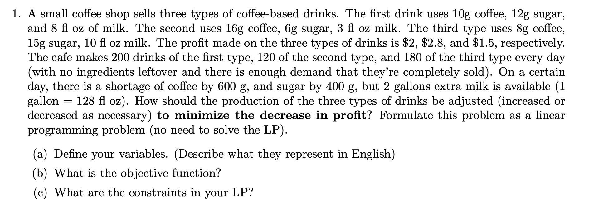

(a) Suppose the number of drinks of each type that are produced in addition to the usual be $x_1, x_2, x_3$.

> 这里是 in addition to the usual, 是差量

(b) objective function:

maximize: $2x_1 + 2.8x_2+1.5x_3$ 这个就是利润，题目让亏损的最少，就是让利润最多

(c) subject to:

$10x_1 + 16x_2 + 8x_3 \le -600$ （第1，2，3种饮料分别使用coffese的量）

$12x_1 + 6x_2 + 15x_2 \le -400$

$8x_1 + 3x_2 +10x_3 \le 128\cdot 2=256$

$x_1 \ge -200$

$x_2 \ge -120$

$x_3 \ge -180$ 这三句的意思就是，你总不能弄负数杯吧，原本第一种是200杯，你总不能减少201杯

> [!note]
>
> 这些题目不用说，答案都不止一种的，变量定义不一样答案就不一样。
>
> LP如果这样考，还是不难的，毕竟机器学习课程做了不少这样的题目

## Q2

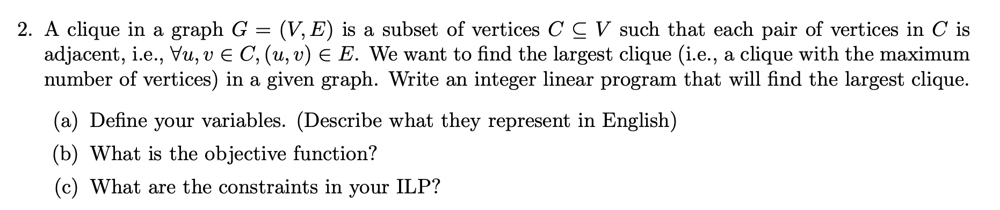

> [!note]
>
> 这种题之前没做过，不会做，现在看题目做一遍

Let $x_u$ be an integer variable that gets a value 1 if $u$ is included in the clique, and 0 otherwise. The ILP formulation is:
这里是：如果u被选入clique，则为1，否则为0。

maximize: $\sum_{u\in V} x_u$ （这个是很好理解的）

subject to: $x_u + x_v \le 1, \ \ \ \forall(u,v)\notin E$

> C 是一个 clique ⇔ **任意两个点 u, v ∈ C 都必须有边 (u,v)。**
>
> 也就是说：
>
> - 如果 u 和 v **不是相邻的（(u,v) ∉ E）**
>
>   → 那他们 **不能同时** 在 clique 里。
>
> 所以对于每一对 没有边的点 (u,v) ∉ E，必须 enforce：
>
> $x_u + x_v \le 1$

## Q3

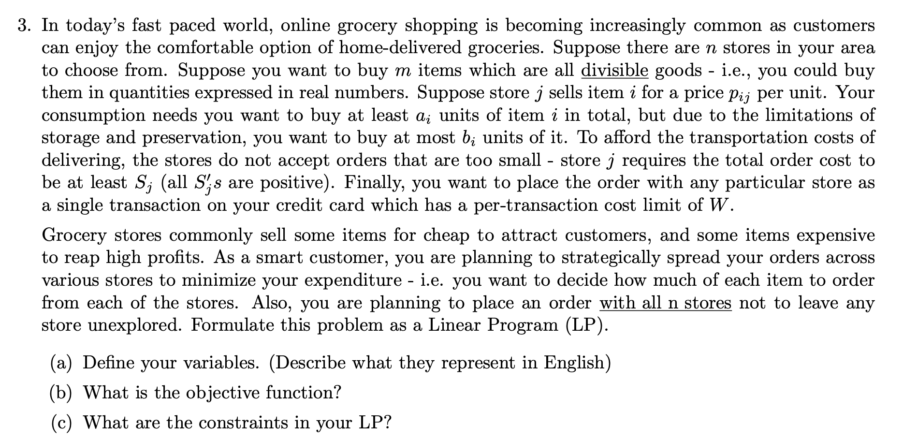

**思考：**

> i need to buy $m$ items
>
> store j sells item i in $p_{ij}$
>
> 假设 item i 在 store j 买的量为 $x_{ij}$, 则 $a_i \le \sum_{j=1..n}x_{ij} \le b_i$
>
> 然后每个store至少要买 $S_j$ cost的东西，但是单次刷卡不能超过 $W$: $S_j \le \sum_{i=1..m}x_{ij}\cdot p_{ij} \le W$
>
> 每个 store 都要买东西：$\sum_{i=1..m}x_{ij} \ge 0, \forall j=i..n$
>
> 目标：$\min \sum_{i}\sum_j x_{ij}\cdot p_{ij}$

大体是没毛病的。

> [!warning]
>
> 题目说，需要 place an order with all n stores, 这一句话并不能保证 $\sum_{i=1..m}x_{ij} \ge 0, \forall j=i..n$. 而是上面 $\ge S_j$ 这里已经保证了。
>
> 对比答案，我少了一句 $0 \le x_{ij}, \ \ \forall i, \forall j$, 保证价格都是positive

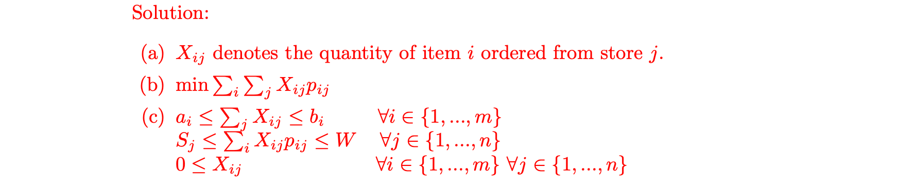

## ‼️Q4

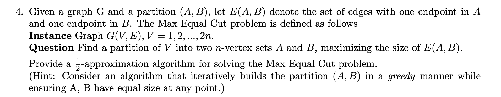

**算法要干什么？（超简单版）**

我们一次处理 **两个点 (u, v)**。

对于每一对点，我们必须让其中一个进 A，一个进 B（保证最后 A、B 一样大）。

问题是：

**把 u 放 A、v 放 B 好？**

**还是把 u 放 B、v 放 A 好？**

算法很简单：

**选那个能产生更多跨边的方案。**

就这么简单。

**为什么这样至少能得到 OPT 的一半？（关键大白话）**

假设当前我们正在处理一对点 u、v。

定义：

- u 现在对 A 中的点有 NAᵤ 条边，对 B 中的点有 NBᵤ 条边
- v 现在对 A 中的点有 NAᵥ 条边，对 B 中的点有 NBᵥ 条边

**两种放置方案带来的跨边数量：**

**方案 1：u→A，v→B**

产生的跨边数：

NBᵤ + NAᵥ

（因为 u 在 A，所以它跟 B 邻居产生跨边；v 在 B，所以它跟 A 邻居产生跨边）

**方案 2：u→B，v→A**

产生的跨边数：

NAᵤ + NBᵥ

**关键观察：**

这两个数的 **和**：

(NBᵤ + NAᵥ) + (NAᵤ + NBᵥ)

其实就是：

> **把 u 和 v 加入图后，所有可能产生的跨边。**

所以两个方案中：

- 一个最小值 ≥ 总数的一半
- 最大值 ≥ 总数的一半（我们选最大那个）

因此：

**每处理一对点，我们至少拿到该 pair 能贡献跨边的一半**

整个图的所有点被 pair 分配完 → 所有边被处理一次 → 拿到 **总跨边 ≥ |E|/2**

而 OPT ≤ |E|

所以我们的解 ≥ OPT/2

→ **1/2 approximation**。

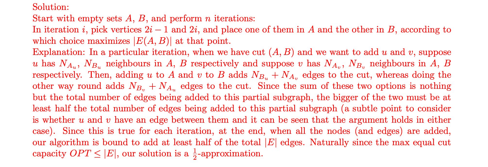

## ‼️Q5

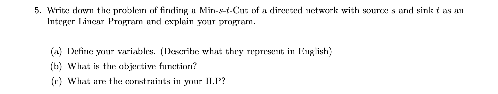

The variable $x_u$ indicates if the vertex $u$ is on the side $s$ in the cut. That is, $x_u=1$ if and only if $u$ is on the side of $s$. Likewise, the variable $x_{(u,v)}$ indicates the edge $(u,v)$ crosses the cut.

objective function: $\min \sum_{(u,v)\in E}c(u,v)\cdot x_{(u,v)}$ 跨越割的容量最小

subject to:

$x_v - x_u + x_{(u,v)}\ge 0, \ \  \forall(u,v)\in E$

$x_u \in \{0,1\}, \ \ \forall u \in V: u \ne s, u \ne t$

$x_{(u,v)}\in \{0,1\}, \ \ \forall(u,v) \in E$

$x_s = 1$

$x_t = 0$

其实就是第一个约束有点难理解：

> $x_v - x_u + x_{(u,v)} \ge 0 \quad\forall (u,v)\in E$
>
> 这啥意思？我给你翻译成**超级大白话**：
>
> **情况 1：如果 (u,v) 没跨边，则允许 $x_{uv} = 0$**
>
> - 如果 u 和 v 在同一边，
>
>   或
>
> - v 在 s-side（不可能是 cut）
>
> 这个等式自动满足。
>
> **因为不会强迫 $x_{uv}$ 必须是 1。**
>
> **情况 2：如果边 (u,v) “必须是 cut-edge”，它会强制 $x_{uv} = 1$**
>
> 什么时候必须？
>
> - 当 u 在 s 这一边（$x_u = 1$）
>
> - 且 v 在 t 这一边（$x_v = 0$）
>
> 代入约束：
>
> $0 - 1 + x_{uv} \ge 0$
>
> 得到：
>
> $x_{uv} \ge 1$
>
> 因为 $x_{uv}$ 是 0/1：
>
> $x_{uv} = 1$
>
> 完美符合 cut 的定义。
>
> **总结一下这个约束做了什么**
>
> $x_v - x_u + x_{uv} \ge 0$
>
> 就是一句话：
>
> **如果 u 在左边、v 在右边，那 $x_{uv}$ 必须 = 1（这条边必须被切）**。
>
> 否则：$x_{uv}$ 可以自由地是 0（也可能是 1，但会被目标函数最小化驱动变 0）。

## ‼️Q6

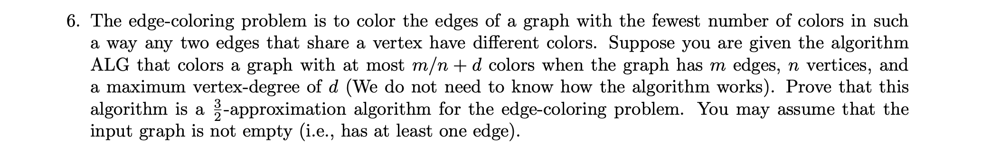

**【算法近似比证明模板（所有考试题都能用）】**

1. 找 OPT 的下界（通常来自 degree、clique、coverage、容量限制）
2. 找 ALG 的上界（通常来自简单估计，比如 m ≤ nd/2）
3. 做比值 ALG / OPT
4. 把所有东西化到同一个变量上（比如 d）
5. 取上界

**① 先找 OPT 的下界（lower bound）**

图的最大度数是 d。

什么意思？

存在一个点 v，它连接了 **d 条边**。

edge-coloring 的规则是：

> 相邻的边不能用同一个颜色。

那 v 的这 d 条边，互相都共享顶点 v，

所以这 d 条边必须用 **d 种不同的颜色**。

所以我们得到：

$OPT \ge d$

这是“天然下界”，永远成立。

**② 再找 ALG 的上界（upper bound）**

题目已经给了你：

> ALG 用 ≤ m/n + d 种颜色。

但我们想把 m/n 也变成 d 的形式，这样才能和 OPT 比。

因为最大度数是 d，所以：

- 最多有 nd/2 条边（每个点度 ≤ d，边总数 m ≤ nd/2）

于是：$\frac{m}{n} \le \frac{nd/2}{n} = \frac{d}{2}$

代回 ALG：$ALG \le \frac{d}{2} + d = \frac{3d}{2}$

这就是算法使用颜色数的上界。

**③ 算 approximation ratio**

$\rho = \frac{ALG}{OPT} \le \frac{3d/2}{d} = \frac{3}{2}$

所以是 3/2–approximation。

> [!tip]
>
> 其实这题是很简单的，就是没有掌握这种题的做题的方法。感觉像是个脑筋急转弯题目。

## Q7

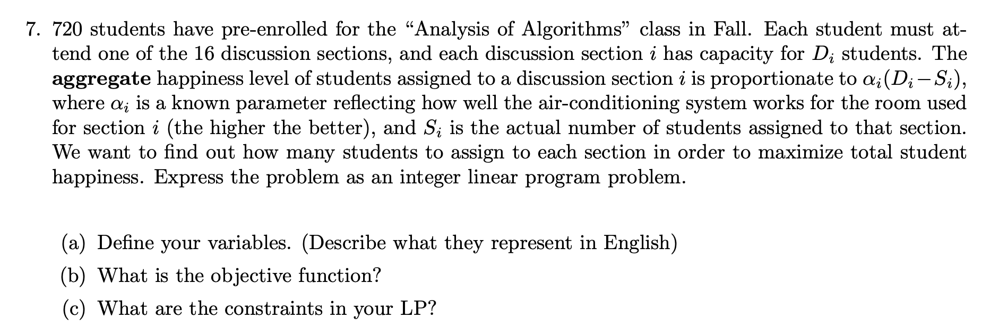

Variables: $S_i$ represents the actual number of students assigned to the i-th section.

Objective function: $\max \sum_i \alpha_i(D_i-S_i)$

Constraints:

$S_i \le D_i, \ \ \forall i < 0 \le 16$

$S_i \ge 0, \ \ \forall i < 0 \le 16$

$\sum_{i=1}^{16} S_{i}=720$, 这个不要漏掉了，总学生人数的限制

## ‼️Q8

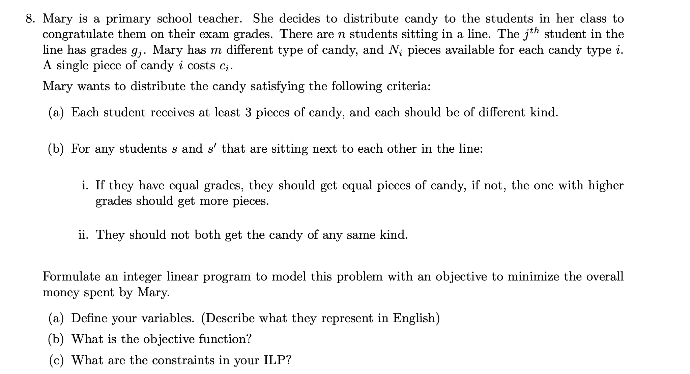

Let $X_{ij}$ denotes the number of pieces of candy $i$ given to studnent $j$.

Summing the $X_{ij}$ over $i$ gives us the total no. of pieces student $j$ has, and similarly, summing them over $j$ gives us the total no. of piece of candy $i$ used.

Objective function: $\min \sum_i \sum_j c_i X_{ij}$

s.t. 

2. $\sum_iX_{ij} \ge 3, \forall j\in\{1..n\}$, 每个人至少要有3块糖果
3. $X_{ij} \le 1, \forall j\in\{1..n\}, \forall i\in\{1..m\}$, 手上的糖果种类不能重复
4. $\sum_i X_{ij} = \sum_i X_{i(j+1)}, \forall j\in\{1..n-1\}, \text {s.t} .g_j = g_{j+1}$ 分数相同的时候，身边两个人要有相同数量的糖果
5. ‼️$\sum_{i} X_{i j} \geq \sum_{i} X_{i(j+1)}+1 \quad \forall j \in\{1, \ldots, n-1\} \text { s.t. } g_{j}>g_{(j+1)}$ 如果前面的人分数高，那么要比后面的人糖果多
6. ‼️$\sum_{i} X_{i j} \leq \sum_{i} X_{i(j+1)}-1 \quad \forall j \in\{1, \ldots, n-1\} \text { s.t. } g_{j}<g_{(j+1)}$ 反向同一道理
7. ‼️$X_{ij} + X_{i(j+1)}\le 1, \forall j\in\{1..n-1\}, \forall i\in\{1..m\}$，身边两个人不能有相同类型的糖果，又因为每个人的糖果不能重复，所以 $\le 1$ 就可以完成约束。
8. $\sum_j X_{ij} \le N_i, \forall i \in \{1..m\}$, 对于一种类型的糖果，总数不能超
9. $X_{ij} \ge 0, \forall i, \forall j$
10. ‼️$X_{i j} \in \mathbb{Z}, \forall i, \forall j$, 需要是整数

## Q9

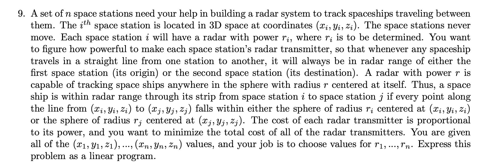

**Variables:**

$r_i$ is the power of the i-th space station's radar transmitter, $i=1..n$

**Objective function:**

$\min \sum r_i, \forall i=1..n$, 这个很简单，很好理解啊

**Constraints:**

$r_i + r_j \ge \sqrt{(x_i-x_j)^2(y_i-y_j)^2(z_i-z_j)^2}$

> [!warning]
>
> **但是题目还有一句话要求：“Describe the set of constraints… specify the number of constraints.”**
>
> 也就是说：
>
> 不仅要写出约束的形式，还要说：
>
> 👉 **一共需要多少条这样的约束？**
>
> 因为每一对空间站都需要一个约束。
>
> 组合数：
>
> $\binom{n}{2}=\frac{n(n-1)}{2}$
>
> 这就是红色答案中的：
>
> $(n² - n)/2$ constraints