# Lecture13

[TOC]

## Approximation Algorithm

Approximation Algorithm are efficient alg. that find approximate solutions to optimization problems.

**近似算法（Approximation Algorithms）**

- 场景：很多优化问题本身是 NP-hard，想要精确最优解在多项式时间里做不到。

- 做法：我们退一步，只要求“**近似最优**”，设计一个多项式时间算法，保证

  > 算法输出的解 ≤ α × 最优解

  > 这里 α ≥ 1 是一个常数，叫 **approximation ratio**（近似比）。

### Load Balancing Problem

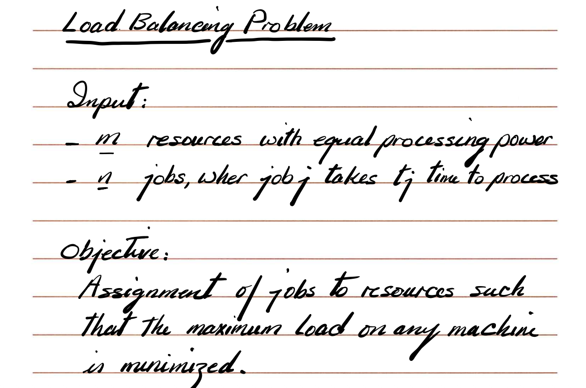

输入：

- 有 m 台机器/资源，算力一样。
- 有 n 个 job，第 j 个 job 需要时间 $t_j$。

目标：

- 把这些 job 分配到机器上，使得 **所有机器中，负载最大的那台的负载（makespan）最小**。
- 记第 i 台机器的负载为 $T_i$，最优 makespan 为 $T^* = \min\_{{\text{所有分配}}} \max_i T_i$。

$T_i$：算法得到的解中，第 i 台机器的总负载。

$T^*$：最优 makespan。

#### Greedy Balancing

按输入给的顺序处理 job（不排序）。每来一个 job，就把它丢到 **当前负载最小** 的那台机器上。

**这个算法是一个 2-approximation, 现在只是给出结论，后面再证明。$\max_i T_i \le 2 T^*$**

#### Prove that Greedy Balancing Alg. is 2-approx

思路：

1. 设机器 i 在算法结束时负载最大：

   $\max_k T_k = T_i$。

2. 设 job j 是 最后一个被放到机器 i 上的 job，且它的处理时间是 $t_j$。

此时：

$T_i = (\text{放 j 之前的负载}) + t_j = (T_i - t_j) + t_j$

关键观察：

- **(1) job 不可拆分：**任何 job 在最优解中的执行时间 ≤ 最优 makespan，所以

  $t_j \le T^*$

- **(2) Greedy 选择的含义：**当我们把 job j 放到机器 i 时，i 是当前负载最小的机器。

  因此其他任意机器 k 在那一刻的负载都 ≥ 机器 i 的旧负载：

  $T_k^{\text{当时}} \ge T_i - t_j$

- 把所有机器的负载加起来得到一个下界：

  $\sum_{k=1}^m T_k \ge m (T_i - t_j)$

- 但总负载 = 所有 job 的时间和，这个和在任何解里都一样，所以

  $m (T_i - t_j) \le \sum_j t_j \le m T^* \Rightarrow T_i - t_j \le T^*$

综合两点：

$T_i = (T_i - t_j) + t_j \le T^* + T^* = 2 T^*$

所以 Greedy Balancing 是 2-approx。

#### Improved Approximation to Greedy Balancing

Initially sort jobs in decreasing order of duration. Then use the same greedy balancing algorithm.

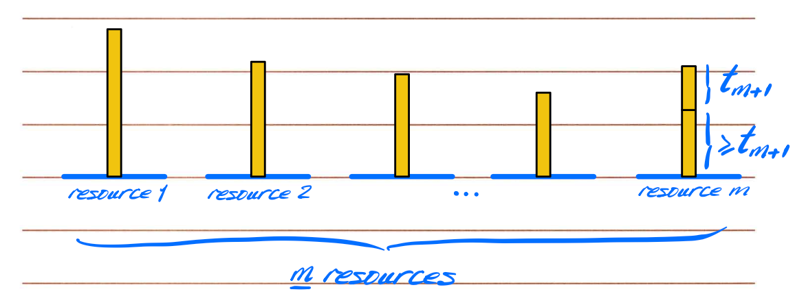

一个关键讨论：

- 如果 job 的数量 ≤ 机器数 m，那最优解当然是：**每台机器最多一个 job，且一定有最优解就是这么干**，此时把长 job 先放，算法就直接得到最优。
- 真正有趣的是 job 数量 > m 的情况，也就是会有机器分到 ≥2 个 job。

#### 排序后 Greedy 的 1.5-approx 证明（LPT 的简单版本）

略

### Vertex Cover Problem's 2-approx alg.

算法：

> S ← ∅
> while 还有边没被 S 覆盖:
>     选一条没被覆盖的边 e = (u, v)
>     把 u, v 都放进 S
> return S

为什么是 2-approx？

- 每次我们选一条“没被覆盖的”边 e，这条边的两个端点 u, v，**在任何合法的顶点覆盖里，至少要选其中一个**。

- 也就是说：每次循环至少“消费掉”了最优解中的 1 个顶点，但是我们的算法选了 2 个。

- 所以：

  - 设循环一共执行 k 次；

  - 我们的解大小 = 2k；

  - 而任意最优解大小 ≥ k。

  - 因此：

    $|S| = 2k \le 2 \cdot \text{OPT}$

### Independent Set 不能这么“反推近似”

| 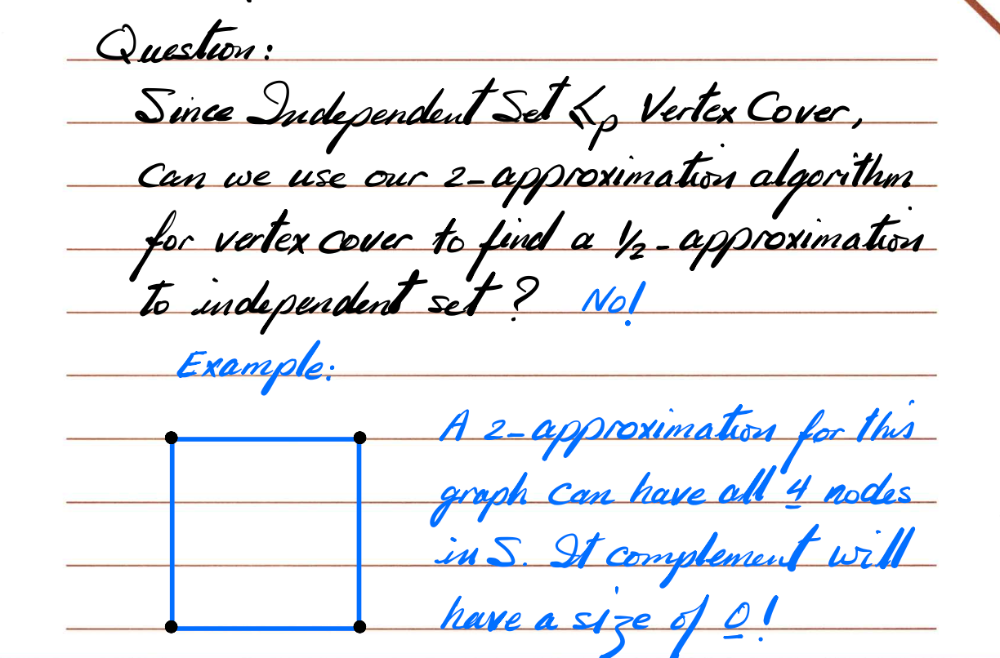 | 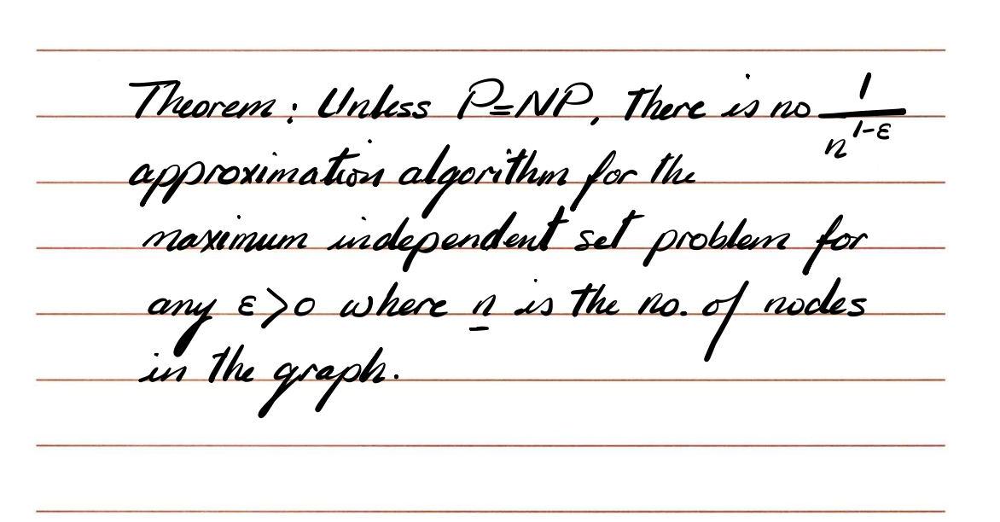 |
| ------------------------------------------------------------ | ------------------------------------------------------------ |

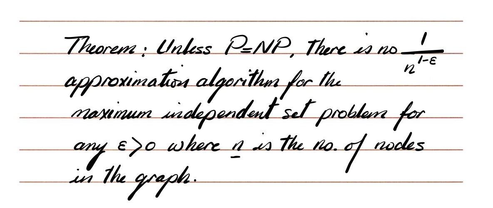Unless P = NP，**不存在**对最大独立集的“多项式时间、常数因子近似算法”，甚至连 $n^{1-\varepsilon}$ 因子内的近似都不行（对任意 $\varepsilon > 0$)。

所以 Independent Set 问题，是不能去近似的。

### 从 Vertex Cover 的近似推 Set Cover 的近似（反向是可以的）

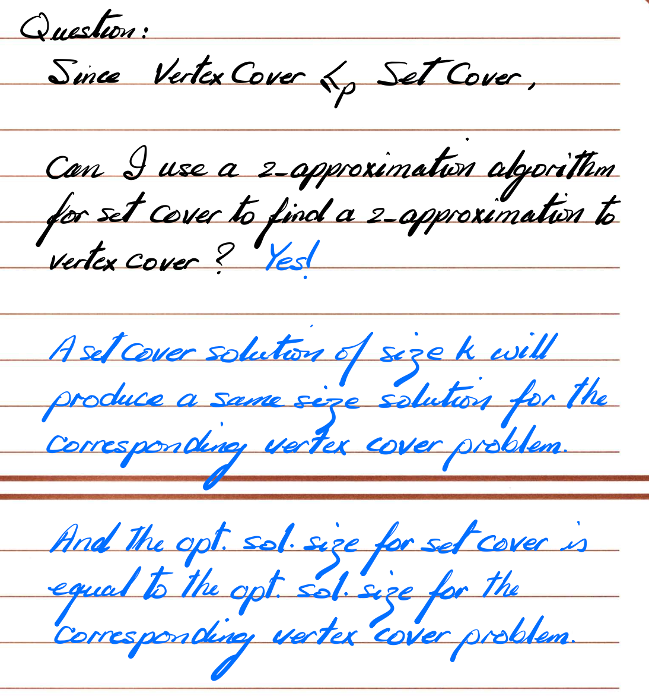

原因：规约的构造保证：

- 顶点覆盖实例 ↦ 集合覆盖实例；
- 顶点覆盖的任意解 size k ⇔ 对应集合覆盖也有 size k 的解，反之亦然；
- 最优解的大小在规约前后相同。

所以：

- 对 set cover 跑 2-approx，得到大小 ≤ 2·OPT 的集合覆盖解；
- 把它“翻译回”顶点覆盖，就是一个大小同样 ≤ 2·OPT 的顶点覆盖解；
- 因此，**set cover 的 2-approx 带来了 vertex cover 的 2-approx**。

注意对比：

Independent Set 和 Vertex Cover 的互补关系 **不是一个多项式规约**，在近似意义上不保真；

而 Vertex Cover ≤ₚ Set Cover 的规约在“解的大小”上保持得很好。

### Max-3SAT's 1/2-approx

问题：Max-3SAT

- 给一堆子句，每个子句恰好 3 个文字（literal）；
- 想给所有变量赋值，使得 **满足的子句数最大**。

简单的 1/2-approx 算法：

1. 先把所有变量都设为 True：
   - 看看有多少比例的子句被满足了。
2. 如果 ≥ 50% 的子句被满足了，就直接用这个赋值；
3. 否则，把所有变量都设为 False，这时至少有另一边达到 ≥50%。

为什么至少能保证 1/2？

- 每个子句在“全 True”和“全 False”这两种赋值下，至少有一种是满足的（直观上：如果全 True 不满足，说明三个 literal 都是负文字；那全 False 一定满足）。
- 所以，总的来说：
  - “全 True” + “全 False” 这两种赋值，加起来满足的子句数 ≥ 子句总数。
  - 因此二者中的较优一个，至少满足一半的子句。

课件最后一句提到：更复杂的方法可以做到更接近最优（比如接近 7/8 或 8/9 这样的常数因子），但不在这张课件里展开。

### 删除边得到最大 DAG 的 1/2-approx

问题：

- 给你一个有向图 G；
- 想删掉一些边，使剩下的图是 **DAG（无环有向图）**；
- 希望剩下的边数尽量多（等价于删掉的边尽量少）。

简单的 1/2-approx：

1. 随便选一个顶点顺序（v₁, v₂, …, vₙ）；
2. 把所有 **从前往后**的边保留（即 (vᵢ → vⱼ) 且 i < j 的边），把“后指前”的边（i > j）删掉；
3. 得到的图一定是 DAG，因为所有边都沿着这个线性顺序往前。

课件上说：“如果这样保留下来的边数 < m/2，就把顺序反过来再做一次（vₙ,…,v₁），两次中的较好者一定 ≥ m/2”。

直观上：

- 每条边在某个顺序下要么是“前指后”，要么“后指前”；
- 原始顺序和反向顺序中，这条边会在其中一个顺序里变成“前指后”；
- 所以两个顺序保留的边数之和 = 总边数 m；
- 因此至少有一个顺序保留的边 ≥ m/2。

而最优解最多能保留 m 条边，所以我们至少保留了其中的一半，是 1/2-approx。

## Linear Programming

### LP Overview

$[A][x] \le [b]$

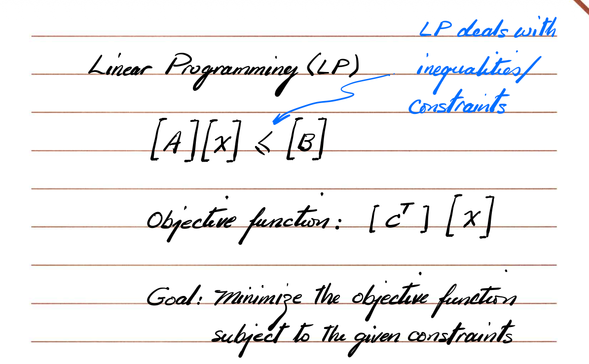

- 把“线性约束 + 线性目标函数”的优化问题写成矩阵形式：
  - 约束：$A x \le b$（不等式，可以是 ≤、=、≥，标准形式一般统一成 ≤）；
  - 目标：最大化或最小化线性函数 $[c^T] [x]$。

**Standard Form**

LP标准型：

1. 所有约束都是“≤”型；
2. 所有变量 $x_i \ge 0$（非负约束）；
3. 目标函数是“最大化”形式（最小化可以通过取负号转换）。

几何视角 & Simplex

- 约束 $A x \le b$ 描述了一个 可行区域（feasible region）：几何上是一个 凸多面体（convex polytope）。
- 线性目标函数在这个凸多面体上最大/最小的时候，一定出现在某个顶点（corner / vertex）。
- **Simplex 方法：从一个顶点走到另一个更优顶点，沿边“爬坡”，最后停在最优顶点。**

| 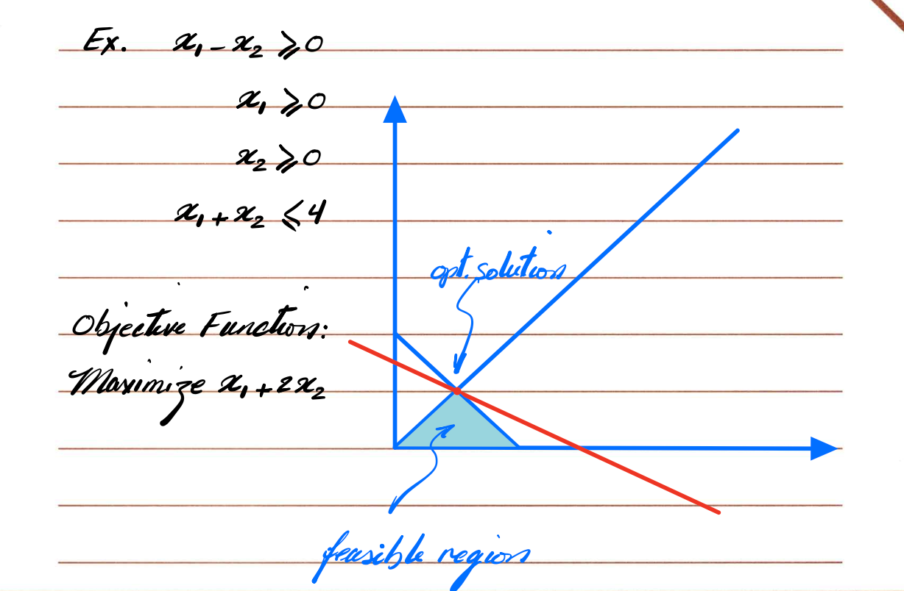 | 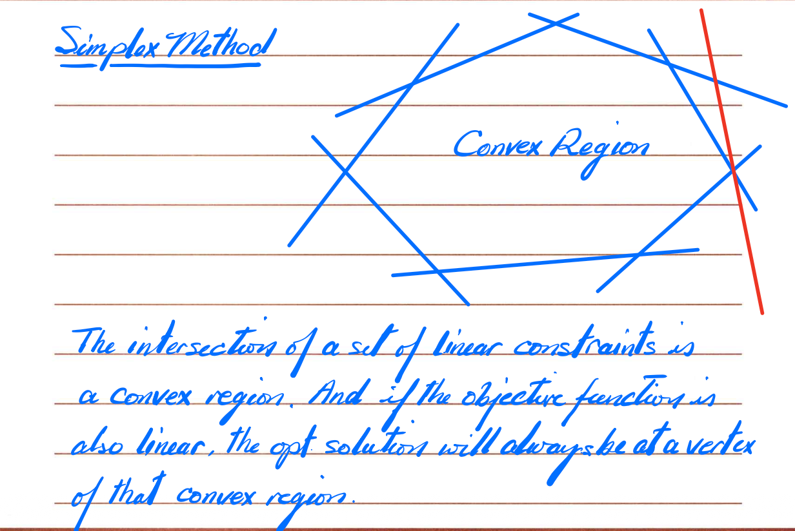 |
| ------------------------------------------------------------ | ------------------------------------------------------------ |

***

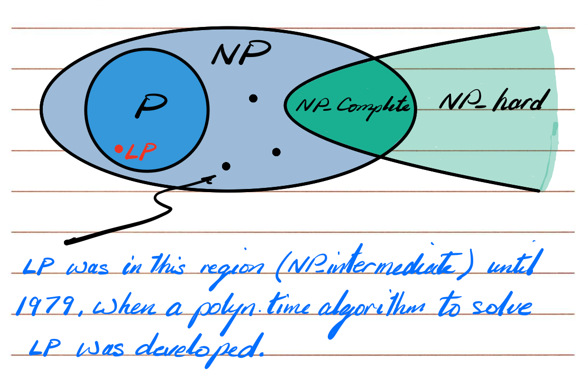

The simplex method has an exponential time worst case performance but in practice normally runs in polynomial time.

LP 的复杂度

- 早期不知道 LP 是 P 还是 NP-complete，所以曾被认为是“NP-intermediate”。
- 1979 年出现了 **ellipsoid method**，证明了 LP 可以在多项式时间内求解 ⇒ LP ∈ P。
- Simplex 算法最坏情况是指数级时间，但在实际中往往表现非常好，接近多项式时间。

### 用 LP 近似 Weighted Vertex Cover

问题：有向无向图 G=(V,E)，每个顶点 i 有权重 $w_i \ge 0$。

目标：选一个顶点集合 S 覆盖所有边（每条边至少一个端点在 S 里），同时使总权重 $w(S)=\sum_{i\in S} w_i$ 最小。

**决定变量：**

- 对每个顶点 $i$，设变量 $x_i$：
  - $x_i = 1$ 表示选这个顶点进 S；
  - $x_i = 0$ 表示不选。

边的覆盖约束：

- 对每条边 $e = (i, j)$，至少选 $i$ 或 $j$ 中的一个：

  $x_i + x_j \ge 1$

所以此时可以写成 Integer Linear Program 的形式 (ILP)

完整 ILP：

- 目标：

  $\min \sum_{i} w_i x_i$

- 约束：

  $x_i + x_j \ge 1,\quad \forall (i,j) \in E$

  $x_i \in \{0,1\},\quad \forall i \in V$

- 这是一个整数线性规划（Binary ILP），一般是 NP-hard。

***

- Linear Programming：变量连续；
- Integer Programming：变量整数；
- Mixed Integer Programming：有的变量整数，有的连续；
- Nonlinear Programming：目标或约束中有非线性项。

### LP relaxation（放松成 LP）

为了得到近似解，我们做 LP relaxation：

- 把整数约束 $x_i \in \{0,1\}$ 改成：

  $0 \le x_i \le 1$

- 其它约束不变：

  $\min \sum_i w_i x_i\quad \text{s.t. } x_i + x_j \ge 1,\ \forall (i,j)\in E;\ 0 \le x_i \le 1$

求得的解 $\{x_i^*\}$ 是一个“fractional solution”。

此时定义 LP 解的权重是：

$W_{\text{LP}} = \sum_i w_i x_i^*$

显然：

$W_{\text{LP}} \le W(S^*)$

其中 $S^*$ 是真正的最优 vertex cover，权重 $W(S^*)$，因为 LP 放松了限制，搜索空间更大，最优值只会更小。

### 阈值取整 & 2-approx 证明

我们怎么从 fractional solution 变成真正的 0/1 vertex cover？

做法：

$S_{1/2} = \{\, i \in V \mid x_i^* \ge 1/2 \,\}$

Claim 1：$S_{1/2}$ 是一个合法的 vertex cover。

- 对任意边 (i, j)，LP 中有约束：

  $x_i^* + x_j^* \ge 1$

- 不可能同时有 $x_i^* < 1/2$ 且 $x_j^* < 1/2$，否则两者之和 < 1，违反约束。

- 所以每条边至少有一个端点的 x 值 ≥ 1/2 ⇒ 该端点被放进 $S_{1/2}$。

- 因此 $S_{1/2}$ 覆盖所有边。

Claim 2：$S_{1/2}$是一个 2-approx。

- 把 LP 解取整：对每个顶点 i，如果 $x_i^* \ge 1/2$ 就把它的 x 变成 1，否则变成 0。

- 取整后每个变量的值最多被放大一倍：

  $x_i^{\text{round}} \le 2 x_i^*$

- 所以：

  $W(S_{1/2}) = \sum_i w_i x_i^{\text{round}} \le \sum_i w_i (2 x_i^*) = 2 W_{\text{LP}} \le 2 $W(S^*)

- 即：

  $W(S_{1/2}) \le 2 \cdot \text{OPT}$

  成功得到一个 2-approx。

这里有个例子，也很好理解：

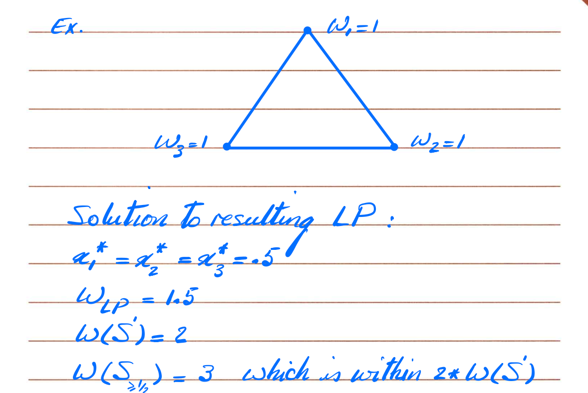

### Solving Max Flow using LP

现在把“最大流”问题写成一个 LP：

变量：

- 对每条有向边 e，设流量 f(e)。

目标函数：

- 最大化源点 s 流出的总流量：

  $\max \sum_{e \text{ 出自 } s} f(e)$

约束：

1. 容量约束：

   $0 \le f(e) \le c(e),\quad \forall e\in E$

2. 流守恒（对所有非 s,t 顶点 v）：

   $\sum_{e \text{ 进入 } v} f(e) = \sum_{e \text{ 离开 } v} f(e)$

课件提醒：在 LP 中，等式可以用两条不等式替代：

- $A = B ⇔ A \le B 且 B \le A$。

### Solving Shortest Path using LP

这里用 LP 写单源最短路（s 到其他点的最短距离）。

变量：

- 对每个顶点 v，设变量 $d_v$，表示从 s 到 v 的“距离”。

想法（常见写法之一）：

- 给出所有边的长度 $l(u,v)$。

- 若要保证 $d_t$ 是从 s 到 t 的最短路长，可以用这样的约束：

  $d_v \le d_u + l(u,v),\quad \forall (u,v)\in E$

  直觉：走一步，从 u 到 v，距离最多增加 $l(u,v)$。

  > “如果你从 s 走到 u 的最短路长度是 d_u，
  >
  > 那你再走一条边 (u→v)，花费 l(u,v)，
  >
  > 到 v 的距离就应该 $≤ d_u + l(u,v)$”

- 同时规定 $d_s = 0$。

==然后做一件看起来有点反直觉的事：==

**最大化** $d_t$。

为什么是“最大化”却能得到“最短路”？

- 所有约束一起意味着：对任何从 s 到 t 的路径 P，其路径长度 L(P) 都是一个对 $d_t$ 的上界；
- 也就是说：$d_t \le$ 所有从 s 到 t 路径长度的最小值；
- 在这些约束下，我们最大化 $d_t$，最后得到的最优 $d_t$ 就会等于那个最小的上界，也就是最短路径长度。

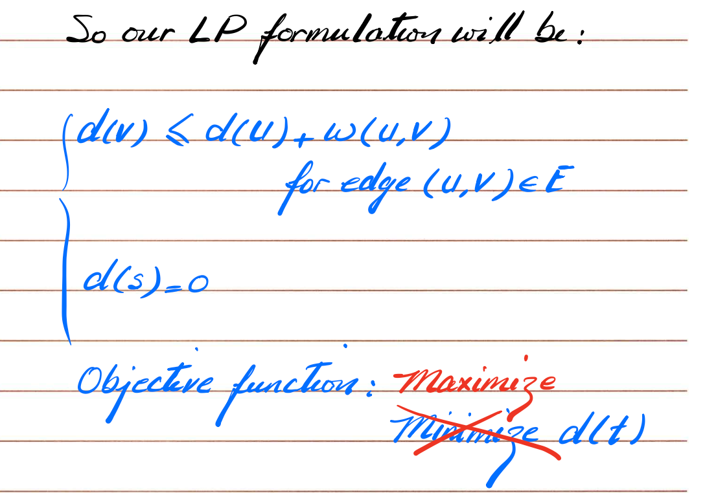

这里是 maximum！要注意！！！！