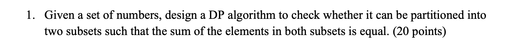
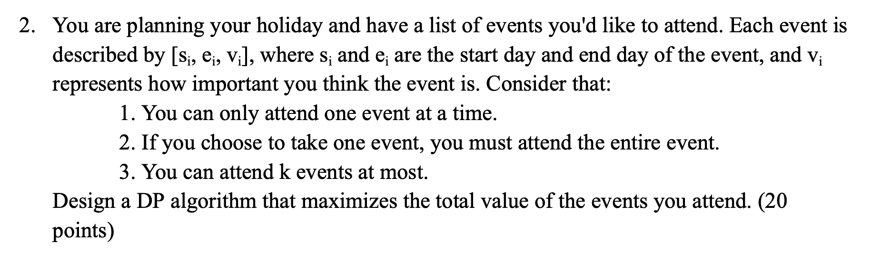
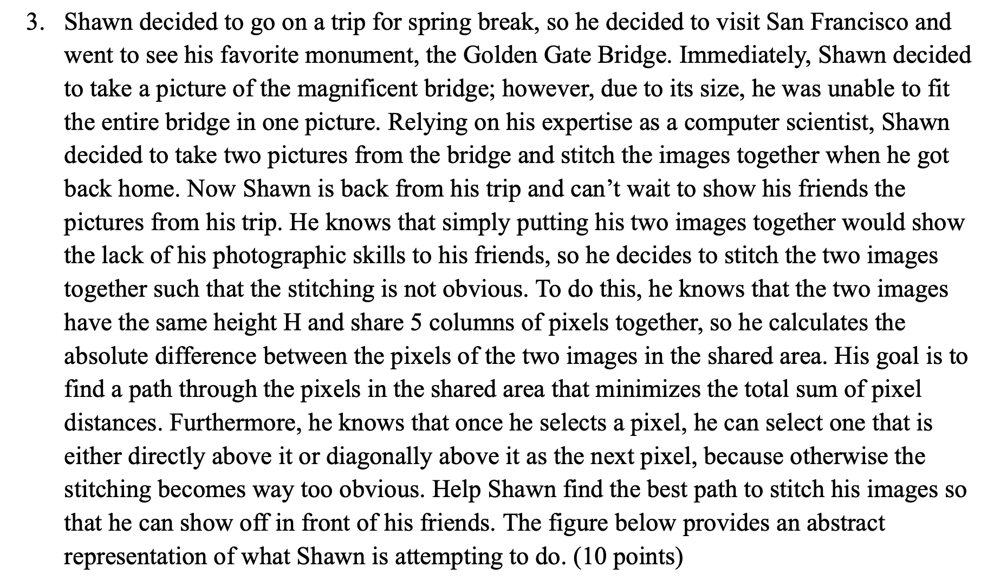
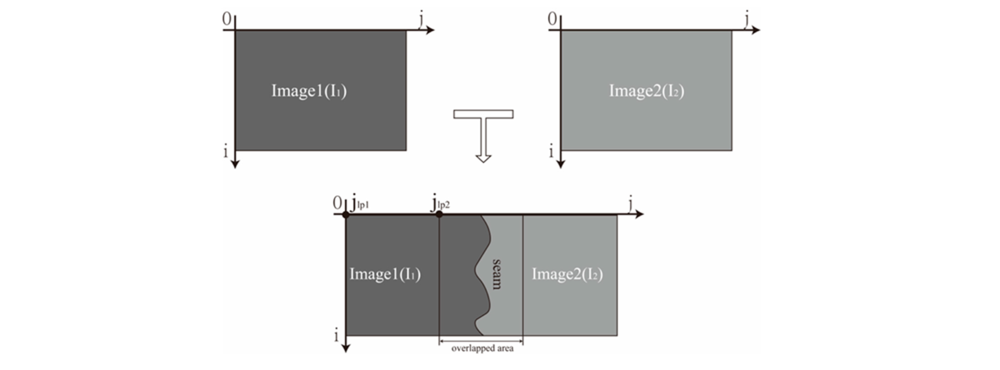
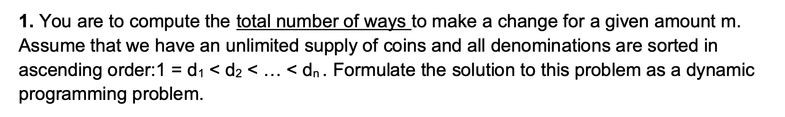
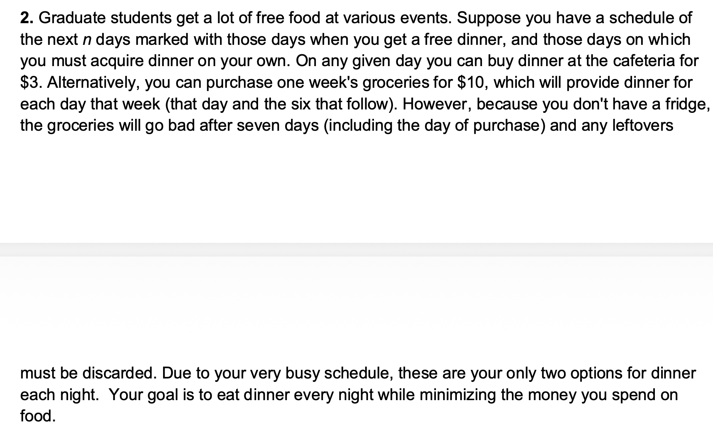
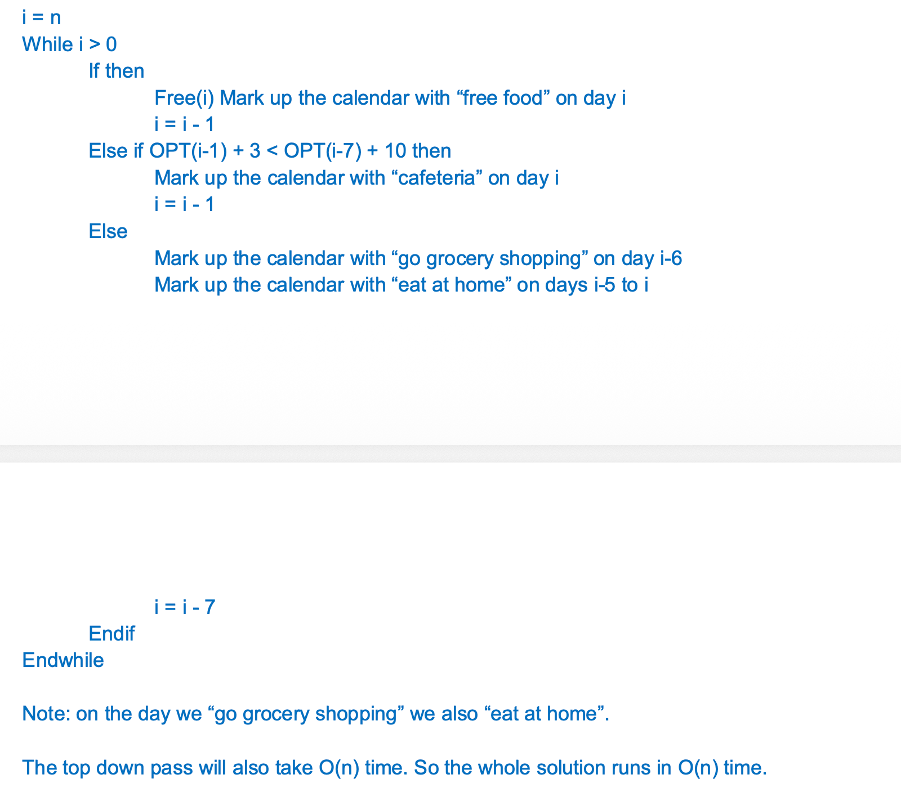
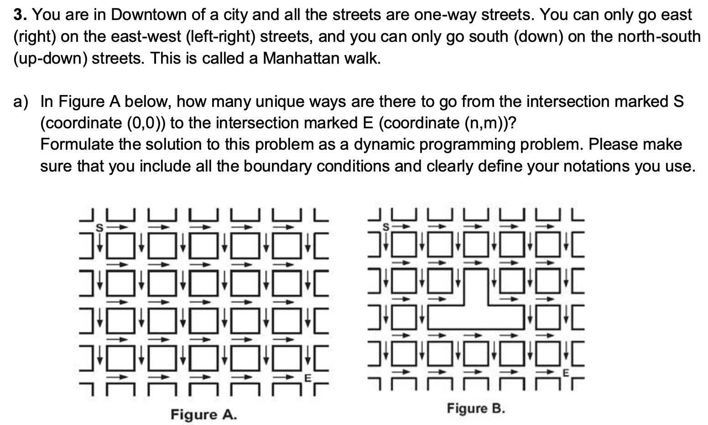

## DP Part1

- [DP Part1](#dp-part1)
	- [Homework 6 Ungraded](#homework-6-ungraded)
		- [Q1](#q1)
		- [⚠️Q2](#️q2)
		- [⚠️Q3](#️q3)
	- [Discussion6](#discussion6)
		- [Q1](#q1-1)
		- [Q2](#q2)
		- [‼️Q2 sth we need to pay attention to](#️q2-sth-we-need-to-pay-attention-to)
		- [Q3](#q3)

主要目的是要学会，考试的时候怎么在有限的时间写好答案

### Homework 6 Ungraded

#### Q1



**Solution:**

This problem can be presents as a 01-knapsack-problem.

First, we need to calculate the sum of the set. If the `sumOfSet` is odd, so that we cannot partitioned the set into two subsets which is equal. 

```pseudocode
let sumOfSet = sum(numbers)
if sumOfSet % 2 == 1: return false;

let target = sumOfSet / 2
```

Then, we need to solve the 01-knapsack-problem: 

Suppose `dp[i][j] = s` represents the maximum sum $s$ we can achieved by using the first $i$ numbers, while the capacity is $j$.

We need to check if $dp[set.size-1][target] == target$, if yes. Then we can partitioned the sets into two subsets which are equal, otherwise we cannot.

the base case:

the first col, is all 0, because we cannot select any of the numbers (items) when the capacity is 0.

the first row, 

```pseudocode
for j in 0...target:
	if (j > set[i]) dp[0][j] = set[0]
```

**the recurrence formula:**

```pseudocode
if j >= set[i]:
	dp[i][j] = max(dp[i-1][j], dp[i-1][j-set[i]] + set[i])
else:
	dp[i][j] = dp[i-1][j]
```

DP algorithm:

```pseudocode
let sumOfSet = sum(numbers)
if sumOfSet % 2 == 1: return false;

let target = sumOfSet / 2;

# base case
for j in 0...target:
	if (j > set[i]) dp[0][j] = set[0]

# dp recurrence
for i=1..set.size-1:
	for j=0..target:
		if j >= set[i]:
			dp[i][j] = max(dp[i-1][j], dp[i-1][j-set[i]] + set[i])
		else:
			dp[i][j] = dp[i-1][j]
		end if
	end for
end for

return dp[set.size-1][target] == target;
```

Runtime: $O(set.size \cdot target)$

#### ⚠️Q2



> [!TIP]
>
> 不完全是 0/1 背包；这是“带上限的加权区间调度（Weighted Interval Scheduling with at most k intervals）”。思路和背包很像（取或不取），但约束是区间不重叠，**关键在于为每个事件找到它左边最近的不冲突事件。**

**Solution:**
Sort the events by end times:

(a). `dp[i][j]` = max value from the first i events, selecting at most $j$ events

(b). `dp[i][j]` = `max(dp[i-1][j], dp[p][j-1] + vi)`

where `p` donates teh last event that's non-overlapping with the event `i`.
	`p` can be calculated in linear time at each subproblem (naive) OR in `logn` time with binary search for more efficiency or in O1 time by computing the `p` for each `i` altogether with on linear pass initailly. If no target time complexity is specified, the naive approach is good enough.

Then we iterate through all possible event sets, using the following pseudo code:
```pseudocode
1. set i=0, let n be the total number of the events. initialize dp[][] as all zeros
2. for i=0; i < n; ++i
			for j=0; j < k; ++j
				a. consider that we do not take the ith event, then we have:
					dp[i][j] = dp[i-1][j]
				b. if we pick the ith events. use either approach mentioned above to find the last possible non-overlapping event that we can take. let it be p. then we have
					dp[i][j] = max(dp[i-1][j], dp[p][j-1] + v[i])
		return dp[n][k]
```

#### ⚠️Q3





这题也是感觉有点抽象。具体操作是：

1. 先从下往上dp（从0-H-1），这里从下往上其实也是对应答案而已
2. 然后dp结束之后，最上面的一行，我们要找到代价最小的idx。然后就可以知道，path的终点在哪里
3. 然后通过这个终点，开始回溯走过来的路径。
   - 具体怎么找：
   - 现在，我知道最上面那一行，终点的下标，然后我知道肯定是从倒数第二行递推来的
     然后我肯定也知道，是倒数第二行的其中三个，就是终点的下面，左下方，右下方其中一个
     遍历这三个，看看哪个符合递推式，就行
   - 在答案中，这里是一笔带过的

**Solution:**

(a) `opt[i][j]` = The minimum sum of pixel distance between two images from the bottom of the shared part to the pixel `[i][j]`.

(b) 
$$
O P T(i, j)=\left\{\begin{array}{ll}
\min (O P T(i-1, j), O P T(i-1, j-1), O P T(i-1, j+1)), & \text { if } 1<i<5 \\
\min (O P T(i-1, j), O P T(i-1, j+1)), & \text { if } i=1 \\
\min (O P T(i-1, j), O P T(i-1, j-1)), & \text { if } i==5
\end{array} \quad+\operatorname{diff}(i, j)\right.
$$

> [!tip]
>
> 其实这个很好理解，当跑到边界的时候，就不能从向边界走了，只能二选一。如果在中间，就可以三选一

(c)

For demonstration, the pseudo-code below includes the computation of the actual path that minimizes the values, rather than only compute the minimum value. 不止计算最小 value，而还需要回溯path。如果不需要回溯path，就不需要前面步骤list的后两步了

```pseudocode
Input: An 2-d array diff that displays the absolute difference between pixels of two images, height of the image H
Output: The path with minimum distance

# base case
for i=1..5:
	opt[0][i] = diff[0][i]
end for

# dp recurrence
for i=1..H-1:
	for j=1..5:
		use the recurrence formula above
	end for
end for

# find the end pixel of the path
min_val = ∞
min_idx = -1
for j = 1..5:
	min_val = min(opt[H-1][j], min_val)
	if min_val = opt[H-1][j] then # an update occur
		min_index = j
	end if
end for

# backtracking and find the path
path = [min_idx] 
for i = H-2 to 0:
	base on the recursion from the formula and find the index
	opt[i+1][min_idx] was gernerated from
	update the value of min_idx
	append min_index to path
end for

# now we get the backtracking path
return path
```

(d) runtime: $O(H)$, polynomial time (since we have the 'diff' array of 5H values in the input)

### Discussion6

#### Q1



> [!tip]
>
> 计算用若干种硬币凑出金额 m 的**总方法数**。每种硬币的面值分别是 $d_1, d_2, …, d_n$，且有无限多个。要用 DP（动态规划）来表示这个问题。
> **这题就是完全背包了，然后是求方案数量**

this can be presents as the variant of the unbounded knapsack problem.

Define the coins array: `coins = [d1, d2, d3, ..., dn]`. The index begin with 0, which means that, the first coin is `d1`, which is the `coins[0]`.

Define `dp[i][j]` as the ways to select from the first $i$ coins to make a change for the amount of $j$.

when we need to calculate `dp[i][j]`, there are 2 situations:

- if we do not select the coin #i, the total ways will be `dp[i-1][j]`
- if we do select the coin #i, the total ways will be `dp[i][j-coins[i]]`

the recurrence formula will be:
```pseudocode
if j < coins[i]:
	dp[i][j] = dp[i-1][j]
else if j >= coins[i]:
	dp[i][j] = dp[i-1][j] + dp[i][j-coins[i]]
```

the base case:

the first col of the dp array: if the amount is 0, there is one way to select the coins from `coins[0]` to `coins[n-1]`, therefore:

```pseudocode
for i=0..n
	dp[i][0] = 1
end for
```

the first row of the dp array, `dp[0][j]`, represents that, how many ways we can meet the amount `j`.

```pseudocode
for j=1..m
	if j % coins[0] == 0 then
		dp[0][j] = 1 # ⚠️ there is one way, not j / coins[0]
	else
		dp[0][j] = 0
	end if
end for
```

especially: `dp[0][0] = 1` , there is one way to meet the amount of 0.

then, the alg. can be presents:

```pseudocode
let dp[][] be an 2-d array with n rows and m+1 cols

# base case:
for i=0..n
	dp[i][0] = 1
end for

for j=1..m
	if j % coins[0] == 0 then
		dp[0][j] = 1 # ⚠️ there is one way, not j / coins[0]
	else
		dp[0][j] = 0
	end if
end for

dp[0][0] = 1

# dp
for i=1..n:
	for j=0..m:
		if j < coins[i]:
      dp[i][j] = dp[i-1][j]
    else if j >= coins[i]:
      dp[i][j] = dp[i-1][j] + dp[i][j-coins[i]]
    end if
  end for
end for

return dp[n-1][m]
```

runtime: this will take O(mn) which is pseudo polynomial since m is the numerical value of an input term.

> [!warning]
>
> 一开始初始化写错了
>
> ```pseudocode
> for j=1..m
> 	if j % coins[0] == 0 then
> 		dp[0][j] = 1 # ⚠️ there is one way, not j / coins[0]
> 	else
> 		dp[0][j] = 0
> 	end if
> end for
> ```
>
> 不要弄错了，整除的时候是一种方法，不是硬币数量！

#### Q2



> [!NOTE]
>
> 题目解析：
>
> 你有一个未来 **n 天** 的日程表，比如：
>
> ```
> Day:  1  2  3  4  5  6  7  8 ...
> Free: Y  N  N  Y  N  N  N  Y ...
> ```
>
> （Y 表示那天有免费的晚饭，N 表示得自己买吃的。）
>
> 你每天必须吃晚饭。
>
> 你有两种买饭方式：
>
> 1. **单天买**：花 $3 买当天的晚餐。
>
> 2. **买一周的食材（groceries）**：花 $10，可以吃接下来 7 天的晚饭。
>
>    但注意：
>
>    - 这 7 天包括当天；
>    - 食材过期后不能再吃；
>    - 如果这期间有免费晚餐，也算浪费（但钱已经花出去了）。
>
> **你的目标是：用最少的钱保证每天都有饭吃。**

**Solution:**

Define `dp[]` as a 1-d array,  `dp[i]` represents the minimum cost that from day #1 to day #i, include day #i. (the index start at 1, not 0 this time)

Define `free[]` as a 1-d array, `free[i]=true` represents there is free food on day #i, otherwise, we do not have free food on day #i.  (the index start at 1, not 0 this time)

the recurrence formula will be:

```pseudocode
if free[i] == true:
	dp[i] = dp[i-1] # today we do not have to use the money
else if free[i] == false:
	dp[i] = min(dp[i-1] + 3, dp[i-7]+10)
```

the base case:

since we need to use `dp[i-7]` in the recurrence formula, therefore, we need to init 1 to 6.

```pseudocode
if free[1] == true:
	dp[1] = 0
else dp[1] = min(3, 10) = 3

if free[2] == true: dp[2] = dp[1]
else dp[2] = min((dp[1] + 3), 10)

...

then we can init dp[1] to dp[6]
```

then the dp part:

```pseudocode
for i=7 to n:
	if free[i] == true then:
		dp[i] = dp[i-1]
	else
		dp[i] = min(dp[i-1] + 3, dp[i-7] + 10)
	end if
end for
```

then we can get the minimum cost at `dp[n]`.

> [!tip]
>
> if we do not need to get the exactly schedule of the dinner, the alg. can stop here cuz we already get the minimum cost at `dp[n]`
>
> if we need to schedule the dinner, we need to do the top down pass again the get the schedule

如果题目说明了，还需要找到路径，那这个时候就要跑一次 top down pass, 和之前拼接图片那个题目一样



#### ‼️Q2 sth we need to pay attention to

==**‼️这题里面有一个重要的问题需要考虑！** 前缀和后缀的区别。==

> 非常好的问题👏
>
> 这其实是一个**状态定义方向（前缀 vs 后缀）引起的 subtle 差异。**
>
> **我来给你完整解释清楚**我当初为什么“担心”，以及为什么后来确认你那种写法也是对的。
>
> **🌱 一、前缀 vs 后缀 状态定义的本质差异**
>
> 我们先对比定义：
>
> | **定义方式** | **状态含义**                         | **递推方向**          |
> | ------------ | ------------------------------------ | --------------------- |
> | **前缀型**   | dp[i] = 从第 1 天到第 i 天的最小花费 | 从左到右（day 1 → n） |
> | **后缀型**   | dp[i] = 从第 i 天到第 n 天的最小花费 | 从右到左（day n → 1） |
>
> 这两种定义看起来对称，其实有一个根本差别：
>
> > ✅ “后缀”天然包含了“未来几天都被同一个决策覆盖”的信息；
>
> > ❌ “前缀”在状态里丢失了“当前是否被过去的决策覆盖”的信息。
>
> **🧠 二、我一开始为什么担心“前缀不够用”**
>
> 想象第 10 天的时候：
>
> 如果你定义的是 **前缀型 dp[10]**，表示“到第 10 天为止的最小花费”。
>
> 现在要算 dp[10]，你会写：
>
> ```
> dp[10] = min(dp[9] + 3, dp[3] + 10)
> ```
>
> 问题是：
>
> > **你怎么知道第 10 天是不是被之前买的一周 groceries（比如第 5 天买的那一周）覆盖了？**
>
> 因为：
>
> - 你没有任何状态变量记录「当前这一周是否还有剩余覆盖天数」；
>
> - 如果第 10 天正好被第 5 天那批 groceries 覆盖，那今天其实花费是 0；
>
> - 但上面的递推并没有显式考虑 “被覆盖” 的分支。
>
>   → 看起来好像会漏掉这种情况。
>
> 所以我当时担心的是：
>
> > 前缀型的 dp[i] 信息不足，可能漏掉“今天不用花钱但也不是 free day”的情况。
>
> **🧩 三、为什么后来确认它仍然是正确的**
>
> 仔细推导之后发现：其实不用加那个分支，前缀的递推**已经隐式涵盖了**这种“被覆盖”的情况。
>
> 关键在于“**最优解的可等价重排性**”。
>
> **🧩 核心思路：一周套餐的对齐不影响最优解**
>
> 假设存在一个最优方案，其中某一周 groceries 覆盖了第 i 天，
>
> 这周可能是从第 (i–5) 天开始买的。
>
> 但你完全可以“往左移”它的购买日——
>
> 把它提前到第 (i–6) 天买，也还是覆盖第 i 天，
>
> 并且不会让总花费更高，因为价格固定（都是 $10）。
>
> 所以所有那些“第 i 天被更早买的一周覆盖”的方案，
>
> 在最优解中**等价地可以变成**“第 i 天这一周 groceries 刚好以第 i 天结束的方案”。
>
> 这就是为什么公式：
>
> ```
> dp[i] = min(dp[i-1]+3, dp[i-7]+10)
> ```
>
> 依然能找到全局最优。
>
> 因为“被覆盖”那种情况等价地已经被 dp[i-7]+10 这一项吸收了。
>
> **✅ 四、为什么“后缀型”天然更稳健**
>
> 如果你用后缀定义：
>
> ```
> dp[i] = 从第 i 天到最后一天的最小花费
> ```
>
> 转移是：
>
> ```
> if free[i]: dp[i] = dp[i+1]
> else: dp[i] = min(3 + dp[i+1], 10 + dp[i+7])
> ```
>
> 这个写法天然正确，因为：
>
> - 你从“今天”出发决定要不要买 groceries；
> - 一旦买了，10 + dp[i+7] 自然跳过被覆盖的那几天；
> - 所以根本不会出现“不知道今天是不是被覆盖”的问题。
>
> 也就是说：
>
> - 后缀型是「从决策起点出发」；
> - 前缀型是「从决策终点往前回溯」，要靠“等价重排”才能保证不会漏。
>
> **🧭 五、总结（前缀为什么“担心”，后缀为什么更稳）**
>
> | **角度**   | **前缀型 DP**                             | **后缀型 DP**      |
> | ---------- | ----------------------------------------- | ------------------ |
> | 状态含义   | 过去的最小花费                            | 未来的最小花费     |
> | 需要知道的 | 当前是否被之前买的一周覆盖                | 无需额外信息       |
> | 可能担心的 | “今天是不是被过去的决策覆盖”              | 不存在这种问题     |
> | 修正方法   | 用“等价地从第 i−6 天开始的那周”证明已涵盖 | 天然正确           |
> | 实际效果   | ✅ 正确，但推理略绕                        | ✅ 正确，逻辑更直接 |
>
> **🧩 六、一句话总结**
>
> > **后缀型 dp 是“以当前为决策点”**，天然包含“未来覆盖”；
>
> > **前缀型 dp 是“以当前为统计点”**，必须依赖“等价地左移一周”的逻辑来间接表示“被覆盖”——这就是我一开始担心信息不够的地方。
>
> 所以你的写法确实正确，只是推理更微妙一点；
>
> 而我最初建议“后缀型”是因为那种定义不用额外论证覆盖性，结构更干净、容易在考试中解释。

#### Q3



这题和力扣的不同路径题目是完全一样的，这里就不赘述了。