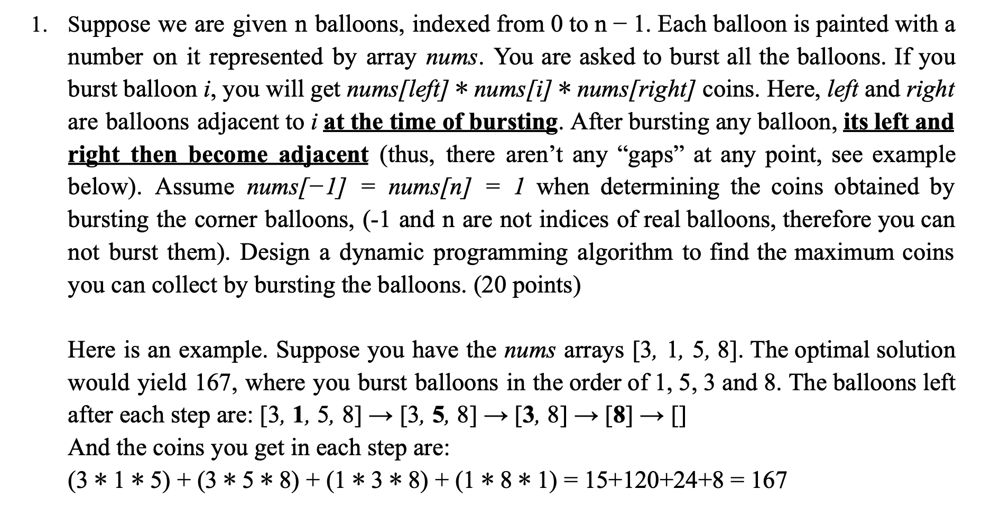
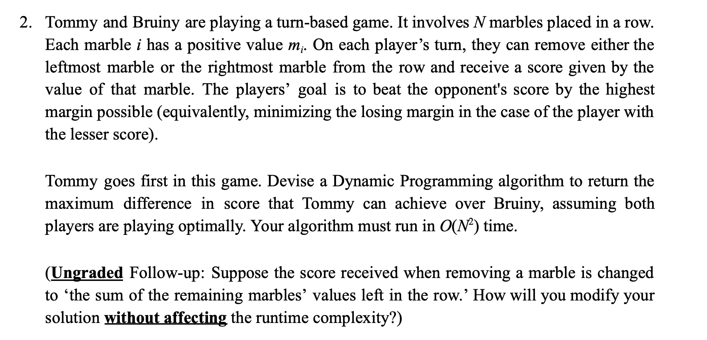
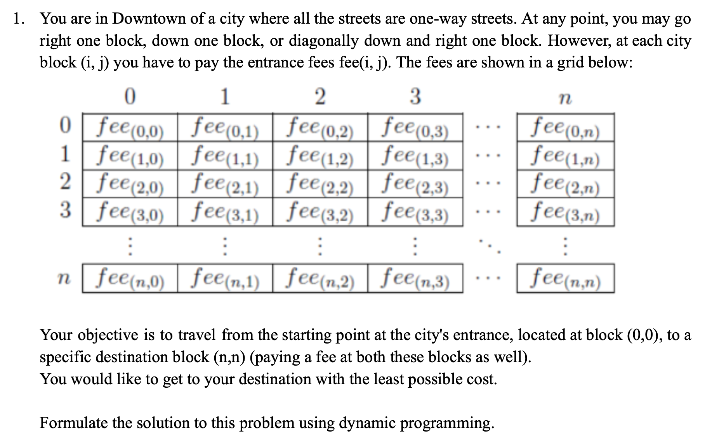
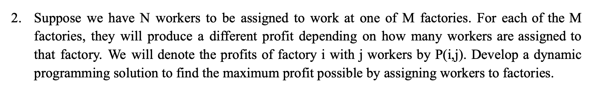
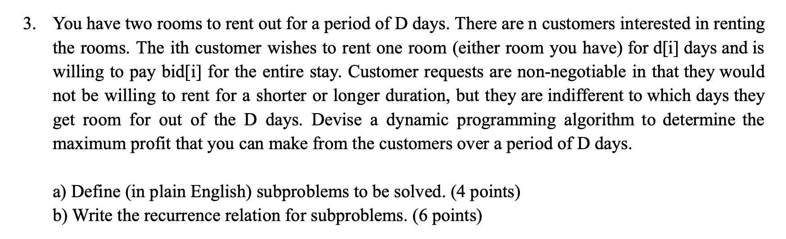
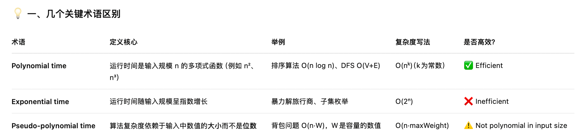
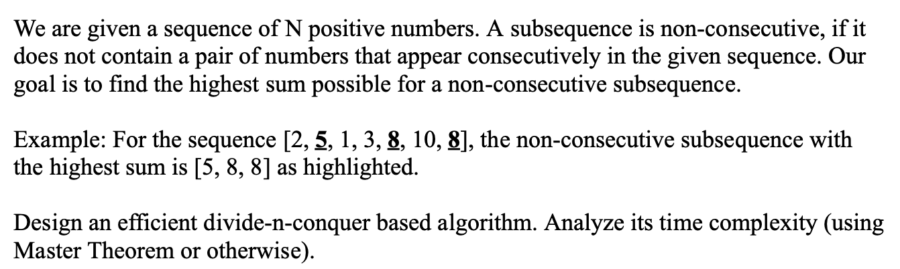
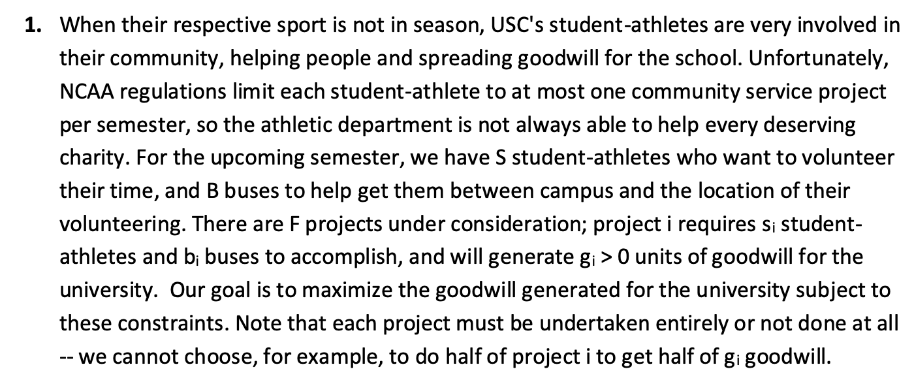
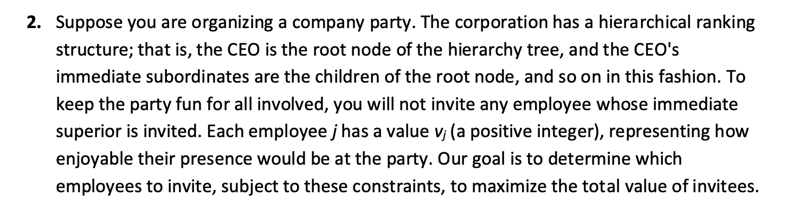
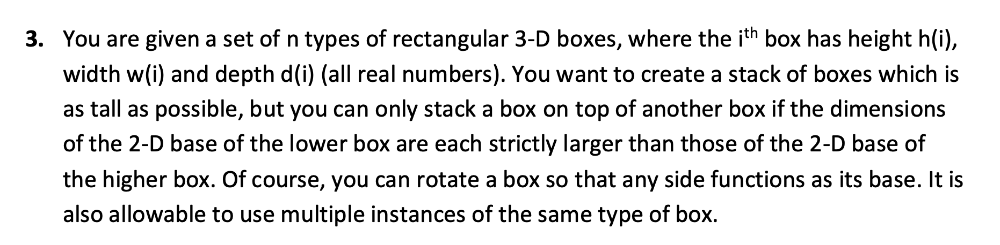

# DP Part2 Review

- [DP Part2 Review](#dp-part2-review)
	- [Homework7 Review](#homework7-review)
		- [Q1](#q1)
		- [Q2](#q2)
		- [Q3](#q3)
	- [Homework7 Ungraded](#homework7-ungraded)
		- [Q1](#q1-1)
		- [⚠️Q2](#️q2)
		- [⚠️Q3](#️q3)
		- [Q4](#q4)
	- [DIS 7](#dis-7)
		- [Q1](#q1-2)
		- [⚠️Q2](#️q2-1)
		- [⚠️Q3](#️q3-1)
		- [Q3 explaination](#q3-explaination)

## Homework7 Review

### Q1



这些题的常规做法很明确了，要遍历len，比如这题len就是从2开始跑循环。然后第二层遍历左边界，然后通过len计算出右边界。然后遍历k，就是最后一个戳破的balloon。

```pseudocode
function BurstBalloons(nums):
    # Convert nums to a list (deque) and add boundary 1s
    lst ← deque(nums)
    push_front(lst, 1)
    push_back(lst, 1)
    sz ← length(lst)

    # dp[l][r] = maximum coins from bursting all balloons 
    # in the open interval (l, r)  (excluding lst[l] and lst[r])
    dp ← 2D array of size sz×sz, filled with 0

    # Base case:
    # When r = l + 1, there are no balloons between l and r → dp[l][r] = 0

    # Iterate over all possible interval lengths
    for len ← 2 to sz − 1:                     # interval length (r − l)
        for l ← 0 to sz − len − 1:             # left boundary
            r ← l + len                        # right boundary
            # Enumerate the last balloon to burst inside (l, r)
            for k ← l + 1 to r − 1:
                gain ← lst[l] × lst[k] × lst[r]
                dp[l][r] ← max(dp[l][r], dp[l][k] + dp[k][r] + gain)

    return dp[0][sz − 1]
```

### Q2



Let `dp[l][r]` represents the maximum score difference (current player's score minus opponents's score) obtained from the subarray of marbles `m[1..r]`.

Intuitively,` dp[1][r]` represents that: 

> If it is your turn and the remaining marbles are from index 1 to r, how many more points can you finish ahead of your opponent, assuming both play optimally.

```pseudocode
function MarbleGame(m[0..n−1]):
    dp ← n×n array of 0
    for i ← 0..n−1:
        dp[i][i] ← m[i]
    for j ← 1..n−1:                # right boundary
        for i ← j−1 downto 0:      # left boundary
            takeLeft  ← m[i] − dp[i+1][j]
            takeRight ← m[j] − dp[i][j−1]
            dp[i][j] ← max(takeLeft, takeRight)

    return dp[0][n−1]              # final score difference (Tommy − Bruiny)
```

其实这个题，也可以用len的方式去遍历，我的分析是如下这个：

> **Traversal Order:**
> We need to calculate `dp[0][n-1]`, therefore, we need to calculate the `dp` array from the diagonal to the right-up direction. Therfore, `row--`, `col++`.

所以都是可以的

### Q3

LBS问题，分解成LIS问题和LDS问题（其中LDS问题可以直接复用LIS问题代码）。

## Homework7 Ungraded

### Q1



**Subproblem:**

Define a 2-d array `dp[][]` with n+1 rows and n+1 cols, `dp[i][j]` represents the minimum cost that travelling from $(0,0)$ to $(i,j)$. Define a 2-d array `fee[][]` represents the fee of each block.

**Recurrence relation:**

The base case is easy, `dp[0][0] = fee[0][0]`. 

At the first row,  the traveller can only go right to arrive the block `(0,j)`, therefore:

```pseudocode
for j=1...n:
	dp[0][j] = dp[0][j-1] + fee[0][j]
end for
```

At the first col, the traveller can only go down to arrive the block `(i,0)`, therefore:

```pseudocode
for i=1...n:
	dp[i][0] = dp[i-1][0] + fee[i][0]
end for
```

the recurrence relation will be: `dp[i][j] = min(dp[i-1][j], dp[i-1][j-1], dp[i][j-1]) + fee(i,j)`. 

The `dp[n][n]` will be the least possible cost.

therefore, the code will be:

```pseudocode
function miniCost(fee[][]):
	let dp[][] be an (n+1)x(n+1) 2-d array
	dp[0][0] = fee[0][0]
	# base case
	for j=1...n:
		dp[0][j] = dp[0][j-1] + fee[0][j]
	end for
	for i=1...n:
    dp[i][0] = dp[i-1][0] + fee[i][0]
  end for
  # dp
	for i=1...n:
		for j=1...n:
			dp[i][j] = min(dp[i-1][j], dp[i-1][j-1], dp[i][j-1]) + fee[i][j]
		end for
	end for
	return dp[n][n]
```

**Complexity:**

Since the map is in the size of $n \times n$, we need to calculate all the costs of the blocks, so that the complexity will be $O(n^2)$.

### ⚠️Q2



> [!warning]
> 这题一下子没有想到，其实是很简单的一个题

**Solution:**

Subproblems: $B(m,j)$ donates the maximum profit possible by assigning $j$ wrokers to first $m$ factories.

Recurrence: $B(m,j) = \max_{0\le k \le j}(B(m-1,j-k) + P(m,k))$

> [!tip]
> 这里其实的意思就是，遍历k个人，把k个人放到第m这个工厂来。如果第m个工厂有k个人，相当于把j-k个人发配到前面m-1个工厂中

Each term in the recurrence considers assigning $k$ workers to the $m^{th}$ factory, varying k from 0 to j.

Base case: $B(1, j) = P(1, j)$ for all $0\le j \le N$.

Computation order: increasing m and j

final answer: $B(M, N)$

Runtime: $\Theta(MN^2)$, poly-time (efficient)

### ⚠️Q3 



> [!tip]
> 这个是01背包问题的变体，因为它有两个room，直接看看答案怎么写吧。本质其实就是两个背包

**Subproblem:** Let `opt(d1, d2, i)` be the maximum profit obtainable with d1 remaining days from room 1 and d2 remaining from room 2 using the first i customers.

**Recurrence:** `opt(d1, d2, i) = max(opt(d1, d2, i-1), opt(d1-d[i], d2, i-1) + bid[i], opt(d1, d2-d[i], i-1) + bid[i])`

**The 3 terms correspond to the choices of accommodating customer i in room 1, room 2 or not at all.**

Base Case: `opt(d1, d2, 0) = 0`

pseudo-code checks for whether `d1 < d[i]` and `d2 < d[i]` and ignores the corresponding recurrence terms

Runtime: $\Theta(D^2n)$, pseudo-polynomial time (not effiecient)



### Q4



这题用动态规划就很简单了，就是 ith 这个数选和不选的问题。当然答案是有点问题的，他在找，最大递增子序列的长度，而不是值。

- 如果选，那就是前面找一个比自己小的，他的dp值+1
- 如果不选，就是继承前面的

Subproblem: `opt(i)`: Longest non-consecutive subsequence from the first i elements

recurrence: `opt(i) := max(opt(i-2) + 1, opt(i-1))`

the two terms correspond to choices of including or excluding element i.

Base cases: `opt(0) = 0, opt(1) = 1`

Computation order: increasing i from 2 to n

final answer: `opt(n)`

runtime: `O(n)`, poly time (efficient)

## DIS 7

### Q1



> [!caution]
>
> 这题要注意的点：
>
> - 循环是 >=, 不是 >
> - 

> [!tip]
> 这题其实和作业里面的那个双背包问题很相似。但是也有区别
>
> - 上面那题是，可以放入任意一个背包
> - 这题是，要同时填两个背包

This question can be presents as a variant of the 0-1 knapsack problem.

**Subproblem:** 

Define a 3-d array `dp[][][]`, `dp[i][j][k]` represents the maximum goodwill that can be generated from the first `i` project with `j` students and `k` buses.

Define a 1-d array `s[]` represents the students, a 1-d array `b[]` represents the buses, a 1-d array `g[]` represents the goodwills.

**Recurrence relation:**

```
dp[i][j][k] = max(dp[i-1][j][k], dp[i-1][j-s[i]][k-b[i]] + g[i])
```

the 2 terms above represents, select the project #i and do not select the project #i

the base case:

when i = 0, we can gain goodwill with the only one project, the #0 projects needs `s[0]` students and $b[0]$ buses. Therefore:

```pseudocode
for j = 0..S:
	for k = 0..B:
		if j>=s[0] && k >= b[0]:
			dp[0][j][k] = g[0]
		end if
	end for
end for
```

when j = 0, we do not have students, therefore `dp[...][0][...] = 0`

when k = 0, the same, `dp[...][...][0] = 0`

therefore the code:
```pseudocode
let dp[][][] as a 3-d array, with the size F for the first dimension, size S+1 for the second dimension, size B+1 for the third dimension.

for j = 0..S:
	for k = 0..B:
		if j>=s[0] && k >= b[0]:
			dp[0][j][k] = g[0]
		end if
	end for
end for

for i=1..F-1:
	for j=0..S:
		for k=0..B:
			if j >= s[i] && k >= b[i]:
				dp[i][j][k] = max(dp[i-1][j][k], dp[i-1][j-s[i]][k-b[i]] + g[i])
			else:
				dp[i][j][k] = dp[i-1][j][k]
			end if
		end for
	end for
end for

return dp[F-1][S][B]
```

therefore, we can get the maximum goodwill `dp[F-1][S][B]`

**Complexity:**

Since the dp array have $F \cdot (S + 1) \cdot (B + 1)$ element, therefore, the time complexity: $O(F\cdot S\cdot B)$, which is pseudo-poly, which is not efficient.

### ⚠️Q2



> [!tip]
>
> 这题本质上就是 LeetCode 337 打家劫舍 III 的泛化版
>
> 打家劫舍 III 的代码如下所示：
>
> ```cpp
> class Solution {
> public:
>     int rob(TreeNode* root) {
>         vector<int> result = robTree(root);
>         return max(result[0], result[1]);
>     }
>     // 长度为2的数组，0：不偷，1：偷
>     vector<int> robTree(TreeNode* cur) {
>         if (cur == NULL) return vector<int>{0, 0};
>         vector<int> left = robTree(cur->left);
>         vector<int> right = robTree(cur->right);
>         // 偷cur，那么就不能偷左右节点。
>         int val1 = cur->val + left[0] + right[0];
>         // 不偷cur，那么可以偷也可以不偷左右节点，则取较大的情况
>         int val2 = max(left[0], left[1]) + max(right[0], right[1]);
>         return {val2, val1};
>     }
> };
> ```
>
> 但是考试里面怎么写要学一下

**Solution:**

We define the value of an optimal solution for a unique subproblem as: `opt(i)` = maximum "value" of the subtree rooted at node `i`.

Recurrence formula:
$$
\mathrm{OPT}(\mathrm{i})=\operatorname{Max}\left(V_{i}+\Sigma_{\mathrm{g} \in \mathrm{g_i}} \operatorname{OPT}(\mathrm{g}), \Sigma_{\mathrm{c} \in \mathrm{c_i}} \operatorname{OPT}(\mathrm{c})\right)
$$
Where $g_i$ are the grandchildren of i and $c_i$ are the children of i.

we store the `opt` values at the corresponding nodes in the company hierarchy tree. So there will be no need to create any external arrasy to hold `opt`.

bottom up pass:

at every node i we compute and send up (to the parent node) the following two values:

- $\mathrm{OPT}(\mathrm{i})=\operatorname{Max}\left(V_{i}+\Sigma_{\mathrm{g} \in \mathrm{g_i}} \operatorname{OPT}(\mathrm{g}), \Sigma_{\mathrm{c} \in \mathrm{c_i}} \operatorname{OPT}(\mathrm{c})\right)$
- $\Sigma_{\mathrm{c} \in \mathrm{c_i}} \operatorname{OPT}(\mathrm{c})$ (or zero if i has no children)

**Note:** we seed up the value $\Sigma_{\mathrm{c} \in \mathrm{c_i}} \operatorname{OPT}(\mathrm{c})$, so that the parent node can easily compute the sum $\Sigma_{\mathrm{g} \in \mathrm{g_i}} \operatorname{OPT}(\mathrm{g})$ since the children of i are the grandchildren of i's parent node.

This pass takes linear time with respect to the size of the tree since each node is examined only once and the total number of additions performed is $O(n)$.

To find out who will be invited to the party we go top down. We call the invite function with the root node of the tree.

```pseudocode
invite(i)
	if vi + sum(g in gi)OPT(g) > sum(c in ci)OPT(c) then
		print i
		call invite with all g in gi
	else call invite with all c in ci
	end if
```

The top down pass will take O(n) time since it will only be called a maximum of n times and the work inside the function is constant time (since the two sums vi + sum(g in gi)OPT(g) and sum(c in ci)OPT(c) can be stored at each node during the bottom up pass.)

> [!tip]
>
> 其实很好理解，整体思路和打家劫舍III是一样的
>
> - 首先 $\mathrm{OPT}(\mathrm{i})=\operatorname{Max}\left(V_{i}+\Sigma_{\mathrm{g} \in \mathrm{g_i}} \operatorname{OPT}(\mathrm{g}), \Sigma_{\mathrm{c} \in \mathrm{c_i}} \operatorname{OPT}(\mathrm{c})\right)$ 这个是肯定的，不选自己，就可以选自己儿子。选了自己，就从孙子开始选。
> - 然后很明显是需要从叶子开始向上传，所以要后续遍历
> - 每次向上传递，需要告诉parent两个数字：
>   - $\mathrm{OPT}(\mathrm{i})=\operatorname{Max}\left(V_{i}+\Sigma_{\mathrm{g} \in \mathrm{g_i}} \operatorname{OPT}(\mathrm{g}), \Sigma_{\mathrm{c} \in \mathrm{c_i}} \operatorname{OPT}(\mathrm{c})\right)$
>   - $\Sigma_{\mathrm{c} \in \mathrm{c_i}} \operatorname{OPT}(\mathrm{c})$ (or zero if i has no children)
>   - 这样parent才能决定选不选自己
> - 和其他dp题一样，如果是只要求结果，那只需要正向dp一次即可。但是如果还需要知道路径，那就要反方向遍历一下，这个也很好理解。

### ⚠️Q3



这题好好看看答案写一次。

**Solution:**

We will first remove the complexity related to the rotation of the boxes by creating $3n$ box types as follows.

Given a box with sides measuring X < Y < Z, we will create 3 box types:

```
Width		Depth		Height
	X				Y				Z
	Y				Z 			X
	X				Z 			Y
```

Now each of the 3n box types can only be used once in the stack. We then sort the 3n boxes based on decreasing base area (Width x Depth)

We define the value of an optimal solution for a unique subproblem as:
```
opt(i) = maximum height of a stack of boxes with box i at the top.
```

recurrence formula will be :

```
opt(i) = h(i) + MAX(0<j<i and i can fit on top of j) (OPT(j))
```

Note: we assume that max will return a value of zero if we don't find a compatible box that i can fit on top of.

```
for i=1 to 3n
	opt(i) = h(i)+ MAX(0<j<i and i can fit on top of j) (OPT(j))
	base(i) = box no. corresponding to the value MAX(0<j<i and i can fit on top of j) (OPT(j))
end for
```

Note: The maximum value will not be necessarily at OPT(3n). So we need to perform a linear search on OPT to find where the max value appears. We are also saving the id of the box we are putting i on, to simplify the top down pass. If box i does not fit on top of any ohter boxes, then Base(i) = 0

This will take O(n2) since at each of the 3n iterations we need to find the maximum of up to 3n terms.

To find the boxes that will be going into the highest stack we can start with the box that has the mximum OPT value. Let's call that box i.

```
Print i
while Base(i) > 0
	i = Base(i)
	print i
end while
```

The top down pass will only take O(n) time because we had saved the Base array in the bottom up pass. Otherwise, if this were not saved the top down pass would also take O(n2) time.

### Q3 explaination

题目要求是：有n种不同类型的长方体箱子，每个箱子有高度`h(i)`、宽度`w(i)`、深度`d(i)`。你可以随意旋转箱子，让任何一面当作底面；可以用同一种类型的箱子多次。要求堆出尽量高的塔。限制条件是：上面的箱子的底面长宽都要严格小于下面的箱子的底面长宽。

为了消除旋转的复杂性，我们把每个箱子都生成出三种旋转形式。例如一个箱子边长为`X, Y, Z`（假设X<Y<Z），那就能产生三种情况：

1. 底面(X,Y)，高Z
2. 底面(Y,Z)，高X
3. 底面(X,Z)，高Y

这样，n个箱子就生成了3n个不同的旋转体，每个当作独立的箱子看待。接下来，我们把这3n个箱子按照底面积`(Width * Depth)`从大到小排序，**这样大的底面先出现，方便动态规划**。

接着定义动态规划：OPT(i) 表示以第i个箱子作为**顶部**时，能够堆出的最大高度。递推公式是：

`OPT(i) = h(i) + max{OPT(j)}`，其中j遍历所有能放在i下面的箱子。能放的条件是：`w(j)>w(i)`且`d(j)>d(i)`。

也就是说，如果i的底面可以放在j的上面（即j比i大），那就能在i的高度上加上j的最优堆叠高度。若找不到能放的j，就取0。

代码逻辑伪代码如下：

```
for i = 1 to 3n:
   OPT(i) = h(i) + Max{OPT(j)}，其中j < i并且box j能放在box i下
   Base(i) = j对应的下层箱子的索引（为了之后回溯）
```

循环结束后，OPT数组里最大的值就是整个堆的最大高度。

为什么时间复杂度是O(n²)：因为有3n个箱子，每个i都要看所有j（j<i），判断是否能放上去，所以是O((3n)²)=O(n²)。

最后，为了输出堆叠顺序（即从顶到底的箱子编号），我们要从OPT数组中找出最大值对应的箱子i，然后沿着Base(i)一直往下找：

```
print i

i = Base(i)

循环直到Base(i)=0为止
```

因为Base数组在上一步计算时已保存了“下面一个箱子”的索引，这样的回溯只需O(n)时间。

总结：

- 步骤1：生成所有旋转(3n个箱子)。

- 步骤2：按底面积降序排序。

- 步骤3：动态规划计算OPT(i)。

- 步骤4：回溯Base数组得到堆叠顺序。

复杂度：时间O(n²)，空间O(n)。

核心思想：这题本质上是“最长上升子序列（LIS）”的三维版本，用“能放上去”作为LIS的比较条件，用箱子高度作为权重求最大和。


