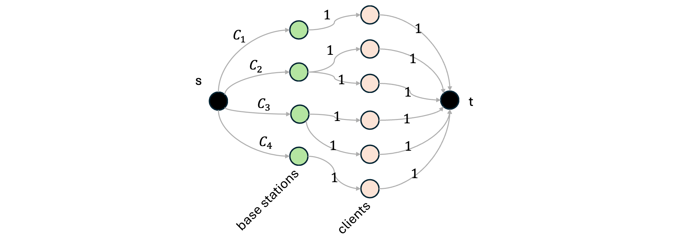
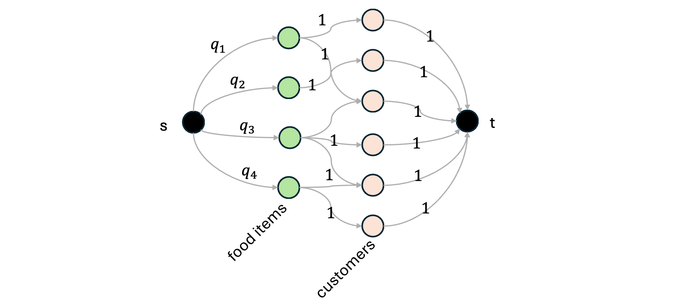
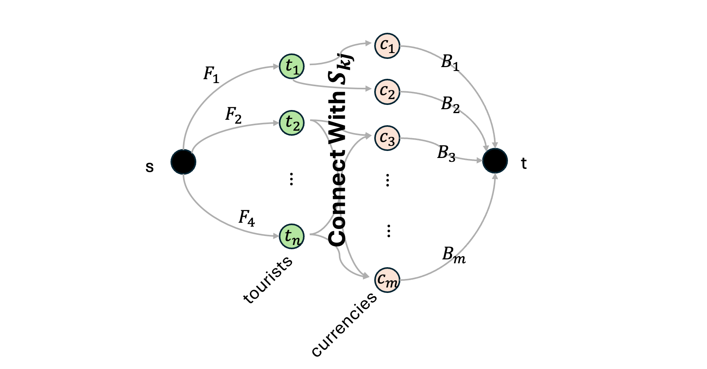

# Homework 8

**Name:** xxx

**USCID:** xxx

**Email:** xxx

- [Homework 8](#homework-8)
  - [Question 1](#question-1)
    - [Solution](#solution)
    - [Complexity](#complexity)
  - [Question 2](#question-2)
    - [Solution](#solution-1)
    - [Proof](#proof)
  - [Question 3](#question-3)
    - [(a.) Solution](#a-solution)
    - [(b.) Proof](#b-proof)

## Question 1

Consider a set of mobile computing clients in a certain town who each need to be connected to one of several possible base stations. We’ll suppose there are $n$ clients, with the position of each client specified by its $(x, y)$ coordinates in the plane. There are also $k$ base stations; the position of each of these is specified by $(x, y)$ coordinates as well. For each client, we wish to connect it to exactly one of the base stations. Our choice of connections is constrained in the following ways. There is a known range parameter $r$ — a client can only be connected to a base station that is within distance $r$ which can be checked using all the known coordinates. There is also a load parameter $C_i$ for each base station $i$ — no more than $C_i$ clients can be connected to the base station $i$. Your goal is to for the following problem. 

Given all the input above, design a polynomial-time algorithm to decide whether every client can be connected simultaneously to a base station, subject to the constraints described. (20 points)

### Solution

**Basic Algorithm**

This problem can be model as maximum flow problem.

First, we need to do flow network construction. We build a directed graph $G = (V, E)$ as follows:

- Add a virtual source node $s$ and a virtual sink node $t$.
- For each base station $b_i \ (i =1...k)$, add an directed edge connect $s$ and $b_i$ ($s \to b_i$), with the capacity of $C_i$. This represents that, for each station $b_i$, the can serve at most $C_i$ clients.
- For each client $c_j \ (j=1...n)$, add an directed edge connect $c_j$ and $t$ ($c_j\to t$), with the capacity of $1$. This represents that for each client, the can be connected to exactly $1$ base station.
- For each pair of $(b_i, c_j)$,
  - if the distance between base station $b_i$ and a client $c_j$ is within range $r$, then add an edge connect $b_i$ and $c_j$ ($b_i\to c_j$) with the capacity of $1$.

an example of the constructed network flow graph can be seen in the figure below:

 

Then, we compute the maximum $s-t$ flow on $G$ by using the Ford-Fulkerson Algorithm.

- if the maximum flow $f = n$, then every client can be connected simultaneously
- Otherwise, it is not possible to connect all the clients under the constraints

**Simple Pruning Checks**

Before running max-flow, we can reject impossible cases early:

1. If $\sum_i C_i < n$, not all clients can be served.
2. If any client has no reachable base station within range r, the answer is also “No.”

These checks are $O(n + k)$ and can save unnecessary computation.

**Simple Proof**

the construction is equivalent to a capacity-constrained bipartite matching problem, which is solvable via max flow in polynomial time.

### Complexity

Build a flow network:

$s \to \text{base stations} (C_i) \to \text{clients} (1) \to t$.

Run Ford–Fulkerson max-flow Alg. (pseudo-polynomial time).

Pre-check $\sum_i C_i \ge n$ and distance constraints.

**Time complexity: polynomial in $n, k$.**

## Question 2

The Sushi Express food truck produces a large variety of different lunch menu items. Unfortunately, they can only produce their foods in limited quantities, so they often run out of popular items, making customers sad. To minimize sadness, Sushi Express is implementing a sophisticated lunch-ordering system. Customers text in their acceptable choices before lunch time. Then they can use an algorithm to pre-assign lunches to customers. In general, suppose that, on a given day, Sushi Express has produced $m$ types of food items $b_1, ..., b_m$, and the quantity of each type of food item $b_j$ is exactly $q_j$. Suppose that n customers $a_1, ..., a_n$ text in their preferences, where each customer $a_i$ submits a set $A_i$ of one or more acceptable lunch choices. Customers who do not get one of their choices should receive a $10 voucher. Sushi Express would like to minimize the number of vouchers they give out.

Give an efficient algorithm for Sushi Express to assign lunches to customers to minimize the number of vouchers. Furthermore, prove the correctness of your algorithm. (20 points)

### Solution

**Basic Algorithm**

This problem can be model as maximum flow problem.

First, we need to do flow network construction. We build a directed graph $G = (V, E)$ as follows:

- Add a virtual source node $s$ and a virtual sink node $t$.
- For each type of food $b_i \ (i =1...m)$, add an directed edge connect $s$ and $b_i$ ($s \to b_i$), with the capacity of $q_i$. This represents the quantity of each kinds of food.
- For each customer $a_j \ (j=1...n)$, since each customer $a_j$ have a perference set $A_j = \{b_k, ...\}$, add an directed edge connect each kind of food $b_k$ in $A_j$ to $a_j$ ($b_k\to a_j$), with the capacity of $1$. This represents $b_k$ in $A_j$ is one of the acceptable choices of $a_j$.
- For each customer $a_j$, add an directed edge connect $a_j$ and $t$ ($a_j\to t$), with the capacity of $1$, which represents that each customer can only have one kind of food.

an example of the constructed network flow graph can be seen in the figure below:

Then, we compute the maximum $s-t$ flow on $G$ by using the Ford-Fulkerson Algorithm.

- if the maximum flow $f = n$ ($n$ is the size of the customers), then every customer can have one of the food item in their perference list.
- Otherwise, it is not possible satisfied all customers, the Sushi Express need to give out $(n-f) \times 10$ vouchers.

**Pruning (early rejection checks)**

Before constructing the full network, we can perform simple checks:

1. If $\sum_{j=1}^m q_j < n$, then at least $n - \sum_j q_j$ customers cannot be satisfied, even in the best case.
2. If any customer $a_i$ has $A_i=\varnothing$, that customer can never be satisfied and contributes one voucher automatically.

These tests run in $O(n+m)$ time and can reduce unnecessary flow computations.

**Complexity:**

The construction uses

$V = m + n + 2, \quad E = \sum_i |A_i| + m + n .$

Building the network takes $O(\sum_i |A_i|)$ time.

Using the **Ford–Fulkerson algorithm**, each augmentation runs in $O(E)$ time and increases the total flow by at least one unit (since all capacities are integers). Let $C = \sum_j q_j$ denote the total amount of available food items. The algorithm therefore performs at most $C$ augmentations, giving an overall running time of$O(E \cdot C)$, which is pseudo-polynomial, as it depends on the capacity values rather than only on the input size.  This complexity is acceptable for moderate integer capacities and still guarantees a correct maximum-flow solution.

### Proof

**Feasibility (Flow ⇔ Assignment equivalence)**

- **(Assignment ⇒ Flow)**

  Suppose we have a valid assignment of lunches: each customer receives at most one acceptable food, and each food type $b_j$ serves at most $q_j$ customers.

  We can construct a flow where each satisfied pair $(b_j,a_i)$ carries one unit of flow on $b_j\!\to\!a_i$, the edge $a_i\!\to\!t$ also carries one unit, and the corresponding $s\!\to\!b_j$ edge sends as much as the number of customers served by $b_j$.

  This satisfies all capacity and flow-conservation constraints, so it is a feasible flow of value equal to the number of satisfied customers.

- **(Flow ⇒ Assignment)**

  All capacities are integers; by the integrality property of max flow, there exists an integer maximum flow.

  In such a flow, each edge $a_i\!\to\!t$ with flow 1 means that customer $a_i$ receives exactly one unit from some $b_j\!\to\!a_i$ edge with flow 1, and every $b_j$ sends out at most $q_j$ units.

  Therefore, this integer flow directly defines a valid assignment of lunches to $f$ customers.

**Optimality**

Any feasible assignment can be represented as a feasible flow, so its total number of satisfied customers cannot exceed the value of the maximum flow.

Conversely, the maximum flow provides a feasible assignment satisfying exactly $f$ customers.

Hence $f$ is the maximum possible number of satisfied customers, and $n-f$ is the minimum possible number of unsatisfied customers. This achieves the goal of minimizing the total number of vouchers.

## Question 3

A group of tourists needs to convert all of their USD into various other international currencies. There are $n$ tourists $t_1, t_2, ..., t_n$ and m currencies $c_1, c_2, ..., c_m$. Each tourist $t_k$ has $F_k$ dollars they want to convert, and will accept any mix of currencies, but they have the following constraints: Tourist $t_k$ is willing to trade at most $S_{kj}$ of their dollars for currency $c_j$. (For example, a tourist with 1000 dollars might be willing to convert up to 300 of their USD for Indian Rupees, up to 500 of their USD for Japanese Yen, and up to 400 of their USD for Euros etc.). For each currency $c_j$, the bank can convert at most $B_j$ dollars to $c_j$. Assume that all tourists give their requests (i.e. hand in their available money in dollars) to the bank at the same time.

(a) Design an algorithm that the bank can use to determine whether all requests can be satisfied. To do this, construct and draw a network flow graph with appropriate source and sink nodes and edge capacities. 

(b) Prove your algorithm is correct by making an if-and-only-if claim and proving it in both directions.

### (a.) Solution

**Basic Algorithm**

This problem can be model as maximum flow problem.

Given that:

- tourists: $t_1, t_2, ..., t_n$
- currencies: $c_1, c_2, ..., c_m$,

Build a source node $s$ and sink node $t$, 

- for each tourist $t_k$, add an edge from s to $t_k$ ($s\to t_k$) with the capacity of $F_k$, which represents that each tourist wants convert exactly $F_k$ dollars.
- for each pair $(t_k, c_j)$, add an edge from $t_k$ to $c_j$ ($t_k \to c_j$), with the capacity of $S_{kj}$, which represents that tourist $t_k$ is willing to trade at most $S_{kj}$ of their dollars for currency $c_j$.
- for each kind of currency $c_j$, add an edge from $c_j$ to $t$ ($c_j\to t$), with the capacity of $B_j$, which represents that the bank can convert at most $B_j$ dollars to $c_j$.

an example of the constructed network flow graph can be seen in the figure below:

Run Ford-Fulkerson Algorithm on this network and compute the maximum flow value $F$.

**Decision rule**

Let $F^* = \text{maximum flow value.}$

Then:

- If $F^* = \sum_{k=1}^n F_k$, all tourists’ exchange requests can be satisfied simultaneously.
- Otherwise, the bank cannot fulfill every tourist’s request under the given limits.

**Complexity**

- Number of vertices: $|V| = n + m + 2$.
- Number of edges: at most $n + m + \#\{(k,j) \mid S_{kj} > 0\}$.
- Using the **Ford–Fulkerson Algorithm**, each iteration finds one augmenting path in $O(E)$ time and increases the total flow by at least one unit (since all capacities are integers). Let $C = \sum_{k=1}^n F_k$ denote the total amount of money that needs to be converted. The algorithm requires at most $C$ augmentations. Therefore, the total running time is $O(E \cdot C)$, which is **pseudo-polynomial**, because it depends on the numerical values of the capacities (the dollar amounts), not just on the number of vertices and edges.

### (b.) Proof

**Claim.** In the network built in part (a.)—with edges $s\!\to t_k$ of capacity $F_k$, edges $t_k\!\to c_j$ of capacity $S_{kj}$, and edges $c_j\!\to t$ of capacity $B_j$—there exists a feasible plan that satisfies all requests (i.e., every tourist $t_k$ converts exactly $F_k$ dollars under the per-currency limits) if the maximum $s-t$ flow value equals $\sum_{k=1}^n F_k$.

**If all requests can be satisfied, then the max flow equals** $\sum_k F_k$**.**

Assume there is a feasible conversion plan. For each tourist $t_k$ and currency $c_j$, let $x_{kj}$ be the number of dollars of $t_k$’s money converted to $c_j$ in this plan. Feasibility means:

- For each k:$ \sum_j x_{kj} = F_k$ and $0 \le x_{kj} \le S_{kj}$.
- For each j: $\sum_k x_{kj} \le B_j$.

Construct a flow f as follows:

- Send $F_k$ units on edge $s\!\to t_k$.
- For each $(k,j)$, send $x_{kj}$ units on edge $t_k\!\to c_j$.
- For each $j$, send $\sum_k x_{kj}$ units on edge $c_j\!\to t$.

All capacities are respected by feasibility, and flow conservation holds at every internal node. Hence $f$ is a feasible $s-t$ flow whose value is

$|f| \;=\; \sum_{k=1}^n F_k$.

Therefore the maximum flow is at least $\sum_k F_k$, and since no flow can exceed the total supply $\sum_k F_k$, the max flow equals $\sum_k F_k$.

**(⇐) If the max flow equals** $\sum_k F_k$**, then all requests can be satisfied.**

Let $F$ be a maximum s*-*t flow with value $|F|=\sum_k F_k$. Capacities are integral (they are dollar amounts; if needed, work in cents), so by the **integrality of max flow** there exists an **integral** maximum flow of the same value. In such a flow:

- Each edge $s\!\to t_k$ has capacity $F_k$, hence must carry exactly $F_k$ units (otherwise the total value would be $<\sum_k F_k$).
- Flow conservation at $t_k$ implies $\sum_j f(t_k\!\to c_j)=F_k with 0\le f(t_k\!\to c_j)\le S_{kj}$.
- For each currency $c_j$, the outgoing flow $f(c_j\!\to t)=\sum_k f(t_k\!\to c_j) respects f(c_j\!\to t)\le B_j$.

Define $x_{kj}=f(t_k\!\to c_j)$. Then for every tourist k,

$\sum_j x_{kj}=F_k$ and $0\le x_{kj}\le S_{kj};$ for every currency $j$,

$\sum_k x_{kj}\le B_j$. Thus $\{x_{kj}\}$ is a feasible plan that satisfies **all** requests.

**Conclusion**

We have shown both directions: a feasible “satisfy-all” plan exists if the maximum flow value equals $\sum_{k=1}^n F_k$. Therefore, the algorithm in part (a)—compute max flow on the constructed network and check whether the value is $\sum_k F_k$—correctly decides whether all requests can be satisfied.
