# Lecture9 Network Flow Notes

[TOC]

examples of network flow problems:

- How much data can we send from one node to another node in a computer network
- How much traffic can the freeways and roads sustain for travel between two cities ?
- How profitable can a manufacturing supply chain be

## Basic Definitions

**Def.** A flow network is a directed graph $G=(V, E)$ with following features:

- each edge $e$ has a non-negative capacity $c(e)\ge0$
- has a single source node $s \in V$
- has a single sink node $s \in t$

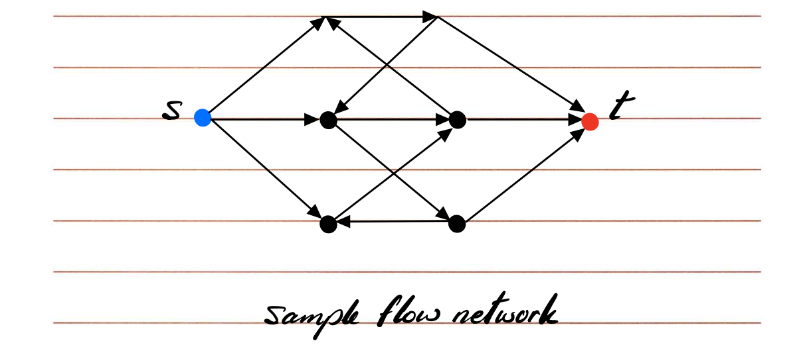

**Assumptions:**

- No edges enter $s$ or leave $t$
- at least one edge is connected to each node
- all capacities are integers


**Notation:**

We will call $f(e)$ flow through edge $e$, $f(e)$ has the following properties:

1. capacity constraint: for each edge $e \in E$, $0 \le f(e) \le c_e$. 容量约束. $c_e$ 是边的容量
2. conservation of flow: 流量守恒：对所有节点 $v\ne s,t$，流入 = 流出. (except for $s$ and $t$)

***

Our focus is on steady state flow, i.e. no transient or burst flows

我们在网络流问题中讨论的，是一种**steady-state flow（稳态流）**，而不是 **transient / burst flow（瞬时或突发流）**。

在算法和数学建模中：

- 我们**不考虑时间维度**（没有“什么时候发”、“延迟多久”），
- 只关注“每条边在长期平均情况下的流量是多少”。
- 所以每个节点在任意时刻满足流入 = 流出，没有积压或延迟。

## Max Flow Problem

### Statement

Given a flow network G, find an s-t flow with maximum value.

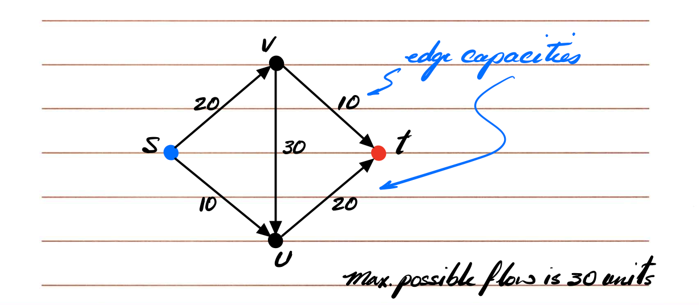

然后课件上有两个try，都是错误的：

- try #1: use highest capacity edges first
- try #2: use lowest capacity edges first

**“贪心策略”不一定能找到最大流（max flow）**

### Ford-Fulkerson Alg.

#### Residual graph

首先，要学会 **“残余图”** 的定义。

**Def.** $G_f$ is the residual graph of $G$ with the following definition:

- $G_f$ has the same number of nodes as $G$
- For each edge $e$ with $f(e) < c_e$, we include edge $e$ in $G_f$ with capacity $c_e - f(e)$
- For each edge $e$ with $f(e) > 0$, we include edge $e'$ (opposite direction to $e$) in $G_f$ with capacity $f(e)$.

如何创建残余图呢？To create $G_f$:

- if $f(e)=0$: $G_f$ will have 1 **forward** edge with capacity $c_e$
- if $f(e)=c_e$: $G_f$ will have 1 **backward** edge with capacity $c_e$
- if $0 < f(e) < c_e$: $G_f$ will have 1 **forward** edge with capacity $c_e - f(e)$, and 1 backward **edge** with capacity $f(e)$

***

#### highlevel solution

**Def.** If $P$ is a simple path from $s$ to $t$ in $G_f$. then $\text{bottleneck}(P)$ is the min residual capacity of any edge on $P$.

如果 $P$ 是残余图 $G_f$ 里一条从源点 $s$ 到汇点 $t$ 的路径，那么这条路径的瓶颈值 (bottleneck) 就是：这条路径上所有边的剩余容量 (residual capacity) 里最小的那一个。


**`Ford-Fulkerson` 的循环核心如下：**

> 1. 在残余图里找到一条从 s 到 t 的路径；
> 2. 计算这条路径的瓶颈值；
> 3. 沿着这条路径，把流量都增加瓶颈值；
> 4. 更新残余图；
> 5. 重复直到找不到 s→t 的路径。

***

High level strategy to find max flow:

> - find a path from $s$ to $t$
> - find the bottleneck value for this path
> - push flow through this path with value equal to bottleneck value
> - repeat

the augment operation:

> Augment(f, C, P)
>     b = bottleneck(P)
>     for each edge (v,u) ∈ P:
>         if (v,u) is a forward edge:
>             f(e) += b
>         else if (v,u) is a backward edge:
>             let e = (u,v)
>             f(e) -= b
> return f'

#### high level solution example

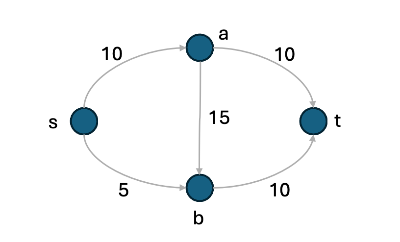

**步骤 0：初始化**

- 所有边流量 $f(e)=0$
- 残余图 $G_f$ 初始就是“容量图”：每条正向边的残余=其容量；没有反向边。

**迭代1**

**① 找一条 s→t 残余路径**

选 s→a→t（两条边残余都>0）

**② 计算瓶颈**

bottleneck = min{ s→a(10), a→t(10) } = **10**

**③ 沿路径增广 10**

- 正向边加 10：f(s,a)=10，f(a,t)=10

**④ 更新残余图**

- 正向剩余减少：s→a: 10→0，a→t: 10→0
- 加反向边表示可回退：a→s: 10，t→a: 10

> 当前总流 |f| = 10

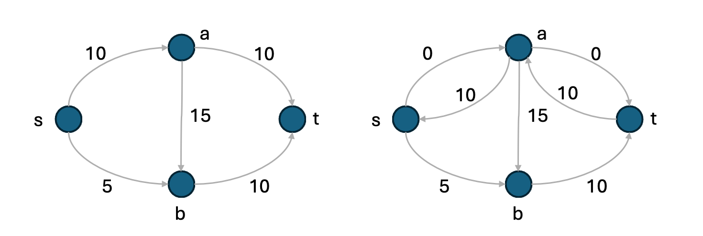

**迭代2**

**① 找另一条 s→t 残余路径**

选 s→b→t（s→b 还有 5，b→t 有 10）

**② 瓶颈**

bottleneck = min{ s→b(5), b→t(10) } = **5**

**③ 增广 5**

- f(s,b)=5，f(b,t)=5

**④ 更新残余图**

- s→b: 5→0，b→t: 10→5
- 加反向：b→s:5，t→b:5

> 当前总流 |f| = 10 + 5 = **15**

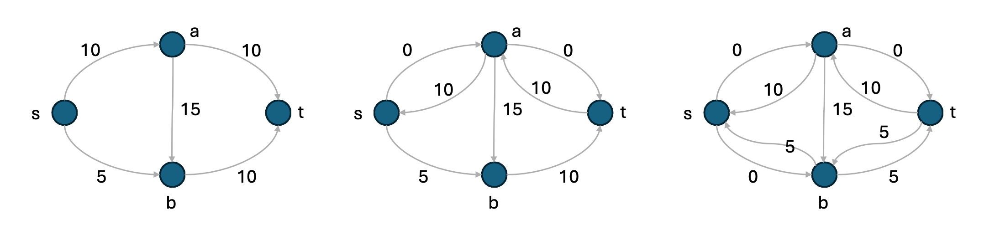

**还能继续吗？**

看看从 s 出发的**正向残余**：

- s→a 残余 0（满了）
- s→b 残余 0（也满了）

虽然有一些**反向**边（a→s:10、b→s:5），但它们都**回不到 s 的前面**来开启新路径；因此**残余图里不再存在 s→t 的路径**。算法停止。

**结论：最大流 = 15。**

（也等于 s 的出流上界 10+5=15，或等于某个最小割的容量。）

```pseudocode
# Ford-Fulkerson Algorithm
maxFlow(G, s, t, c)
initially f(e)=0 for all e in G
while thereis an s-t path in Gf
	Let P be a simple s-t path in Gf
	f/' = Augment(f, c, P)
	f = f/'
	update Gf
end while
return f
```

#### how to implement the high level solution into the codes

1. **初始化**：$f(e)=0$；残余图把每条边设为容量。
2. **找路径 P**：在残余图里用 DFS/BFS 找一条 s→t 路径。
3. **算瓶颈 b**：取路径上所有边的残余容量的最小值。
4. **增广**：
   - 对路径里的**正向**边：f += b；
   - 对路径里的**反向**边：f -= b。
5. **更新残余图**：
   - 正向残余 = c − f（若>0则存在）；
   - 反向残余 = f（若>0则存在）。
6. **重复 2–5** 直到找不到 s→t 路径。此时得到最大流。

> 小技巧：如果你用 **BFS 找最短增广路**（Edmonds–Karp），步骤一样，只是“找路径”的策略固定为 BFS，更好分析复杂度。

#### （只懂大概）proof of the high level solution

好，这部分只需要会“怎么证明就行”。给你一个**精简可背版**，覆盖两点：==**(1) 增广后仍是合法流**、**(2) 为什么算法会停且是最大流**。==

**Ⅰ. 证明增广后仍满足两条流的性质**

设当前合法流为 $f$，在残余图 $G_f$ 上选到一条增广路 P，瓶颈 $b=\min_{e\in P}\text{residual}(e)$。对沿 $P$ 的每条边做更新得到 $f’$：

- 如果沿 P 经过的是**正向残余边** (u,v)（对应原边 (u,v)），令 $f’(u,v)=f(u,v)+b$；
- 如果沿 P 经过的是**反向残余边** (u,v)（对应原边 (v,u)），令 $f’(v,u)=f(v,u)-b$。

**1) 容量约束（Capacity constraint）**

对任意边 e：

- 若 e 在 P 上以**正向**出现：

  $f’(e)=f(e)+b\le f(e)+(\,c_e-f(e)\,)=c_e$；且 $f’(e)\ge0$。

- 若 e 在 P 上以**反向**出现：

  $f’(e)=f(e)-b\ge f(e)-f(e)=0$；且 $f’(e)\le c_e$。

- 若 $e\notin P$：$f’(e)=f(e)\in[0,c_e]$。

结论：对所有 $e$，都有 $0\le f’(e)\le c_e$。

**2) 流量守恒（Conservation of flow）**

取任意中间结点 $v\ne s,t$。增广只影响 P 上与 v 相邻的**两条**边：一条“进 v”的残余边和一条“出 v”的残余边。分四种组合，但结论一致：**进入** v **的净变化与离开** v **的净变化相等**，因此守恒不变。看成“号位记账”更直观：

- 经过**正向残余边** (x,y) 时：给 x 的“出流”加 b，给 y 的“入流”加 b；
- 经过**反向残余边** (x,y)（对应原边 (y,x)）时：给 x 的“入流”减 b，给 y 的“出流”减 b。

在内部结点 v 上，路径恰有一条边“进入 v”和一条边“离开 v”；按上面两条记账规则，**对** v **的入流与出流的改变量相同**（要么同时 +b，要么同时 -b，要么一加一减彼此抵消），所以

$\sum_{e\text{ 入 }v} f’(e)=\sum_{e\text{ 出 }v} f’(e).$

因此 f’ 仍满足守恒。

> 综上：增广把合法流 f 变成另一个合法流 f’。

**Ⅱ. 证明会停且是最大流（只需知道思路）**

1. **终止**（整数容量情形）：每次增广至少使 $|f|$ 增加 1，且 $|f|\le \sum_e c_e$，故有限步后停止。

2. **最优性（Max-Flow = Min-Cut）**：当算法停下时，残余图中**不存在** $s\to t$ 的路径。设

   $A=\{ \text{从 }s\text{ 在 }G_f\text{ 可达的点}\}$，$B=V\setminus A$。则这是一个$割 (A,B)$。

- 由于没有从 A 到 B 的**正向残余容量**，可推出该割已**饱和**：从 A 指向 B 的每条边都满流，从 B 指向 A 的每条边都零流。
- 由此 $|f|=c(A,B)$，即当前流的值等于该割的容量；任何流都不可能超过任一割的容量，所以这是**最大流**，而该割是**最小割**。

把这两块背住，你就能在考试/作业里完整说明：

- “为什么 Augment 不会破坏合法性”；
- “为什么停下时就是最大流”。

## Proof (HARD)

它分成两大部分——**终止性 termination** + **最优性 optimality**

### Proof of Termination (证明算法会终止)

这个其实很简单。

- f is an integer flow

- $v(f)$ increases by at least 1 unit per iteration

- So loop terminates in $≤ C$ iterations.

### Proof of Optimality (证明 f 是最大流)

先定义割

**Def.** A cut divides nodes in the graph into 2 sets A and B such that $s \in A$, and $t \in B$.

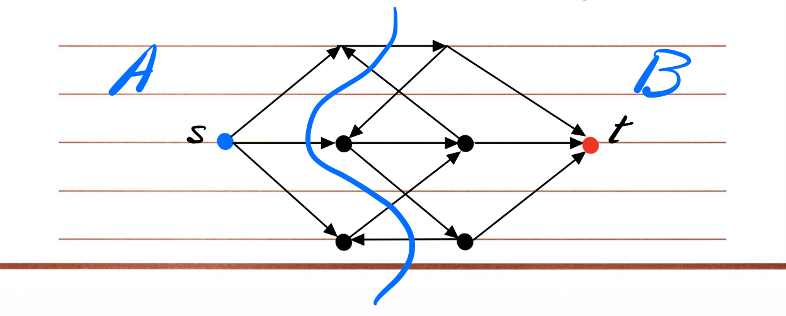

**Def.** The capacity of the cut (A, B), denoted C(A, B) is the total capacity of edges out of A
$C(A,B) = \sum_{e \in out(A)} c_e$

割线跨过的所有从 A→B 的边，把它们的容量加起来，这个总数叫**割的容量**。

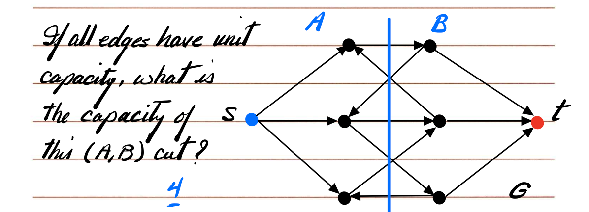
在这个例子中：如果所有边容量都是 1，那么这条割线穿过 4 条边 ⇒ 割的容量 = 4。

**Fact:** max. value of the flow <= cap. of the (A, B) cut

任意 s-t 流量值都不会超过任意 s-t 割的容量。

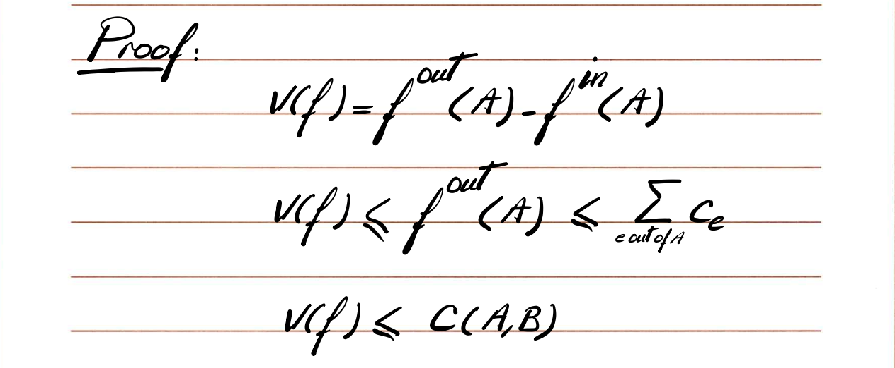

1. 对 A 中的每个点，流量守恒；

2. 对从 A 到 B 的边求和；

3. 可得：

   $v(f) = \sum_{e\in out(A)} f(e) - \sum_{e\in in(A)} f(e) \le \sum_{e\in out(A)} c_e = C(A,B)$

   📘 结论：**任何流量 ≤ 任意割容量**。

   → “流被割限制住”这一直觉成立。

**Ford–Fulkerson 终止条件 + 构造 min cut**

Ford–Fulkerson stops when there’s no $s→t$ path in residual graph $G_f$.

Claim: Then there exists a $cut (A*, B*)$ s.t.

当残余图 G_f 里再也找不到从 s 到 t 的路径时，

我们可以构造一个割 (A*, B*)，使得当前流量值 |f| = 这个割的容量。

==**这句话要解决的核心问题：**==

我们前面知道：

- 对任意流 f 和任意割 (A,B)，都有：

  $|f| \le C(A,B)$（流量不可能超过任意割的容量）

现在要证明：

> 当算法停下（没有增广路）时，

> 我们确实达到了**等号成立**的那一个割。

也就是要证明存在一个$割 (A*, B*)$，

使得 $|f| = C(A*,B*)$。

这样就说明当前流就是**最大流**，同时这个割就是**最小割**。

***

如何证明，从这里开始


> Create sets A* and B* such that

> A* includes all nodes v where there is an s–v path in G_f.

> Then B* = V – A*.

- 从 s 出发，在残余图 G_f 里能到达哪些点？都放进 A*；
- 剩下那些点（t 一定在其中，因为现在 s 到 t 不通）放进 B*。

此时 $(A*, B*)$ 就是一个合法的 “s–t cut”。

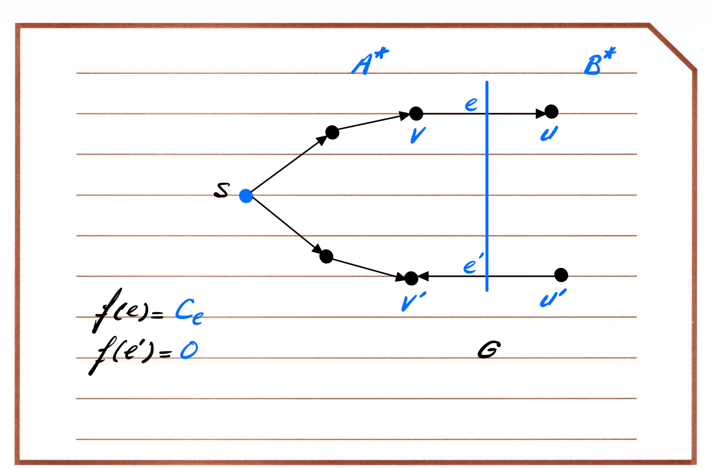

**此时会有这么两个结论**

- 从 A* → B* 的边都是**满流**的（residual capacity = 0）。

  因为如果还有剩余容量，s 就能经这条边到 B*，而这与“B* 不可达”矛盾。

- 从 B* → A* 的边都是**零流**的（flow = 0）。

  因为若有正流，就该在残余图出现反向边 A* ← B*， s 又能回到 A*，矛盾。


也就是说：

- 这个割的容量恰好等于当前流；
- 任何流都不可能超过任何割；
- 所以当前流就是全图的最大流；
- 同时这个割就是最小割。

### 一些要记住的结论

**Is the min cut unique ?** NO!


**How many min cuts in the following graph with unit capacity edges?**

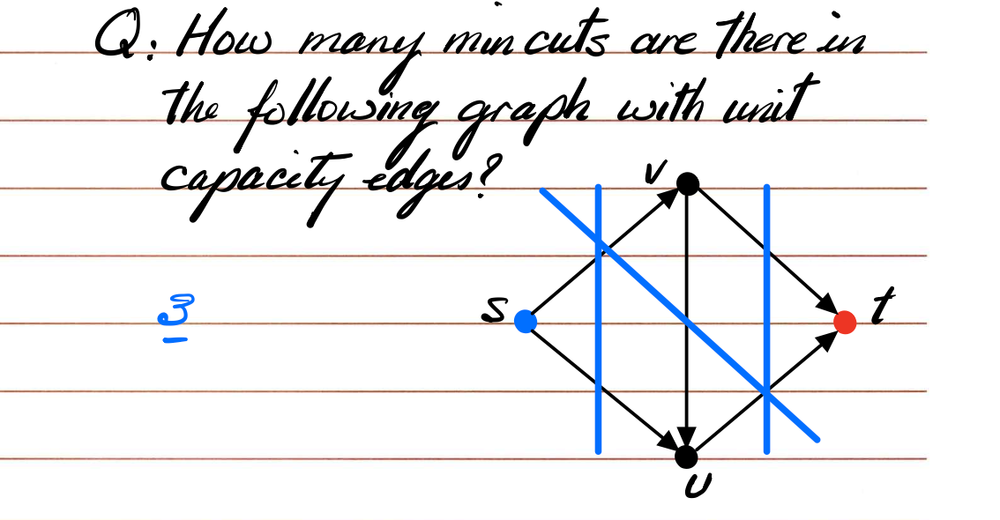**How can we determine if the min cut is unique ?**

> Find min cut closest to s.

> Find min cut closest to t.

> If they are the same cut, then the min cut must be unique.

意思是：

1. 用算法从 s 这边开始，找一个“最靠近 s 的最小割”；

2. 再从 t 那边反过来找一个“最靠近 t 的最小割”；

3. 如果这两条割线其实是同一条 → 说明图里只有这一个割能达到最小容量 → **唯一**。

   否则就有多个最小割。

## Complexity Analysis

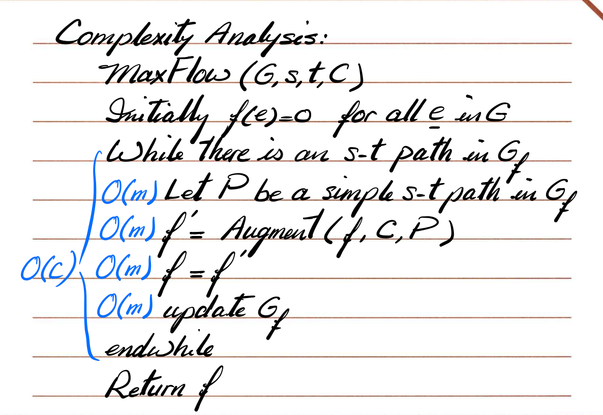

Overall: $O(Cm)$


### How many iterations of Ford-Fulkerson Alg.

**The best case:**


**The worst case:**

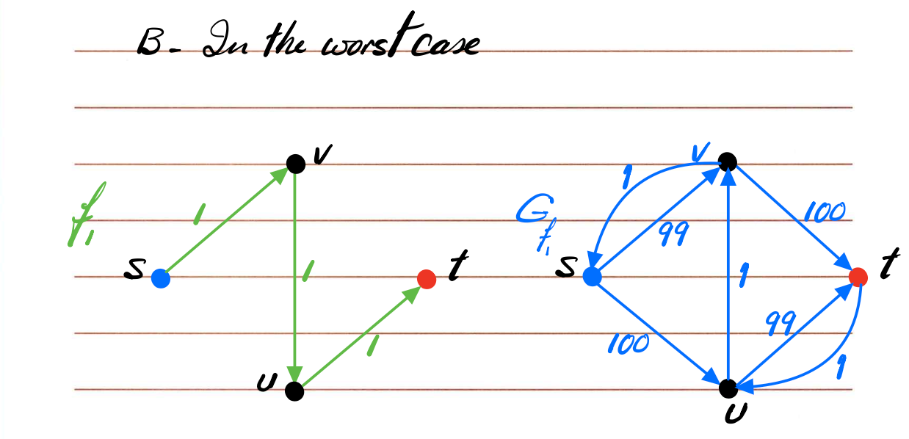

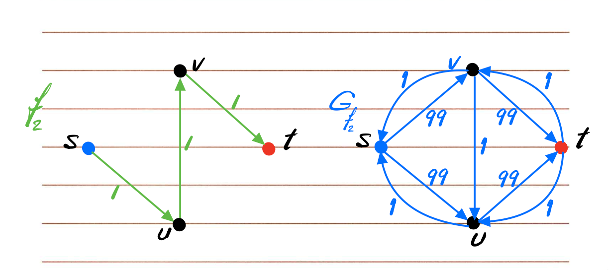

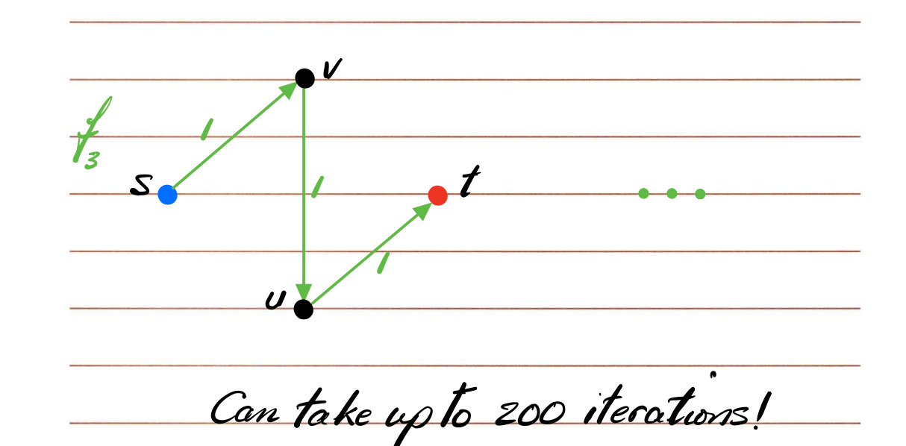

200 iterations

### Scaled version of Ford-Fulkerson

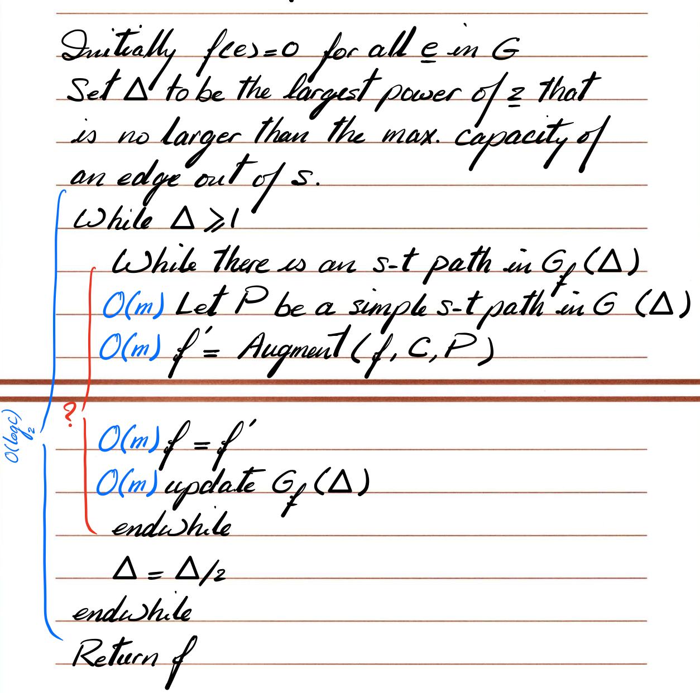

普通 Ford–Fulkerson 的复杂度是

$O(C \cdot m)$

因为每次流量至少 +1，最多加到 $C$（所有容量和）。

如果容量很大，比如边容量 $1e9$，那就得循环十亿次，很慢。

所以这个版本的目标是：

> ✅ 减少增广次数，用“容量分层”的思路，让算法快得多。

**核心思想：Scaling（分层）**

我们引入一个参数 **Δ（Delta）** 表示当前“分层阈值”。

它控制我们在每一阶段只考虑“**大于等于 Δ** 的残余容量” 的边。

```pseudocode
Initially f(e) = 0  for all edges e
Set Δ to be the largest power of 2 ≤ max capacity out of s
```

意思是：

- 所有流量初始为 0；

- 选一个 $Δ = 2^k$，满足

  $2^k ≤ \text{最大边容量} < 2^{k+1}$。

例如最大容量是 20，那么 Δ 初始为 16。

```pseudocode
while Δ ≥ 1:
    while there is an s-t path in Gf(Δ):
        find a path P
        augment along P
        update residual graph
    Δ = Δ / 2
```

解释：

- **Gf(Δ)** = 只保留残余容量 ≥ Δ 的边的残余图。

  （小于 Δ 的边忽略，暂时当作不存在。）

- 在这个阶段，我们只用“粗通道”（容量较大的边）传大流量。

  等这些都饱和之后，再缩小 Δ，让小边也参与。

**内层循环：在 Gf(Δ) 里跑增广**

内层 while 就是标准的 Ford–Fulkerson 增广，只不过：

- 每次的“瓶颈”至少是 Δ；
- 所以每次增广都能让流量至少 +Δ；
- 因此一个阶段的迭代次数 $≤ O(m/Δ)$。

外层 Δ 从最大容量 $C_max（的 2^k）$每次减半：

→ 外层循环 $O(log C_max) $次。

每层内循环增广次数 $≤ O(m)$。

因此：

$\text{总复杂度} = O(m \log C)$


***

1️⃣ **Strongly vs Weakly Polynomial Time（强多项式 vs 弱多项式）**

2️⃣ 各种最大流算法的 **时间复杂度 & 分类对比**

**🧠 核心定义**

**✅ Strongly Polynomial Time（强多项式时间）**

> 如果一个算法的运行步数，只依赖于输入中**整数的个数（数量）**，

> 而不依赖于这些整数的**数值大小**，

> 那么它是 **strongly polynomial**。

👉 简单说：

时间复杂度只和 “图里有多少个点 / 边” 有关，

而不受 “边的容量多大” 影响。

**例如：**

$O(n²)、O(nm)、O(n³)$ 都是 strongly polynomial，

因为它们只和输入规模（点边数量）有关。

**✅ Weakly Polynomial Time（弱多项式时间）**

> 如果算法的运行步数依赖于输入的**比特数（即 logC）**，

> 但不是仅仅依赖于整数个数，

> 那它是 **weakly polynomial**。

也就是说：

- 它还是比伪多项式好（不直接依赖 C），
- 但还是会受 logC 的影响。

**例如：**

$O(m² log C)$ 就是 weakly polynomial。

**🧩 举个对比例子**

| **类型**           | **复杂度依赖** | **示例算法**    | **举例复杂度** |
| ------------------ | -------------- | --------------- | -------------- |
| **Strongly Poly.** | 仅依赖 n,m     | Edmonds–Karp    | $O(n m²)$      |
| **Weakly Poly.**   | 依赖 log C     | Scaling version | $O(m² log C)$  |
| **Pseudo Poly.**   | 依赖 C（数值） | Ford–Fulkerson  | $O(C m)$       |

**🧩 第二页：各种最大流算法对比总结**

**🧠 Edmonds–Karp Algorithm**

> “Same as Ford–Fulkerson, except each augmenting path must be a **shortest path** in residual graph.”

📘 意思：

- Edmonds–Karp 只是 Ford–Fulkerson 的一个特例；
- 它在找增广路径时，用 **BFS** 找“最短路径”（按边数最少）；
- 这样能保证每条边最多成为瓶颈 $O(n)$ 次；
- 所以总复杂度变成 $O(nm²)$。

✅ 它是一个 **strongly polynomial** 算法。

**📊 最后一部分表格总结**

| **算法**                              | **时间复杂度**           | **类型**            |
| ------------------------------------- | ------------------------ | ------------------- |
| **Ford–Fulkerson**                    | $O(C m)$                 | pseudo-polynomial   |
| **Scaled version (Capacity Scaling)** | $O(m² log C)$            | weakly polynomial   |
| **Edmonds–Karp**                      | $O(n m²)$                | strongly polynomial |
| **Orlin + KRT (改进版)**              | $O(n m)$                 | strongly polynomial |
| **Modern Approximation methods**      | $≈ O(m log n + m^{4/3})$ | almost linear time  |

**💬 补充说明**

> 伪多项式 → 弱多项式 → 强多项式

==三者的区别就在“是否依赖容量数值 C”：==

| **分类**      | **是否依赖 C** | **是否依赖 log C** | **说明**                  |
| ------------- | -------------- | ------------------ | ------------------------- |
| Pseudo-poly   | ✅ 是           | ✅ 是               | Ford–Fulkerson 依赖容量值 |
| Weakly-poly   | ❌ 否           | ✅ 是               | Scaling 用 log C          |
| Strongly-poly | ❌ 否           | ❌ 否               | Edmonds–Karp, Orlin       |

✅ **总结一句话：**

- Ford–Fulkerson：慢（依赖容量）
- Scaling：中（依赖 log C）
- Edmonds–Karp：快（只依赖点边数）
- Orlin / KRT：更快（O(nm)）
- 现代算法（Push–Relabel 等）：几乎线性。

要不要我接着帮你总结一下这些算法在图上是怎么“增广”的区别？

比如 Ford–Fulkerson 是随便找路、Edmonds–Karp 是 BFS 找最短、Scaling 是分层找大容量边。