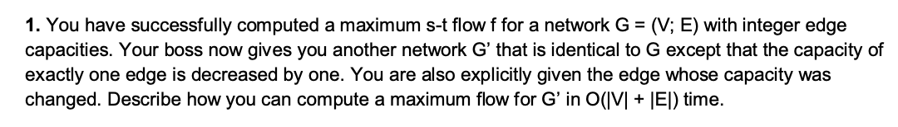
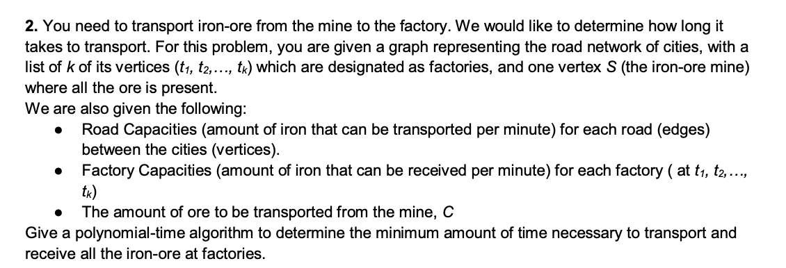
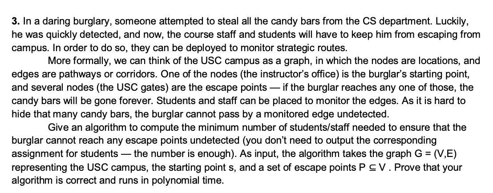
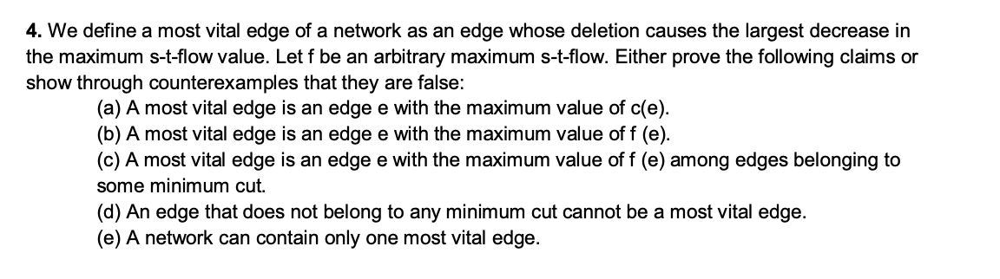
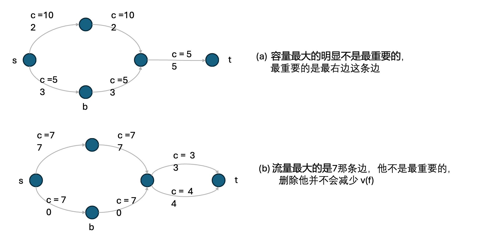
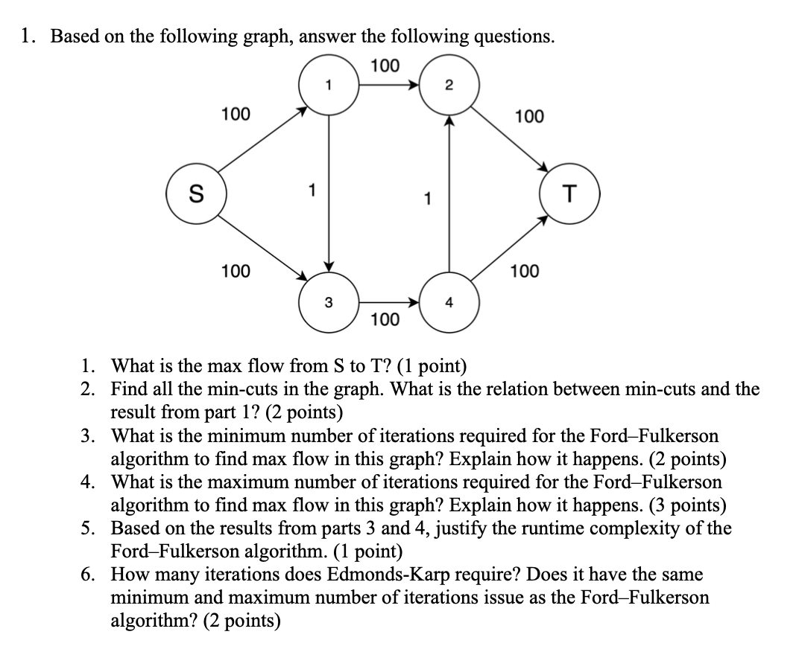
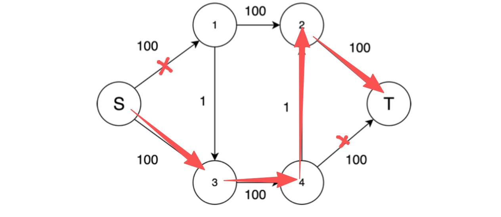
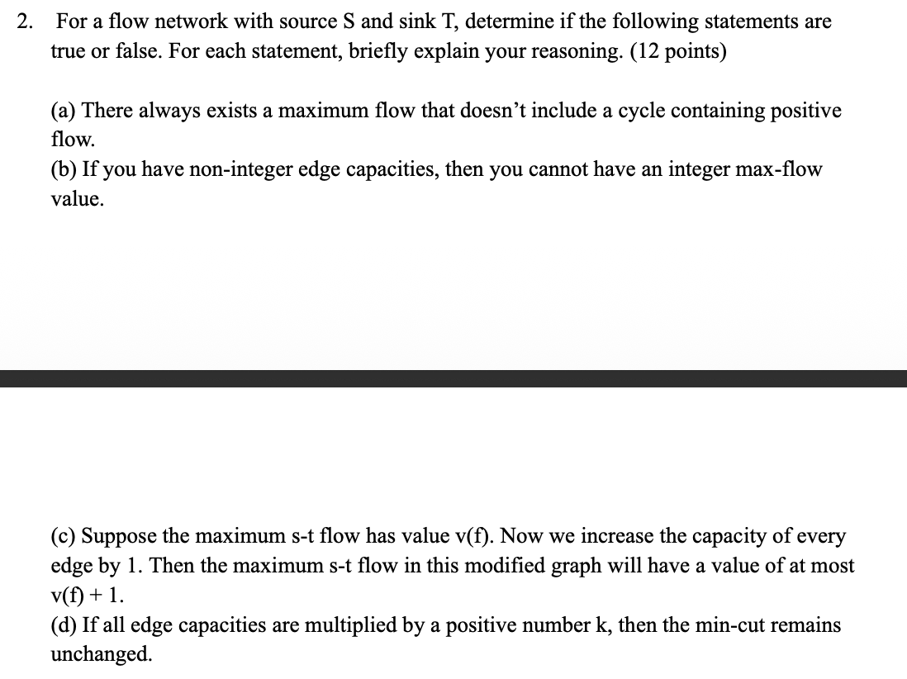
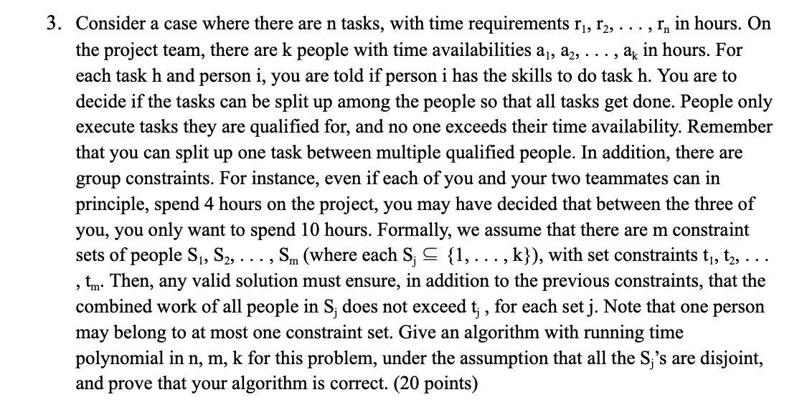

# HW8 ungraded part and DIS 8

[TOC]

- DIS8 Q1有点难
- DIS8 Q2易错！！！
- HW8 UQ1(2) 最小割这里要看看
- HW8 UQ1(3) 要看看答案的描述
- HW8 UQ1 需要完全复习
- ==不要轻易把边的capacity设置成1，这样很容易出错，HW8 UQ3就是如此！==  要想清楚！

## DIS8

### Q1

**Solution:**

Say the edge $vu$ is the edge that lost capacity, then:

- find a path in G from s to v on edges that are carrying some flow
- find a path in G from u to t on edges that are carrying some flow
- reduce flow by unit on edges that are on teh path s->v->u->t. Since all these edges are carrying some flow, then the results will be a new valid flow f'
- Construct Gf'
- Try to find a path Gf' from s to t. If there is such a path then push (augment) one more unit of flow on that path. The resulting flow will be our max flow. If there is no such path then f' Is our max flow.

Complexity: all the above steps can be done in linear time, therefore the whole process takes linear time.

> [!caution]
>
> 这题确实是没看懂

好的，我帮你一步步解释这题。

**题意**

原题是这样的：

你已经求出了网络 $G=(V,E)$ 的一个最大流 $f$。

现在有一个新的网络 $G’$，它和 $G$ 一样，只是**某一条边的容量减少了1**。

并且这条边的编号你也知道。

要求：在 $O(|V|+|E|)$ 的时间里，计算出新的最大流。

**核心思路**

这题考的是**增量 / 减量更新（flow update）**的思想。

如果容量减少了 1：

- 原来的最大流 $f$ 可能 **不再可行（feasible）**，因为在那条边上流量可能超过新的容量；
- 我们需要**修正**这个流，使它重新成为一个合法的最大流。

**具体步骤解释**

假设容量减少的边是 $(v,u)$，原容量为 $c_{vu}$，现在变成 $c_{vu}-1$。

看原来的流 $f(v,u)$。

**Case 1：**

如果 $f(v,u) < c_{vu}-1$

👉 那么流量没超限制，不需要改动。

原来的 $f$ 仍然是最大流。

复杂度 $O(1)$。

**Case 2：**

如果 $f(v,u) = c_{vu}$（即原来满流），现在容量变小了，就**超了1个单位**。

所以我们要让这条边上的流量减少1。

但你不能直接把 $f(v,u)$ 减1，因为那样会破坏流守恒条件（flow conservation）。

于是要“找回”这一单位的流，重新调整。

**修正方案**

1. **找到从 s → v 的一条路径（沿着当前有流的边）**

   表示这条路径上都有流量，意味着你可以沿着反方向推回1个单位。

2. **找到从 u → t 的一条路径（沿着当前有流的边）**

   同理，这边也能推回1个单位。

3. **把路径 s → v → u → t 上的每一条边的流量都减少1**

   这等价于在原流中“拿回”1个单位流量。

   得到一个新的可行流 $f’$。

   - 注意：这个 $f’$ 可能不再是最大流（可能少了1个单位）。
   - 但它一定是合法的流。

4. **在新的残余图 $G_{f’}$ 上尝试找一条 s-t 路径**

   - 如果找到了：再增广 1 个单位（推回1单位流量），得到新的最大流。
   - 如果找不到：那说明 $f’$ 已经是新的最大流。

**复杂度**

- 每一步最多是一次 BFS 或 DFS（找路径）
- 构建残余图 + 找一条增广路径 → $O(|V|+|E|)$
- 总体是 **线性时间**。

**总结（直白讲）**

容量减1时，我们只需要：

1. 检查是否真满流；
2. 如果满流了：
   - 沿当前流的方向，把这条边上的流“退掉”1；
   - 修正路径；
   - 再在残余图里试试能不能补回1；
3. 一切只需线性时间搞定。

### Q2‼️

First, we need to construct a directed graph $G = (V, E)$:

- add a sink node $T$, and the vertex $S$ can be present as the source node.
- add edges from $t_i, i\in[1, k]$ to $T$, with the capacity of $tc_i$
- for the roads that connect $S$ and i-th factories $t_i$, we introduce them as edges, with the capacity of $sc_i$.

them, we run max network flow alg. on graph $G$, then we can get the max value of flow $v(f)$.

$v(f)$ represents the value of mines that can be transported at the same time.

Therefore, the time will be $C / v(f)$.

> [!caution]
>
> 这题不能满分，缺少一些东西：
>
> 1. 城市之间的道路很多，不只是 s->tk, t之间也有
> 2. 双向道路要拆分成两个有向边，要写出来！replace each undirected edge (roads) with two directed edges with the same capacity as the original undirected edge
> 3. Claim要写好！if $v(f)=0$, and $C>0$, then there is no solution, ...

### Q3

This problem is a min-cut problem. For the graph $G = (V,E)$:

- add an sink node $t$, and for the i-th escape point $P$, we introduce the node $P_i$.
- add edges from all the $P_i$ nodes to $t$, with the capacity of 1. (‼️这里写错了，这里的容量应该是无限大)
- for every undirected pathways or corridors in campus, we introduce them as two directed edges on two direction of the pathways or corridors. And these edges are have the capacity of 1.

then, run s-t max-flow alg. on the graph $G$, then we can get the value of max flow $v(f)$.

Claim: As the value of the min-cut is equal to the value of max flow, therefore, the value of min-cut of the graph $G$ is $v(f)$. Therefore, we need to assign at least $v(f)$ students to prevent the theft from escaping.

Complexity, the max-flow alg, if we use Ford-Fulkerson, the rumtime will be $O(Cm)$, and the $C$ is the total of the capacity of the edges, since all the edges have the capacity of 1, therefore, C: $O(n)$, therefore, the overall runtime will be $O(nm)$, whcih is polynomial time.

> [!caution]
>
> 注意：$P_i\to t$ 的容量应该是∞，而不是1，这里不要写错了！

> [!tip]
>
> 简单证明：
>
> - 任何一组被监控的边，把它们从图中删掉后 s 与任意门都不再连通，这就是一个 s-T **割**；其大小=监控人数。
> - 反之，任何最小 s-T 割对应一组边，每条边派 1 人即可阻断所有 $s\to P$ 路径。
> - 由 Max-Flow = Min-Cut，**最少人数 = 最大流值**。

### Q4

全部都是错误的，反例如下：

(c) 有点看不懂，没找到

(d)

(e) 就很简单 s->p->t 容量都为1，两条都是vital

## Homework 8 Ungraded

### Q1‼️

(1) 200

(2) There are 5 min cuts. Min-cut is equal to max flow.

> [!warning]
>
> 这里要注意，这个不是最小割，因为隔开之后，还是能跑到结果。所以一定要看清楚
>
> 

(3) The minimum number of iterations happens when the Ford-Fulkerson algorithm chooses the two 100 paths first and doesn't pass through edges with the weight of 1. And after just two passes the algorithm terminates.

therefore: 2

(4) The maximum number of iterations happens when the Ford-Fullkerson alg. constantly chooses the paths that involve the edges with the weights of 1, and as a result, only increments the flow by one at each pass, since after taking each of the edges with the weight of 1, they create a new augmenting path with weight 1 taht can be taken again. This process can be repeated 200 times.

therefore: 200

(5) The runtime complexity of the Ford-Fulkerson algorithm is $O(fE)$, where $E$ is the number of edges and $f$ is the value of the maximum flow, because, similar to what might happen is that at each pass the algorithm might take the suboptimal path and end up repeating the path finding process $f$ times.

(6) The Edmonds-Karp algorithm solves this issue by finding paths using BFS instead of DFS, and as a result, it will always choose the shortest paths (in terms of number of edges) first. And therefore, it will always choose the first two hundred weight paths first.

### Q2

(a) True. We can always remove the flow from such a cycle and still get the same flow value

(b) False. 这个一眼错啊。Suppose we have two nodes s and t, and have two edges connect s and t, each of them have 0.5 capacity, obviouly the max flow is 1, which is integar.

(c) False. at least 是对的，at most 肯定错啊。Suppose we have two nodes s and t, and have two edges connect s and t, and each of them have 1 capacity, therefore, the max flow will be 2 now. After increasing each edges' capacity by 1, the max flow will be 4. 

(d) True. The value of every cuts get multiplied by k, thus the relative order of all cuts remain the same, hence any min-cut remains a min-cut.

### Q3

我们要完成 **n 个任务**，

每个任务 h 需要 $r_h$ 小时。

团队中有 **k 个人**，

每个人 i 最多能工作 $a_i$ 小时。

另外，对于每个人和每个任务，我们知道：

此人是否**有能力完成**该任务。

任务可以被拆分——也就是说，

一个任务可以由多个人共同完成（比如任务需要 10 小时，一个人做 6 小时，另一个人做 4 小时）。

**新的限制（Group constraints）**

除了“每个人不能超过自己工作上限”之外，还有**团队总上限**：

团队被分成了 m 个不重叠的组 $S_1, S_2, \dots, S_m$，

每个组 $S_j$ 的成员工作时间加起来不能超过 $t_j$。

举例：

- 你、A、B 是一个组 $S_1=\{你, A, B\}$，
- 你们三人理论上都能各工作 4 小时，
- 但规定三人合计最多只能工作 10 小时，
- 那就是 $t_1$=10。

同时假设**每个人最多只属于一个组**（disjoint）。

**目标**

判断：

**是否能安排所有任务都完成**，

并且同时满足：

- 每个人的时间限制；
- 每个小组的总时间限制；
- 每个人只能做自己会做的任务；
- 任务总需求全被分配完。

***

Solution: 

we can present this problem as a max network flow problem. First, we need to construct a directed graph $G = (V, E)$

- add an source node $s$, and a sink node $t$
- for the i-th task, we introduce $h_{i\in[1, n]}$ as a node of $G$
- for the j-th people, we introduce $i_{j\in[1,k]}$ as a node of $G$
- for the i-th group, we introduce $S_{i\in[1,m]}$ as a node of $G$
- add edges from $s$ to all $h_i$, with the capacity of $r_i$, representing that each task $h_i$ need to be worked fro $r_i$ hours
- add edges from each $h_i$ to each $i_j$ if the task $h_i$ can be worked by the people $i_j$, with the capacity of 1
- add edges from each $i_j$ to each $S_i$ if people $i_j$ is in the group $S_i$, with the capacity of $a_j$, representing that people $i_j$ can only work at most $a_j$ hours
- add edges from each $S_i$ to $t$, with the capacity of $t_i$, representing that each group can only work fro $t_i$ hours in total

run s-t max flow algorithm (Ford-Fulkerson) on the graph $G$, then we can get the max value of flow $v(f)$.

Claim: if $v(f) < \sum r_{i\in[1,n]}$, then we have no solutions to finish all the n tasks. Otherwise, we can solve the problem.

Proof:

>  for the forward: we need to proof that, when $v(f)=\sum r_{i\in[1,n]}$, we can finish all the tasks, at the same time, we do not break any of the constraint.
>
> in the returned max flow graph, we can always find a path that: $s\to h_i\to i_j\to S_k\to t$, the flow of $s\to h_i$ is $f(s,h_i)$, the flow of $h_i\to i_j$ is $f(h_i, h_j)$, the flow of $i_j\to S_k$ is $f(i_j, S_k)$ and the flow of $S_k \to t$ is $f(S_k, t)$. Therefore, we can claim that in this path, the task $h_i$ will be worked by the j-th people with $f(i_j,S_k) < r_1$ hours, ...
>
> 这里分开讲，每一个flow都不会超过对应的限制
>
> 所以这个flow不会break any of the constraints, 因此这个是合法的

> for the backward: we need to prove that when the people finish all the tasks, that must exists valid flow.
>
> 存在一个 path: $s\to h_i\to i_j\to S_k\to t$, 表示每个人在某个特定任务上工作了特定时间，每个组也工作了特定时间。此时，这些特定时间都是小于 graph 中特定边的capacity的，因此一定存在合法流

> [!caution]
>
> 思路基本都是正确的，但是有有几个细节弄错了！
>
> 1. 题目可能没有说每个人必须属于一个组，如果这个人不属于任何组，要把人直接连接到t上！==这个特别容易错！！！直接跨层了，没有做过类似的题。考试的时候看清楚！==
>
> 2. ==‼️任务->人的容量不能设置成1，应该设置成∞。任务可被多人拆分，如果设为 1 就强行限制“同一个人最多接这个任务 1 小时”，不符合题意。== 
>
>    这个错误很容易错，没有限制的时候，不是设置成1，而是无穷，要看清楚，看清楚！！！
>
> 3. 忘记写复杂度分析了