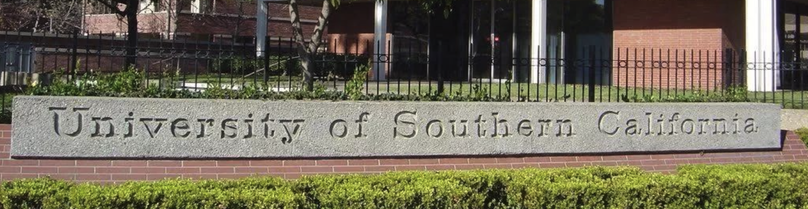

# CSCI570-Analysis-of-Algorithms-USC

Code written for lectures and homework in USC CSCI570-Analysis of Algorithms

### Lecture1 and HW1
- Matching Algorithms
- [GaleShapley Algorithm](./Lecture1-Perfect-Matching/GaleShapley.cc)

### Lecture2 and HW2
- Asymptotic Notation
- [Graph Theory](./Lecture2-BFS-DFS-Graph/README.md)

### Lecture3 Greedy

### Lecture4 Heaps
- [Heaps and its Algorithm](./Lecture4-Heaps/)
- [stl_priority_queue.hpp](./Lecture4-Heaps/stl_priority_queue.hpp)

### Lecture7 DP Part1
- [Lecture7 DP Part1](./Lecture7-DP/)
- [homework6](./Lecture7-DP/HW6.md)
- [homework6-code](./Lecture7-DP/homework.cc)
- [ungraded_homeworks_and_discussions](./Lecture7-DP/ungraded_homeworks_and_discussions.md)

### Lecture8 DP Part2
- [homework7](./Lecture8-DP-part2/HW7.md)
- [homework7-code](./Lecture8-DP-part2/homework.cc)
- [ungraded_homeworks_and_discussions](./Lecture8-DP-part2/ungraded_homeworks_and_discussions.md)

### Lecture9 Network Flow
- [homework8](./Lecture9-Network-Flow/HW8.md)